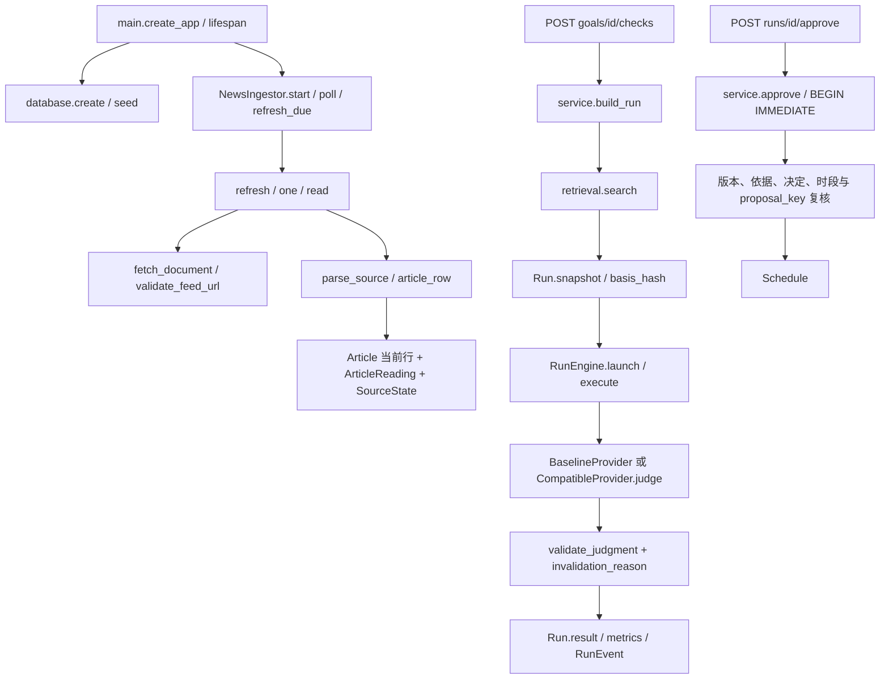

# G0 源码审计与 V1 复用结论

审计日期：2026-10-20（Asia/Shanghai）。唯一产品与研究基准：[CFAW_News_V1.md](../docs/CFAW_News_V1.md)。源码基点：`7f7f50324156b6a6ac61480a82311ba6ebd813b2`；包版本 `0.2.0`。

> 后续文档清理说明：G1 实施以 [G1_IMPLEMENTATION_PLAN.md](../docs/plans/G1_IMPLEMENTATION_PLAN.md) 为准。用户随后要求删除旧规划及重复资料，本报告只修订文档入口，不重新执行或改写 G0 验证结果。`G0_BASELINE.json`、DDL 和日志保持原字节；其中 `audit_artifact_sha256` 是审计时点的历史文件指纹，可能对应已删除或后来维护的文档，不是当前目录存在性清单。原始报告副本在本地 `.local/cleanup/2026-10-20/` 保存，不进入 Git。

## 1. 结论与进入 G1 的决定

**G0 完成，可以进入独立离线的 G1。当前工程可以保留大部分基础设施，但尚未实现 V1 情报产品。**

本次实读源码、DDL 与存量数据库，执行本地检查、SQLite 备份恢复、应用启动、故障场景和浏览器烟测。13 个复用条目中：**4 个 reuse、7 个 adapt、2 个 defer，无需整模块 replace**。V1 原表列出了 13 个条目，G0-03 的“12 个模块”按实际表逐条覆盖，没有漏掉最后一项测试入口。

进入 G1 的依据是旧工程可运行、基线入口通过、历史数据可恢复；不是 V1 已有算法成绩。G1 必须新增文档不可变版本、时间门禁、事件/主张/Persona/曝光契约、开发轨迹及 B0–B4。**现有 Article/Run/Goal 不能直接改名充当这些实体。**

G1-a 双人独立标注尚未开展；需要真实第二名审阅者，AI 多次投票不算双标。没有独立数据、事件级评测、时间防泄漏或 V1 简报完成声明。真实模型、实时来源新抓取、远端 CI、Docker/Linux 和生产部署均不在本次通过范围。

## 2. 审计边界与基准重置

- 开始时 tracked 工作区无源码修改；已有两个未跟踪文档：`docs/AI_PROJECT_HANDOFF.md`、用户提供的 `docs/CFAW_News_V1.md`。本次未覆盖用户的 V1 正文，其 SHA-256 固定在 [G0_BASELINE.json](G0_BASELINE.json)。
- 源码、前端源码、tests、evals 和依赖锁未因审计修改。新增的是审计脚本、结果、文档入口和约束。`frontend/dist` 仅按构建命令生成，不进入 Git。
- 当前方向切换为“面向 AI 开发者的技术情报简报”：重点情报、前沿速览、资讯库；事件聚合、证据透明、曝光去重、回访补齐。Goal 变为可选兴趣信号，用户自主阅读和行动，无默认应用外通知。
- G0 时曾将旧规划归档并提供过渡入口。后续按用户要求，旧 ROADMAP、24 周 TIMELINE、较早开发规划、旧交接和归档副本均已删除；当前只使用 V1 与 G1 计划，不再保留过渡路线。
- “清除旧安排”落实为废止研发安排。没有清空业务目标、run、用户决定、已批准日程或历史来源记录；这符合 V1 §1.4 的保留要求。
- V1 草案关于“未获取源码/未执行 G0”的文字记录其写作时的证据等级；本报告是本地源码核验补充，不回填或改写当时历史。
- 本次无 schema 迁移；迁移 SQL/回滚执行验收为 **N/A**，不能把数据库恢复成功称为迁移成功。实际 DDL 已导出为 [G0_SCHEMA.sql](G0_SCHEMA.sql)。

## 3. 环境、验证与日志

### 3.1 锁定信息

| 项目 | 本次值/范围 |
| --- | --- |
| 系统 | Windows `10.0.26200` / AMD64 |
| Python / SQLite | `3.12.14` / `3.53.1` |
| Node / npm | `v24.21.0` / `11.19.0` |
| 前端 | React `19.3.0`、TypeScript `7.0.2`、Vite `8.3.4` |
| Python 锁定一致性 | 安装包逐项对照 `requirements.lock`，0 项版本不匹配；额外环境包另存指纹 |
| 资产溯源 | migration-manifest 中五个保留资产的 SHA-256 全部匹配 |
| 代码指纹 | G0_BASELINE 的 `audited_source_sha256` 保存被审读源码/tests/evals 文件哈希 |

### 3.2 本次执行结果

| 检查 | 实际结果 | 能证明/不能证明 |
| --- | --- | --- |
| `python -m ruff check backend tests evals` | 通过 | 现有代码静态规则 |
| `python -m pytest -q` | **125 passed, 1 warning in 21.39s** | 领域/API/适配器 mock/采集与资源回归；不代表真实模型或全部源站 |
| `python evals/run_baseline.py` | 通过，`seed-sanity-v1` | 26 条归档、3 组手选标签；不是 G1 或独立算法成绩 |
| 种子指标 | Recall@8 `1.0`；MRR@8 `0.833333`；nDCG@8 `0.864572` | 只保留管线基点，不用于泛化或增益主张 |
| `python -m pip check` | 通过 | 依赖一致性检查 |
| `npm run build`，frontend | TypeScript 与 Vite 通过 | 本机构建，不是远端 CI |
| `python -m ruff check audit/run_g0_checks.py` | 通过 | 新增审计辅助脚本的静态检查 |
| SQLite 备份→恢复→生命周期启动 | 通过，10 表内容哈希/行数相同 | 当前副本可恢复，旧数据可读 |
| 合成来源成功→503 | 通过 | 故障显式、缓存和成功时间保留、不触发业务任务 |
| 隔离 Edge/Playwright 浏览器 | 通过，1440×1000，0 个控制台错误 | 当前新闻/来源状态/阅读器/旧导航烟测；不是完整 V1 E2E |

pytest 首次运行和单例诊断在受限环境中卡在 Python `socket._fallback_socketpair → asyncio.windows_events → TestClient` 初始化；15 秒 faulthandler 堆栈指向环境。两次挂起进程用各自会话 Ctrl+C 停止；环境外完整重跑通过，没有改业务代码或测试来绕过断言。警告来自 Starlette/TestClient 对 HTTPX 的上游弃用提示。

内置 CUA 与 computer-use JS 内核都返回 `failed to write kernel assets ... os error 3`。随后使用已有的 Edge、运行时已安装的 Playwright 执行浏览器检查，没有安装或下载新软件。首次脚本因卡片/阅读器同名标题造成 strict locator 歧义，限定到“新闻阅读”区域后通过；这是烟测定位修正，不是产品故障。

公共脱敏日志在 [logs/](logs/)，原始日志、诊断堆栈、截图、备份及恢复库在被忽略的 `.local/g0/2026-10-20/`。机器结果记录原始及公共日志哈希。日志内容不包含密钥、个人目标正文或日程内容。

### 3.3 可复现入口

```powershell
# 项目根目录；常规检查使用项目自己的 venv
.\.venv\Scripts\python.exe -m ruff check backend tests evals
.\.venv\Scripts\python.exe -m pytest -q
.\.venv\Scripts\python.exe evals/run_baseline.py
.\.venv\Scripts\python.exe -m pip check
cd frontend
npm run build
cd ..

# 只读工作数据库，在 .local/g0 下新建备份与恢复副本；不加载 .env
.\.venv\Scripts\python.exe audit/run_g0_checks.py
# 将合成烟测库以单进程暴露在 127.0.0.1:8123，Ctrl+C 停止
.\.venv\Scripts\python.exe audit/run_g0_checks.py --serve
# 另一终端；参数为已有 Playwright 的 node_modules 目录
node audit/g0_browser_smoke.cjs <existing-node-modules>
```

`--finalize` 是本次冻结审计的整理入口，读取已生成的固定日志和结果，不是通用自动测试命令。需要重复整轮时，应分别保存新的日志、时间和结果，不能沿用旧通过状态。Windows 的 socketpair/浏览器启动需要运行环境允许本地 socket；首次环境卡住不等于业务断言失败。

## 4. 实际函数调用与数据流



对应入口为 `main.py:44/53/190/311`、`ingestion.py:341/386/500/512/520`、`service.py:46/105/123/193/212`。没有隐藏的事件聚合器、曝光写入器、简报生成 API 或时序回放 CLI。

其他分支：

- `main.read_article → ReadingCache.get → queue → worker → process → public_document → extract_page → reading_document → ArticleReading`。迟到正文通过 Article 内容哈希复核；阅读路径不写 Run 快照。
- `main.articles → MediaCache.decorate`，图片后台由 `discover/process` 获取，独立媒体索引和文件；不改变文章文字证据。
- `main.set_following → change_following` 在事务中修改状态/版本并取消同目标运行，提交后调用对应 task.cancel。`main.cancel` 先落库终态再取消任务。
- `main.events` 按数据库 RunEvent ID 发送 SSE；断开连接不是业务取消，也不是模型 token 流。

## 5. 13 项源码复用矩阵

`reuse` 表示保留现有职责；`adapt` 表示可复用内核但必须补 V1 契约；`defer` 表示维护兼容性而不继续扩张。无整模块替换，不表示旧语义可直接用于新产品。

| # | 模块 / 决定 | 真实源码证据 | 本次测试证据 | V1 处理 |
| --- | --- | --- | --- | --- |
| 1 | ingestion + live_sources：**adapt** | [ingestion.py:181](../backend/cfaw_news/ingestion.py#L181)、`:233/341/386/500/512/520`；URL 身份、RSS/HN 时间、条件获取、失败保留、生命周期轮询 | `test_rss_mapping_canonical_identity_and_timestamp`、`test_atom_updated_time_does_not_invent_publication`、`test_source_update_keeps_old_snapshot_and_first_seen`、`test_refresh_failure_preserves_cache_and_success_time`、`test_due_schedule_is_persistent_and_does_not_refetch_early` | 保留抓取；新增逐版本 observed/available 与来源性质/权利/派生关系。当前十源不等于 AI 技术全覆盖 |
| 2 | article_html + reading：**adapt** | [article_html.py:8](../backend/cfaw_news/article_html.py#L8)；[reading.py:109](../backend/cfaw_news/reading.py#L109)、`:203/254/287/319`；允许结构树、正文边界、单份缓存 | `test_reader_removes_active_content_resolves_media_and_bounds_trees`、`test_complete_rss_is_persisted_separately_from_bounded_snapshot`、`test_stale_web_job_cannot_replace_new_evidence` | 复用清洗与阅读；将内容/段落/清洗版本固定到文档版本，禁止当前正文进入过去回放 |
| 3 | database：**adapt** | [database.py:29](../backend/cfaw_news/database.py#L29)–`:141`；10 表、FK、WAL、唯一键、create_all | 本次真实旧库 backup/restore；`test_results_survive_restart_and_incomplete_runs_are_reported` | 保留原表与关系；新版本/事件/主张/投递对象追加，先定协议与迁移方案，不原地改旧 JSON 语义 |
| 4 | retrieval：**adapt** | [retrieval.py:8](../backend/cfaw_news/retrieval.py#L8)、`:21`；中文 bigram/英文词、重复标题、正分 TopK、分数后按 ID 升序 | `test_bm25_has_stable_topk_and_han_bigrams`；本次未来日期候选与平分探针 | 复用评分核心；G1 loader 先做 as_of 过滤，B1 显式传候选和 K。禁止默认 Top8 截断污染其他基线候选池 |
| 5 | providers + prompt：**adapt** | [providers.py:54](../backend/cfaw_news/providers.py#L54)、`:145/199/206/220/271`；结构/引用检查、64KB 输入、最多一次修正、用量白名单 | `test_unknown_citation_and_fabricated_paragraph_are_rejected`、`test_invalid_output_has_one_bounded_repair`、`test_unfinished_output_is_rejected_even_if_json_is_valid`、`test_failure_telemetry_persists_without_result_or_secret`；本次错误语义可通过探针 | 复用传输/错误/成本模式；另建 IntelligenceItem schema、prompt revision 与语义评测，不能直接套 Goal/Proposal 判断 |
| 6 | service：**adapt** | [service.py:46](../backend/cfaw_news/service.py#L46)、`:105/123/184/212`；快照、发布复核、批准事务，直接使用 HTTPException | `test_cancel_cannot_publish_a_late_result`、`test_edit_during_inference_cannot_publish`、`test_approval_is_explicit_and_idempotent`、`test_changed_article_invalidates_approval_but_keeps_snapshot` | 保留旧运行服务；新回放/排序从独立模块开始，不要求 Goal、不串审批；新领域错误与 HTTP 解耦 |
| 7 | following + 旧 schemas：**reuse** | [following.py:12](../backend/cfaw_news/following.py#L12)、`:40`；[schemas.py:11](../backend/cfaw_news/schemas.py#L11)、`:48/66/71` | `test_unfollow_preserves_history_and_calendar_with_reversible_versioned_follow`、`test_unfollow_blocks_late_publication_even_after_restore_and_ignored_task_cancellation` | 保留 expected_version 和状态契约；旧 Goal 可作兴趣来源，不能代替 Persona/Exposure；新增 schema 不改变旧字段含义 |
| 8 | NewsLibrary + ArticleReader：**adapt** | [NewsLibrary.tsx:40](../frontend/src/NewsLibrary.tsx#L40)；[ArticleReader.tsx:27](../frontend/src/ArticleReader.tsx#L27)、`:33`；文章筛选、分页、阅读；snapshot 分支不请求当前正文 | 本次 Edge 新闻/失败状态/阅读器烟测；构建通过 | 用作资料库/证据详情；G4 再加稳定文档版本与情报页。无 as_of 筛选、rendered 回执或时间窗口简报 |
| 9 | GoalWorkspace：**defer** | [GoalWorkspace.tsx:20](../frontend/src/GoalWorkspace.tsx#L20)；[App.tsx:97](../frontend/src/App.tsx#L97) 默认已为 library | 本次无 Goal 可看新闻、旧导航可进入；旧 Goal API 回归 | 维持兼容，不扩张成首页；现有默认首页是文章流，还不是 V1 情报 |
| 10 | ActivityPages：**reuse** | [ActivityPages.tsx:8](../frontend/src/ActivityPages.tsx#L8)、`:16`；[main.py:200](../backend/cfaw_news/main.py#L200)、`:385/393` | 本次空日程/历史导航、恢复库 API 读取；`test_unfollow_and_restore_require_fresh_approval_for_old_proposals` | 保留历史和应用内日程入口；不增加日程产品线，不把旧决定当阅读/理解记录 |
| 11 | media：**defer** | [media.py:57](../backend/cfaw_news/media.py#L57)、`:88/153/347/367/412`；公网 IP 固定、TLS、尺寸/文件检查、队列 | `test_outbound_connection_is_pinned_but_tls_and_host_use_original_name`、`test_private_dns_and_redirect_targets_are_rejected_before_connection`、媒体格式/尺寸测试；烟测来源标识 | 保留与故障维护，不占 G1 算法主线；图片不证明事实、缺图不伪造文章配图 |
| 12 | evals/run_baseline：**reuse** | [run_baseline.py:18](../evals/run_baseline.py#L18)；内存库显式加载 archive、3 查询、Recall/MRR/nDCG | 本次 seed-sanity 实跑 | 保留为旧烟测，G1 另建 intelligence_v1；不能把已有开发种子当冻结测试或事件金标 |
| 13 | tests + verify：**reuse** | [verify.ps1:6](../scripts/verify.ps1#L6)、tests 六文件、前端 build | 本次 125 项、Ruff、seed、build | 旧回归继续做门禁；新增 G1 T01–T26，不能仅凭 125 passed 宣称 V1 正确 |

V1 所需“替代”发生在业务语义：新情报输出应另建 schema/生成流程，首页以后展示事件情报而不是 Goal 审批；并不要求删除旧模块或重写采集/阅读。

## 6. 表、索引、身份与不可变边界

### 6.1 已观察的数据库

| 表 | 备份行数 | 关键约束 / 用途 |
| --- | ---: | --- |
| articles | 912 | article.id PK；当前文章 JSON + content_hash，无历史版本 FK |
| article_reading | 64 | article_id PK/FK；一篇文章一份阅读缓存 |
| article_media | 462 | article_id PK/FK；一篇文章一份媒体索引 |
| goals | 1 | PK、version/status/is_demo，数据 JSON |
| runs | 1 | goal_id FK；goal_id/status/created_at 索引；snapshot/result/metrics JSON |
| run_events | 4 | 整数 PK；run_id FK/索引；SSE 阶段事件 |
| decisions | 0 | run_id FK + UNIQUE；goal_id FK/索引 |
| schedules | 0 | run_id FK；proposal_key UNIQUE |
| source_states | 10 | source_id PK；状态 JSON，无覆盖区间历史 |
| meta | 1 | key PK；原型元数据 |

数量仅为本次快照；不披露实际目标正文。生产库中决定/日程为 0，所以**不能用这份实库证明非空日程的恢复**；非空决定/批准/迁移保留由已有隔离回归覆盖，未来真实 schema 迁移仍需专门验证。

DDL 没有对 Run.snapshot 的禁止 UPDATE 触发器，也没有文档版本/事件/Exposure 表。不可变目前是应用工作流保证，不是数据库强制 append-only。旧 Run 的快照保存副本确实通过刷新回归；不代表所有外部文章历次内容都已保存。

### 6.2 ID、hash 和时间字段的实际语义

- `canonical_url` 去 fragment、utm/fbclid/gclid；不做通用 canonical 标签、跨站转载或实体识别。
- RSS Article ID 为 `feed:` + 规范 URL SHA-256 前 32 位。ID 不含 source_id；两个来源收录相同 URL 会落到同一 Article 当前行，来源元数据差异可能造成不同 content_hash。没有完整来源派生图。
- `article_row` 在 captured_at、图片、first_seen/last_seen 附加前计算 fingerprint。hash 包括标题/摘要/片段、来源及部分时间元数据，不是纯原始网页字节 hash。不能把它直接当 V1 `content_sha256`。
- 同 ID、同 hash：更新时间/展示 metadata，不产生新版本；hash 变化：覆盖当前行，保留 first_seen，已存在的 Run 快照不改写。
- RSS `published_at` 取 published_parsed；Atom updated 单列，不发明 published；HN 的 submitted_at 与原文发表时间分开。没有 published_time_confidence、逐版本 available_at 或 observed_at。
- `captured_at` 不进入内容 hash；同 hash 重抓不更新该字段。first_seen 表示文档初次发现，不表示所有后续正文版本何时可见。
- Reading 有 `fetched_at`、`text_hash`、清洗 revision、evidence_hash，但缓存会覆盖；text_hash 是清洗后、有长度限制的文本 hash，不是原始响应/完整网页 hash。
- 文章 API 按 published/submitted/updated 字符串排序；检索没有 as_of 参数。现有排序不是可直接声明为 G1 B0 的严格可见时间排序。

### 6.3 存量时间质量抽查

912 条 Article 中，published_at 非空 613、submitted_at 非空 299、updated_at 非空 3、captured_at 非空 912、first_seen/last_seen 非空各 873；available_at、doc_version_id、event_id 均为 **0**。

现有 SourceState 时间字符串保存了 `+08:00`，当前 `utcnow()` 产生 UTC offset；代码中存在字符串时间排序/比较。**跨 offset 的 ISO 字符串不保证按真实时间排序**。G1 必须用有时区解析与 UTC 规范化，不把旧文本时间直接用于新回放，也不为“补齐”而改写旧证据。

## 7. 两个反证探针与安全/预算边界

本次审计脚本运行了两个明确标识 synthetic 的探针：

1. 输入存在的 `article_id/p1`，内容只有发布日期，输出却声称“性能提升一百万倍”。`validate_judgment` 接受该结构。结论：定位检查有效，但没有语义支持判别；这是已识别的能力边界，不把虚假句子写入业务库。
2. 为候选附 `available_at=2030-01-01`，直接调用现有 search 仍返回候选。结论：检索本身没有时间门禁；G1 必须在可见候选构造时拒绝未来文档。相同分数按 ID 升序稳定输出，但这只覆盖单步词法排序。

资源与权限边界：

- RSS 每跳校验 HTTPS、目录允许域名、公网 DNS、最大 4 跳和 2MB，timeout/并发有限；HTTPX 随后自行连接，**未像 media.public_document 一样固定经过校验的实际连接 IP**，存在 DNS 检查与使用分离的剩余风险。
- media/reading 复用公网 IP 固定、原域名 TLS/Host、限制响应大小与并发。reading 清洗只输出允许节点，测试覆盖脚本/iframe 等剔除；无原始全文/版本存档保证，清洗也可能丢失表格语义或上下文。
- CompatibleProvider 有输入/输出/超时限制和一次修正；没有按简报/100 文档汇总的全局费用预算或 V1 主张支持审查。
- RunEngine semaphore 限制执行并发，`launch` 仍为每个任务创建 asyncio Task；不是有持久队列、全局排队背压或崩溃 checkpoint 的执行系统。
- 模型目前无工具执行权限，外部网页不能成为动作授权。未来 V1 若加补证，应继续隔离动作空间与预算，不能只依赖提示词防注入。
- `main.py` 默认本地单用户，无鉴权；本次未扩展公网部署。`service.py` 耦合 FastAPI HTTPException，G1 不导入该服务执行回放。

## 8. 备份、恢复、启动与故障证据

### 8.1 工作库备份恢复

以 SQLite `mode=ro` 打开 `.local/cfaw-news.db`，在同一读事务快照中统计所有表并执行 SQLite backup API。这样包含 WAL 中的已提交数据，不是直接复制活动 `.db` 文件。

本次备份目录：`.local/g0/2026-10-20/capture-20261020T060756Z/`。备份与启动前恢复库 SHA-256 均为：

`e9bb60a115799136174ad512941c816e220d4e704136c5ab466e1a8331ba7b04`

backup 与一致性源快照的 schema/每表行数/逐行内容哈希相同。`integrity_check=ok`、FK 违例 0。恢复到独立副本，以明确 baseline、禁自动获取/图片/正文、禁 demo/archive、`_env_file=None` 配置走真实 create_app 生命周期。

恢复副本的 health/config/goals/runs/schedules/articles/sources 七类 GET 全部 200；唯一已有 run 的 snapshot/result 可读，9 个引用通过现有结构校验。启动后 10 表行数/内容哈希没有变化。工作库从未作为写目标，也没有修改实际运行进程配置。

没有备份 `.local/media` 文件，因而本次证明的是结构、文字证据与业务记录恢复；不声称图片缓存完整灾备。未来业务迁移需再次备份并做非空旧关系、schema 升降级与失败回滚测试。

### 8.2 合成成功/故障及浏览器

在全新隔离库中，用人工 RSS 条目经过真实 `NewsIngestor.one → parse_source → DB` 成功入库，再注入明确的 HTTP 503。断言 error_code=http_503、原文章内容未变、last_success_at 保留，goals/runs/decisions/schedules 均为 0。失败分支来源网络边界被 mock，没有声称实测某个公网源站停机。

随后以 Uvicorn 单进程监听 127.0.0.1:8123，只暴露这一个合成库。Headless Edge 验证：不建 Goal 可看到文章；来源失败说明与缓存文章同时存在；打开阅读器时明确“正文未开启”；Goal/行动日程/检查记录可访问；控制台错误为 0。浏览器阻断非该回环地址请求，没有访问用户实际浏览会话。

### 8.3 已保存来源健康不等于当前联网结果

工作库十个 SourceState 最后均为 ok，但最后成功集中在 **2026-10-18 23:04–23:25（+08:00）**。这是备份中的历史状态；本次没有重新请求公网源站，不能据此宣称 2026-10-20 十源可读或持续监控。

当前 UI 可展开最后成功/下次时间和错误，但没有覆盖窗口、进程停机区间或来源覆盖报告。需要把“未采集”与“无变化”分开。来源配置没有逐源的 redistribution_rights/许可依据或 publisher/independent_test 分类；不能为现存全文缓存推定公开再发布授权。G1 真实数据入集前逐条登记，否则使用明确的合成 fixture 或仅外链/哈希/必要摘录。

## 9. V1 T01–T26 与现有回归的差距

这里的“缺失”表示没有 G1 实现/验收，不表示现有 125 项有失败。完整 G1-a 仍未启动。

| V1 案例 | 当前覆盖 | G1 工作 |
| --- | --- | --- |
| T01 未来 available_at | 缺失；反证探针可越过 search | loader/索引/prompt 前统一时间门禁 |
| T02 早发布晚采集 | 仅保留部分时间字段 | 禁止按自报 published 回灌 |
| T03 只读旧正文版本 | 缺失；Run 副本不是文档版本库 | 不可变版本选择与重放 |
| T04 同 URL 同 hash | 已有采集去重回归，非版本层 | 版本重复判定测试 |
| T05 hash 变化新增版本 | 当前覆盖 Article，Run 副本保留 | 新版本 append-only 与 supersedes |
| T06 跨站转载同事件 | 缺失 | 事件/上游派生关系与预测分组 |
| T07 同项目不同公告 | 缺失 | related_distinct_event 负例 |
| T08 厂商声称非独立验证 | 旧 source_role 非 claim 标签 | Claim provenance 与 verified 状态 |
| T09 独立测试条件 | 缺失结构化测试范围 | 条件与支持范围契约 |
| T10 空候选/源故障 | 旧 skip/failure 回归、本次503通过 | 新简报覆盖缺口行为 |
| T11 访问≠理解 | 没有 Exposure/Delivery | included/rendered/opened/ack 分离 |
| T12 已展示无增量降权 | 旧 Decision 不是曝光信号 | B4 显式历史规则 |
| T13 更正重新升权 | 无事件更正/简报排序 | 有版本依据的实质变化 |
| T14 旧重大变化保留 | 缺失 | B3/B4 回访时间策略 |
| T15 事件单主展示位 | 缺失 | event-level budget/dedup |
| T16 虚构段落拒绝 | 旧引用/修正回归通过 | 新 doc_version 引用契约接续 |
| T17 定位存在但不支持 | 当前校验会接受，探针已证实 | 独立人工语义评测，不混入定位通过率 |
| T18 同分稳定 | 单步 BM25 已有；本次 id tie-break 通过 | B0–B4 全链稳定排序 |
| T19 persona 约束变化 | 旧 Goal 可编辑但无情报层 | 事实不变、价值可变的反事实样例 |
| T20 未来反馈拒绝 | 缺失 | 时间化 persona/曝光历史门禁 |
| T21 停机覆盖缺口 | 来源最后成功/中断状态仅部分 | 覆盖窗口与缺口报告 |
| T22 gold 被改拒绝 | 缺失 | manifest 与标签版本校验 |
| T23 family 泄漏 | 缺失 | family split 与衍生样例锁组 |
| T24 B0–B4 重现 | 只有旧 B1 类似内核 | 固定 JSONL、seed、数据与版本输出 |
| T25 历史迁移保留 | 本次恢复通过；旧清理回归通过 | 真正 schema 迁移尚未发生，迁移验收 N/A |
| T26 真实/合成出处 | 旧 origin 只区分 feed/archive | 新 record_origin/provenance_uri 逐条校验 |

## 10. 差异与风险登记

P0 表示必须在相关阶段启用前解决，P1 表示扩展/交付前处理。它们不全是 G0 运行阻断项。当前没有未解决的 G0 执行阻断；G1 硬门槛仍全部按 V1 原定义保留。

| ID / 优先级 | 源码/实测依据与影响 | 处理阶段 / 退出条件 |
| --- | --- | --- |
| R01 P0 | Article 当前行覆盖、Reading 单缓存，历史版本缺失 | G1：版本只追加、旧版本可读，T03/T05 |
| R02 P0 | available_at=0/912；search 无 as_of，未来候选可进入 | G1：四道时间门禁，T01–T03/T20 负例全过 |
| R03 P0 | 无事件/Claim/来源派生关系，转载不等于独立证据 | G1 契约/标签，G2 预测聚合；T06–T09/T15 |
| R04 P0 | 引用校验接受无语义支持的结论 | G1 独立支持评测，G2 生成契约；不能伪称100%忠实 |
| R05 P0 | 旧种子手选标签，无 family/manifest/gold 隔离 | G1 独立目录、split、防污染；T22/T23/T26 |
| R06 P0 | 无曝光/访问历史，Decision 不能替代阅读信号 | G1 固定合成历史，G3 真实独立表；T11/T12/T20 |
| R07 P0 | 源数据无再分发权利清单、AI 来源覆盖有限 | G1 数据入集前核权/来源范围；缺档不能伪造历史全文 |
| R08 P0 | 旧时间含 +08:00、当前生成 UTC，部分逻辑按字符串比时间 | G1 loader 严格解析/UTC；保留旧记录文本；跨offset负例 |
| R09 P1 | `Database.create_all` 不是迁移系统，无 SQL rollback | 接业务前做 schema 迁移设计/备份/非空恢复与回滚；本轮 N/A |
| R10 P1 | RSS DNS 校验后连接不固定IP，和 media 防护不同 | 扩源/联网补证前统一安全连接，不能概括为整体SSRF已解决 |
| R11 P1 | 状态 ok 可长期陈旧，无 CoverageGap 轨迹 | G1报告/G4 UI：明确截至时间、停机与来源失败缺口 |
| R12 P1 | service 依赖HTTPException、Task排队无全局背压 | G1离线模块隔离；G2+按量级拆解；不先上复杂框架 |
| R13 P1 | 实库决定/日程为空，当前恢复不覆盖非空迁移 | 保留现有非空fixture回归，真正迁移加旧接口与FK校验 |
| R14 P1 | 浏览器只有合成烟测；未重新联网源站/模型 | 按后续阶段分别采集真实运行证据，不扩大本次结论 |

## 11. 按 V1 推进的后续 PR 顺序

G0 的初步任务拆分已由用户提供的 [G1 详细实施计划](../docs/plans/G1_IMPLEMENTATION_PLAN.md) 取代，本报告不再维护第二份执行清单。按该计划的 PR1–PR5、预测/金标隔离、时间门禁、B0–B4、双人标注及验收条件推进；G1 未通过不得进入 G2。这里保留的 G0 缺口与 T01–T26 对照是审计证据，不是 G1 已实现的声明。

## 12. 交付清单与完成条件

- [G0_REUSE_AUDIT.md](G0_REUSE_AUDIT.md)：源码复用、函数流、时间/引用边界、测试映射、风险和 G1 准入决定。
- [G0_BASELINE.json](G0_BASELINE.json)：HEAD、环境/依赖/代码指纹、实际 DDL、计数/哈希、命令/UI/恢复结果。
- [G0_SCHEMA.sql](G0_SCHEMA.sql)：实际 schema，仅供审阅，不是迁移脚本。
- [run_g0_checks.py](run_g0_checks.py)、[g0_browser_smoke.cjs](g0_browser_smoke.cjs)：可复核的隔离探针和浏览器入口。
- [logs/](logs/)：本次脱敏命令结果；原始日志与私有备份不进 Git。
- 当前方向入口：[V1 产品与研究规格](../docs/CFAW_News_V1.md)、[G1 详细实施计划](../docs/plans/G1_IMPLEMENTATION_PLAN.md)及根目录 README/AGENTS。旧规划、重复交接和过渡归档已清除。

**G0-01 至 G0-05 已完成。准入结论为“允许开始离线 G1”，不是 G1-a 通过、V1 完成、模型质量已验证或线上发布。**
