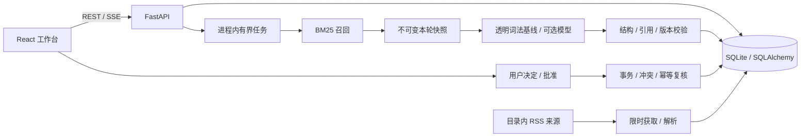

# 起步架构

`schemas.py` 定义输入和结果；`retrieval.py` 是可单独替换的算法入口；`providers.py` 隔离模型服务与结果验证；`service.py` 协调快照、发布和批准；`database.py` 管理持久化；`main.py` 只负责 API 和静态资源。

## 当前不变量

1. 检查绑定目标版本，引用只能来自本轮快照。
2. 保存快照与历史结果，来源刷新不改写已完成轮次。
3. 目标/证据变化、取消或任务终态后，迟到结果不能发布。
4. 无候选不调用模型；结构/引用失败不保存为成功，不静默降级冒充模型结果。
5. 本轮没有提议时不能批准；模型无权自行写日程。
6. 批准事务再次检查目标、证据、用户决定、未来时间和日程重叠。
7. 同目标版本、证据和提议内容有唯一键，重试不重复写日程。
8. 相同证据下的用户决定会抑制新提议。

SSE 是持久化的任务阶段事件，不是模型 token 流。浏览器断开不会取消检查；重连支持 `Last-Event-ID`。模型用量只记录服务方返回的 usage，不用字节伪造 token。

## 有意保留的简化

本版使用单进程、有界 asyncio 任务和 SQLite，适合本地开发。小规模同步数据库读写发生在 API 进程，CPU 检索也未拆到专用 worker。先观察实际瓶颈，再迁移异步数据库/独立任务系统。

首批新闻来源由服务生命周期内的轮询任务获取，保存来源状态和下次获取时间；重启重试中断获取，失败保留缓存。它不创建目标检查，不调用模型，也不是独立调度服务。原始迁移目录保持不变，`data/live_sources.json` 覆盖运行时首批来源配置。

`media.py` 按当前浏览页异步补全配图，优先来源图片，再读取公开原文分享元数据；Reddit 使用官方嵌入服务。图片索引保存在独立的 `article_media` 表，文件在 `.local/media/`，API 只装饰展示结果，不写回文章证据或运行快照。任务队列与每站并发有上限；失败分类、退避重试和抓取版本用于更新旧失败缓存。图片请求校验公网地址并固定实际连接目标，沿用环境代理、按原域名验证 TLS；DNS 回退和隐私范围见 `PRIVACY.md`。这些限制不代表整个起步 API 已达到生产安全要求。

尚无数据库迁移、完整图 checkpoint、目标周期触发、队列背压、语义去重、向量索引、账户隔离或工具自主调用。已有 Docker/CI 配置不等于远端构建与部署已通过。

下一步迁移 PostgreSQL/Alembic、任务分发/触发和 LangGraph 时，应保持领域接口与上述不变量。研究评测直接导入检索/验证模块，不要求启动浏览器。
