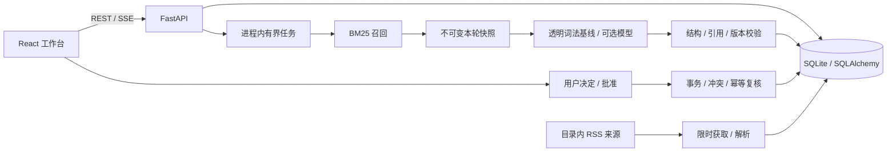

# 起步架构

目标关注状态由 `following.py` 处理，领域转换不依赖 HTTP/UI。取消关注通过期望版本进行条件更新，递增目标版本，在同一事务中取消该目标的排队/运行检查并保存事件；HTTP 层在提交后取消相应任务。即使推理忽略取消并迟到返回，终态和版本校验仍阻止发布。恢复关注再次递增版本，不启动检查或复活旧提议。重复转换不重复增版。普通目标保留历史和已确认日程；正常启动不生成示例，清除没有历史的旧示例，有历史的示例退出日常关注并保留快照。编辑过的示例已转为个人目标，不参与清理。

`schemas.py` 定义输入和结果；`retrieval.py` 是可单独替换的算法入口；`providers.py` 隔离模型服务与结果验证；`service.py` 协调快照、发布和批准；`database.py` 管理持久化；`main.py` 只负责 API 和静态资源。

## 当前不变量

正常启动不载入演示归档，并清理旧库中 `origin=archive`、`id` 前缀为 `archive:` 的预存条目及配图索引。原始迁移文件保留；隔离测试/评测显式使用 `include_archive=True` 或 `archive_seed=True`。历史检查快照不改写；涉及已移除演示新闻的检查只供回溯，不作为目标默认结果、新检查的前次判断或决定上下文，不能据此新建安排。已批准安排的精确幂等重试仍可返回已有记录，不新增写入。

1. 检查绑定目标版本，引用只能来自本轮快照。
2. 保存快照与历史结果，来源刷新不改写已完成轮次。
3. 目标/证据变化、取消或任务终态后，迟到结果不能发布。
4. 无候选不调用模型；结构/引用失败不保存为成功，不静默降级冒充模型结果。
5. 本轮没有提议时不能批准；模型无权自行写日程。
6. 批准事务再次检查目标、证据、用户决定、未来时间和日程重叠。
7. 同目标版本、证据和提议内容有唯一键，重试不重复写日程。
8. 相同证据下的用户决定会抑制新提议。

SSE 是持久化的任务阶段事件，不是模型 token 流。浏览器断开不会取消检查；重连支持 `Last-Event-ID`。模型用量只记录服务方返回的 usage，不用字节伪造 token。

CompatibleProvider 为每次尝试记录允许的模型身份、状态、耗时和 usage，使用固定错误码隔离供应商异常；不保存原始错误响应或思考内容。非法结构/引用最多修正一次，截断、鉴权和网络故障不自动重试。取消或目标过期后可以保存已知用量，但不能发布结果。`python -m cfaw_news.live_check` 提供配置检查、公开样例预览和显式付费验收入口，默认不调用模型；隔离数据库位于 `.local/live-checks/`。

## 有意保留的简化

本版使用单进程、有界 asyncio 任务和 SQLite，适合本地开发。小规模同步数据库读写发生在 API 进程，CPU 检索也未拆到专用 worker。先观察实际瓶颈，再迁移异步数据库/独立任务系统。

首批新闻来源由服务生命周期内的轮询任务获取，保存来源状态和下次获取时间；重启重试中断获取，失败保留缓存。它不创建目标检查，不调用模型，也不是独立调度服务。原始迁移目录保持不变，`data/live_sources.json` 覆盖运行时首批来源配置。

`media.py` 按当前浏览页异步补全配图，优先来源图片，再读取公开原文分享元数据；Reddit 使用官方嵌入服务。图片索引保存在独立的 `article_media` 表，文件在 `.local/media/`，API 只装饰展示结果，不写回文章证据或运行快照。任务队列与每站并发有上限；失败分类、退避重试和抓取版本用于更新旧失败缓存。图片请求校验公网地址并固定实际连接目标，沿用环境代理、按原域名验证 TLS；DNS 回退和隐私范围见 `PRIVACY.md`。这些限制不代表整个起步 API 已达到生产安全要求。

`article_html.py` 共享中新网正文边界：普通新闻 `.left_zw`，图集当前照片 `.tuji_current_img` 与说明 `.current_img_desc_wrapper`。已知来源未匹配正文时停止提取，防止拿推荐或广告填充；其他来源保留通用提取路径。Pillow 检查封面实际尺寸与结构，`cover_file` 与正文图片的 `image_file` 分开，封面阈值不误伤阅读器内的插图。旧正缓存也验证真实文件；文件检查按文件名、大小与修改时间做有界内存缓存。媒体版本变更可复核成功记录，有效旧图在后台获取期间继续展示，确认正文无图后显示来源标识。网页正文缓存另有页面提取版本，升级正文边界不使 RSS 正文缓存失效。

`reading.py` 与 `article_reading` 保存阅读正文，和模型使用的摘要/片段分离。GitHub Blog、阮一峰、爱范儿、MIT 在采集时把订阅正文转为允许的结构树；其他来源在打开条目时通过队列读取公开网页，用 Trafilatura 提取正文。提取前规范化懒加载图片，输出后只保留允许的文本、标题、列表、代码、表格和图片节点。原网页 HTML 不直接送给 React。正文图片地址只存后端，经文章 ID 与图片序号获取，限制上游大小、并发和重试。文章证据哈希变化时丢弃迟到的正文任务；阅读缓存不会改变证据哈希、运行快照、判断或日程。

正文补抓默认开启，可用 `NEWS_READING_FETCH=false` 关闭；订阅已有的正文仍可展示。配图关闭时不获取未缓存正文图片。历史证据阅读器不请求当前正文，引用核对仍指向原快照。GitHub 缺图使用本地 Octicons 官方标识，其余缺图使用来源文字标记，均标注非文章配图。HN 保留社区提交语义，通过前端默认 `exclude_discovery=true` 从主文章流过滤，选中 HN 时可查看全部社区缓存；不改变其证据存储或算法召回规则。

尚无数据库迁移、完整图 checkpoint、目标周期触发、队列背压、语义去重、向量索引、账户隔离或工具自主调用。已有 Docker/CI 配置不等于远端构建与部署已通过。

下一步迁移 PostgreSQL/Alembic、任务分发/触发和 LangGraph 时，应保持领域接口与上述不变量。研究评测直接导入检索/验证模块，不要求启动浏览器。
