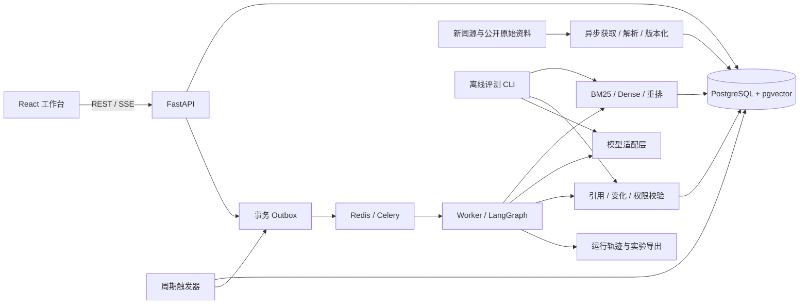

# CFAW News 后续开发规划

制定日期：2026-10-14。最近修订：2026-10-17（GitHub 参照融入与下一轮交付）。

按当前独立 Demo 起点制定的日期、周任务和交付门槛见 [24 周开发时间线](TIMELINE.md)。

本文件保留后续研究路线。起步 Demo 的实际能力与未实现范围以根目录 README 和 ARCHITECTURE.md 为准；以下里程碑不等于已完成状态。

依据：最终版源码与文档审查；用户明确“优先算法，其次应用开发”，不设时间上限，以作品质量为先。当前状态见[迁移记录](MIGRATION.md)。本文所有新功能、数据规模、实验和验收指标均为计划，不代表已经实现或测得。

## 1. 建议定位与成功标准

**建议把 CFAW News 发展为“面向个人目标的持续证据研究 Agent”，算法主线为“时序证据检索与决策更新”。**

它持续回答：在用户的设备、预算、时间和使用条件下，新证据是否足以改变上一轮判断？需要继续观察、补证、提出有限行动，还是撤回旧建议？

这条主线与比赛版一致，也能自然承载检索排序、RAG、Agent 策略、评测、PyTorch 训练和可靠运行系统。产品中的天气、资讯首页、收藏、日程继续提供实际场景，研发重点放在证据如何影响判断。

优先争取的岗位能力匹配：Agent 算法与评测、RAG/检索排序算法、应用研究型 AI 工程；第二目标是 Agent/LLM 应用开发。模型预训练、强化学习后训练和 GPU 推理 Infra 需要额外的专项成果，不能靠一个完整 Web 应用代替。

作品达到求职使用标准，应同时具备：

1. 一个陌生使用者可以运行、使用、追溯证据的产品。
2. 一个边界明确、能复现的时序任务数据集与评测协议。
3. 一组可靠基线，以及至少一个自己实现并认真评估的算法改进。
4. 对提升、退步、代价和失败条件的解释；实验无提升也如实报告。
5. 可以说明个人贡献、上游来源和 AI 辅助验证方式的代码与记录。

时间不受限不等于范围无限。每完成一个阶段，都形成可投递版本；后续根据实验结果决定是否继续加深。

## 2. 产品保留什么，优先改变什么

| 保留资产          | 下一代改进                     |
| ------------- | ------------------------- |
| 可编辑的目标、范围、偏好  | 结构化目标及版本；明确硬约束、软偏好和未知条件   |
| 当前情况、下一步、查看依据 | 增加“相较上次，具体哪条事实改变了什么”      |
| 不可变证据与引用原句    | 文档版本、段落定位、事实声明及支持/反驳关系    |
| 观察、已处理、不采纳    | 可选反馈原因和后续结果；不把不采纳直接当负相关   |
| 变化、更新、撤回      | 语义事件/事实增量与时间有效性评测         |
| 用户确认日程        | 确认前重验，持久化幂等；日程只承担有限行动闭环   |
| 有界运行、取消、旧回调保护 | 独立 worker、断点恢复、预算、事务与运行轨迹 |
| 三个日常决策案例      | 保留产品示例，另建独立研究数据，扩展中英文条件差异 |

前端建议围绕三个核心页面：**目标工作台、证据与变化详情、行动/决定历史**。来源设置和基础新闻流作为辅助；实验结果展示放在独立评测页面，避免普通用户面对调参选项。

首个完整故事可以继续使用“每周两小时，在 Mac 上尝试一个省时 AI 工具”：首次了解能力 → 重复报道不提醒 → 明确中文/账号限制后补证 → 有条件试用 → 用户批准 → 后来官方更正导致旧建议修订。历史回放是下一代待开发能力，演示时明确与实时运行区分。

### 2.1 GitHub 参照的融入清单

2026-10-17 根据公开仓库 README 与部分核心实现阅读，将下列机制纳入开发计划。优先级按本项目的问题与依赖排序；没有在本机运行这些上游项目，其描述、评分或性能不作为本项目验收证据。以下均为待实现或待独立验证的计划。

| 优先级 | 借鉴机制与参照 | 在 CFAW News 中的交付 | 验收门槛 |
| --- | --- | --- | --- |
| 先做 | 事实记忆与新颖性判断：[Topic Watch](https://github.com/0xzerolight/topic_watch) | 为每个目标版本保存已确认事实、适用条件、待核实问题和知识修订；识别重复、补充条件、变更、冲突、更正、撤回 | 重复报道保持判断；新条件可解释地影响判断；反驳不会被当作无关；无法取得证据时保留未知状态 |
| 先做 | 证据版本与差异展示：[changedetection.io](https://github.com/dgtlmoon/changedetection.io) | 在已有运行快照外保存文章历次版本、时间与段落定位；展示旧片段、新片段、关联事实及对本目标的影响 | 原文更新不覆盖历史；回放只读当时已获得的版本；每项变化可追溯到保存的片段 |
| 随后做 | 事件归并与来源关系：[NewsPrism](https://github.com/moguiyu/NewsPrism) | 建立事件分组及转载、独立报道、官方更正关系；选择代表材料，继续保留原始证据与反驳版本 | 多篇转载不算多份独立佐证；相似标题中的新条件不被丢弃；更正保留时序与来源依据 |
| 算法主线 | 证据价值重排：[FlagEmbedding](https://github.com/FlagOpen/FlagEmbedding)、[FlashRAG](https://github.com/RUC-NLPIR/FlashRAG) | 保留 BM25 对照，逐步加入 Dense、RRF、通用重排器；训练目标/约束/历史感知重排器，统一离线评测接口 | 固定候选池、可见信息、生成模型与预算；报告排序、最终判断、成本和分组失败；不得预填收益 |
| 基础可靠后做 | 事件驱动持续跟踪：[Huginn](https://github.com/huginn/huginn)、[Open Scouts](https://github.com/firecrawl/open-scouts) | 用户明确开启目标跟踪，按周期或来源变化检查，只对重要变化通知；先在现有 Python 工程实现确定流程 | 暂停后不产生新任务；重启不重复提醒；目标/依据版本变化阻止迟到发布；行动继续走独立批准接口 |
| 再深入 | 预算内主动补证：[Open Scouts](https://github.com/firecrawl/open-scouts)、[STORM](https://github.com/stanford-oval/storm) | 根据设备、地区、语言、套餐等关键未知条件选择补读与核实工具；限制调用次数、时间、Token 和费用 | 与固定补证策略同预算比较；失败调用计成本；拿不到证据时明确停止；未经工具返回的正文不可见 |
| 并行记录，学习后置 | 可解释反馈：[NewsPrism](https://github.com/moguiyu/NewsPrism/blob/main/newsprism/service/calibrate.py) | 增加可选决定原因及结果记录：设备/预算不符、已经知道、暂缓、证据不足；先用于误差分组 | 区分证据不相关、条件不适用和暂时不行动；不把“不采纳”直接当负相关标签；训练前有独立协议和切分 |

参照重点为领域机制和实验协议，保持独立 FastAPI/React 架构。复用源码或模型前记录 revision、许可证、依赖与署名；Open Scouts 在本次检索中未被 GitHub 识别出许可证，复用前需单独核对。上游固定相似度阈值、来源权重和“不确定就不提醒”规则均需在本项目验证；重要变化漏报与普通资讯误报分别统计。

建议源码入口：[Topic Watch 新颖性规则](https://github.com/0xzerolight/topic_watch/blob/main/app/analysis/prompts.py)、[知识更新与版本写入](https://github.com/0xzerolight/topic_watch/blob/main/app/analysis/knowledge.py)、[changedetection.io 意图与差异评估](https://github.com/dgtlmoon/changedetection.io/blob/master/changedetectionio/llm/evaluator.py)、[NewsPrism 去重](https://github.com/moguiyu/NewsPrism/blob/main/newsprism/service/dedup.py)、[Open Scouts 有界执行](https://github.com/firecrawl/open-scouts/blob/main/supabase/functions/scout-cron/agent.ts)、[FlashRAG 统一复现实验](https://github.com/RUC-NLPIR/FlashRAG/blob/main/docs/original_docs/reproduce_experiment.md)。这些链接指向可变分支，正式实验或复用时另行固定提交。

### 2.2 事实历史与事件流的实现约束

已有 `service.py` 将上一轮结果与用户决定放入本轮快照；下一步在此基础上引入事实级历史。建议领域对象随实现定稿：

- `DocumentVersion`：保存内容哈希、段落、发布时间、首次发现/获取时间与版本标识；快照引用确定版本。当前文章视图与历史版本各自维护，既有归档和迁移出处保留。
- `Claim` 与证据关系：保存主体、属性、值、适用条件、有效时间、支持/反驳片段和状态。事实来源、模型提取结果与用户决定分别保存；摘要作为阅读入口，不成为丢失出处的唯一事实库。
- `GoalKnowledgeRevision`：绑定目标版本、文档版本、旧知识修订、事实增量、未知条件及模型/提示版本。模型先产生待验证更新计划，发布前再次检查取消与版本，在事务中保存相关状态；失败或过期不能改写有效知识。
- `EventGroup` 与来源关系：事件归并不物理删除材料；转载、独立来源和更正分别标识。同一事件家族的改写、不同 persona 与派生样例保持同一评测分组。

持续跟踪采用“来源新增/更新 → 关联目标 → 候选与证据变化检查 → 更新判断 → 必要时通知 → 用户决定”的可追溯事件流。通知去重结合目标版本、语义变化和用户决定，不能只比较 URL，也不能仅因候选列表变化就宣称事实变化。自动采集与目标检查分开控制；用户启用目标跟踪后才进入周期检查。调度、运行恢复和通知按第 8 节验收。

### 2.3 下一轮交付：证据版本、事实增量与时序样例

2026-10-16 的真实 DeepSeek 公开归档闭环已有[独立验收记录](LIVE_MODEL_CHECK.md)；以下交付基于该起点，仍属计划。下一轮先保持 BM25 与现有模型适配，围绕一条可回放纵向用例完成：

1. 写清任务和标签协议，建立 5 条、每条 3–6 步的开发轨迹，再依据复核情况扩至原计划的 20–30 条。样例明确标记人工构造/真实来源与时间，不计最终留出测试。
2. 实现最小文档版本存储及按时点可见性，保留历史证据与出处；同时安排 schema 迁移和已有 SQLite 数据的备份/兼容验证。
3. 实现事实提取、带出处的目标知识修订与事实增量，分开“没有新事实”“有变化但不影响用户”“证据不足/来源失败”。
4. 工作台增加旧判断、新证据、变化原因与下一步对比，能打开具体版本/段落；决定原因支持可选填写。
5. 建立离线时序回放与逐步结果导出，记录预测标签、支持证据、漏报/误报和成本。引用定位与语义支持分别检查。

这一轮先为重复、条件补充、变更/冲突、更正/撤回和来源失败建立开发验收，不承诺泛化指标。完整事件归并在下一批扩展；训练重排器、自动跟踪与动态补证按后续门槛推进。

| 开发验收情形 | 预期行为 |
| --- | --- |
| 同一事实换标题、换 URL 或被转载 | 记录来源变化，保持原判断与用户决定，不重复提醒 |
| 新证据补齐设备/地区/语言/套餐条件 | 明确增加了哪个条件、是否适用于当前用户；有充分证据才推进下一步 |
| 官方更正影响旧结论或行动提议 | 保留旧事实及其时点，引用更正证据，解释更新/撤回范围；证据不足不能自行撤回 |
| 来源失败、没有候选或只有薄弱片段 | 明确证据缺口；保留已知历史，不冒充“外界无变化”，无候选不调用模型 |

完成门槛还包括：回放不使用未来版本；每个增量有版本/段落依据；取消、目标修改和重复批准的既有保护继续成立。模型 mock、人工轨迹、真实模型调用与真实新闻运行分别报告。

## 3. 一个可以检验的核心研究问题

**在相同模型、相同候选语料、相同工具/Token 预算下，结合用户约束与历史事实的证据选择，能否提高有效变化发现率，并减少无依据行动和重复提醒？**

每步输入为：当前目标版本、明确约束、截至时刻 t 可获得的文档快照、上次判断、用户决定、剩余预算。输出分成三层：

- 证据状态：足够/不足/冲突/无法取得。
- 判断变化：首次形成/实质更新/需要撤回/无实质变化。
- 建议：观察/进一步核实/有限行动；任何写入行动另走用户确认。

“没有相关新闻”“没有新事实”“有新事实但对用户无影响”“可能重要但证据不足”必须是不同标签。文章相关性、证据充分性和建议适当性也分别评价。

### 3.1 第一条算法线：目标条件检索与重排

任务：从大量“主题相关”材料中选出对当前用户和本轮判断有用的证据。

依次建立：

1. 比赛版策略的 Python 复现：标题门禁 + 中文 bigram/英文词 + 原有排序逻辑。
2. 标准 BM25：统一候选范围，分别比较中文 bigram 与分词策略，记录 tokenizer/index revision。
3. 稠密向量检索。
4. BM25 + 稠密检索 + RRF。
5. 相同召回池上的通用 CrossEncoder 重排。
6. **自己的目标/时序感知重排器**：输入目标、约束、必要历史与候选片段，学习证据的适用性和本轮信息价值。

首先实现特征/规则或轻量排序模型，再以 PyTorch/Transformers 训练一个小型重排模型，明确训练目标、负样本、数据量和基线。可比较分类/成对排序损失，保留随机负样本与困难负样本比例的消融。[Sentence Transformers 官方训练文档](https://sbert.net/docs/cross_encoder/training_overview.html)提供 CrossEncoder 训练与负样本处理入口。

首个可学习目标先定义为“固定历史时点下，单篇候选的分级证据价值”：是否解决关键未知条件、提供实质更新或可靠反驳，附独立的主题相关、适用性与支持方向标签。它评价单篇排序，不宣称解决证据集合最优选择；同一材料在已选集合中的边际价值与去冗余留给第三条策略实验。

困难样本至少包括：产品同名、地区不适用、价格版本不同、只是转载、标题夸大、旧能力重新介绍、相同设备但套餐不同。**与旧判断矛盾的可靠材料可能极有价值，不能直接视为负例。** 把“证据有用程度”和“支持/反驳的方向”分开标注。

从已核实的多语言公开基线开始，如 [BGE-M3](https://huggingface.co/BAAI/bge-m3) 与 [bge-reranker-v2-m3](https://huggingface.co/BAAI/bge-reranker-v2-m3)。它们是可复现候选，不宣称当前最优；先测中文/英文质量、延迟和内存，再决定是否比较更新模型。硬件不足时先固定外部 embedding 服务或较小公开模型，单独记录数据出境与成本配置。

### 3.2 第二条算法线：新事实、冲突与判断更新

任务：区分新增网页与新增事实，并判断变化是否影响当前目标。

baseline 从现有文本 fingerprint、固定历史摘要和一次 LLM 判断开始；改进采用事件归并、结构化 claim、适用条件和事实关系。claim 建议至少包含主体、谓词/属性、值、时间、条件、来源与证据片段。

对同一事件分别识别：重复、补充适用条件、变更、矛盾、官方澄清、撤回、无关。来源转载不等于独立佐证；官方更正与旧报道冲突时，应说明时序和权威性，而非简单多数投票。

使用固定生成模型比较“无历史 / 旧摘要 / 结构化事实历史 / 加用户决定”。同时设计同新闻不同设备/地区/预算的配对样本，检查系统是否真的使用约束。

### 3.3 第三条算法线：预算内主动补证与可靠停止

在第一、二条已有可信评测后再做。任务是决定下一步检索什么、补读哪篇、是否足以停止。

比较固定 Top K、固定次数补读基线（待在独立工程实现）、简单不确定性规则，以及依据“尚未解决的关键条件/预期证据价值/成本”的策略。动作空间先限定为搜索现有库、改写查询、补读已知 URL、核对原始来源、停止/等待；所有动作有数量、时间和费用上限。

不要只让模型口头给一个 confidence。可用独立验证集校准分类分数或阈值，并画风险—覆盖率与质量—成本曲线。在低预算、冲突证据、不可访问正文时单独报告表现。

研究借鉴可从 [FLARE](https://arxiv.org/abs/2305.06983) 的何时检索问题、[Self-RAG](https://arxiv.org/abs/2310.11511) 的按需检索/反思思路开始。Self-RAG 包含专门训练，不能把增加一段“自我反思”提示写成完成论文复现；若不使用 token 级概率，也不能声称精确复现 FLARE。

建议把第一条中的可训练重排器作为首个算法贡献，第二条作为产品特有任务，第三条作为后续研究加深。先完成一项可信改进，再扩展下一项。

## 4. 数据集优先于复杂 Agent

### 4.1 每个样本是一段时间轨迹

不能仅用“问题—答案”表示本项目。一个研究样本建议包含：

```text
trajectory_id / event_group_id / persona_id
goal + constraints + goal_version
time_steps:
  decision_time
  environment_document_versions + paragraphs  # 环境保存，不能默认暴露给策略
  initial_policy_observation + tool_observation_log
  previous_claims + previous_decision
  evidence_relevance / applicability / utility / polarity
  material_change_label
  supported_claims + unresolved_conditions
  acceptable_decision_set + annotation_rationale
```

每步保存 `published_at`、`first_seen_at`、`fetched_at`、适用时间和内容版本。回放时只允许使用当时已经获得的版本。今天抓取到的、后来被修改过的旧网页，不能仅凭旧发布日期放进历史时刻。

主动补证实验要区分三类信息：环境保存的全部快照、策略当时能看到的标题/摘要/已获取片段、仅供评测的标注和未来轨迹。全文只有在相应工具返回后才进入策略 observation，消耗对应预算；失败请求也记成本。未来证据、gold 标签和 oracle 决策不能进入检索索引、提示、特征或停止判断。所有策略从相同初始观察开始，不能免预算复用其他策略已经获取的正文；离线缓存只是复现工具响应，不代表正文免费可见。

### 4.2 分阶段建设，规模是建议值

| 数据阶段   | 建议规模                                                     | 用途                  |
| ------ | -------------------------------------------------------- | ------------------- |
| 开发种子   | 现有 26 条归档 + 20–30 条手工时间轨迹                                | 定义任务和失败模式，不计最终成绩    |
| 标注试点   | 约 100 条轨迹，每条 3–6 步                                       | 修订规范、测标注一致性、做首轮基线   |
| 主实验    | 约 300–500 条轨迹、约 1,000–3,000 个决策步骤；5,000–20,000 篇合法可用候选文档 | 时间/事件隔离评测、重排与策略比较   |
| 真实运行补充 | 新产生的公开事件与用户自愿反馈                                          | 检查离线结论是否迁移；不能替代留出测试 |

规模根据学习曲线、标注质量和统计不确定性调整。几千个相关步骤并非几千个独立样本；同事件和同轨迹相关性要计入估计。

先写数据说明和标注规范，20–30% 样本做双人独立标注与仲裁。若只有一人，可先盲重标和记录分歧，但应明确缺少独立标注的限制；LLM 预标注只能辅助，不能代替人工真值。

建议记录“允许的合理决策集合”及依据，不强迫每个主观生活决策只有唯一正确答案。事实支持和硬约束违规可以更严格地判定。“当时证据允许的合理判断”与“后来真实结果”分开保存；后者可以分析结果，不能倒推为早期 gold。

### 4.3 切分与防泄漏

- 开发集用于提示、阈值和模型选择；测试集冻结后只用于最终报告。
- 按事件家族分组并使用时间切分，转载、翻译、同一公告的改写不得跨 train/dev/test。
- 同一基础事件生成的不同 persona、反事实改写和合成变体归在同一分组。
- 训练模型/重排器时，不挖掘测试集负样本，不用测试结果回调阈值。
- 合成场景与真实新闻分开报告；合成时间线的收益不直接宣称真实新闻收益。
- 冻结语料、chunking、索引、模型 revision、提示版本、候选池和随机种子。
- 人工标注也按当步可见证据逐步进行，冻结当步判断后再看下一步，避免后见之明把“当时合理等待”判错。
- 现代 LLM 可能从预训练知道历史事件的后来结局，单靠索引过滤无法消除。按当步证据评分，未来事实即使事后正确也不能获得当步证据正确分；做无证据/遮蔽证据对照、实体替换的受控场景与冻结模型后的前瞻事件切片，分别报告限制，不宣称获得绝对无污染历史评测。
- 公开元数据、标注、合法短引用与抓取脚本；新闻全文能否再分发逐源核对。代码许可不覆盖新闻版权。

## 5. 评测协议：把算法成绩与工程检查分开

| 层次     | 核心指标                                   | 需要回答的问题                   |
| ------ | -------------------------------------- | ------------------------- |
| 召回/排序  | Recall@K、MRR、nDCG@K、按条件分组的表现           | 有没有找到对本用户有用的证据            |
| ANN 索引 | 相对精确向量搜索的 recall、延迟、内存                 | 加速损失多少召回；它不同于相关性 Recall@K |
| 引用     | 原句定位正确率、claim 支持精度、关键 claim 引用覆盖率      | 引用存在之外，是否真的支持结论           |
| 时序变化   | macro-F1、每类 precision/recall、漏变更率、误撤回率 | 是否分清重复、更新、冲突与撤回           |
| 决策     | 硬约束违规率、无依据行动率、合理决策命中率                  | 建议是否有证据且适用于用户             |
| 连续体验   | 重复提醒率、重要变化发现延迟、已处理决定保持率                | 长期使用是否少打扰、能纠错             |
| 策略     | 固定预算下成功率、质量—成本曲线、停止质量                  | 多调用工具是否真的值得               |
| 系统     | 失败率、P50/P95、取消响应、恢复成功率、单成功任务费用         | 算法能否可靠交付                  |

先固定评测单位和分母。例如“无依据行动率”以系统给出的行动建议为分母；另报行动覆盖率，避免靠永不建议取得低错误率。引用覆盖率按需要证据的关键 claim 计数。任务无正例时单独统计，不硬算 Recall。

大语料 qrels 如果只标注候选池，应称“相对已标注候选池的召回”；通过多系统 pooling、补标和抽样未召回文档估计遗漏，不能当作穷尽真值。

主比较固定生成模型与提示、候选语料、上下文和工具/Token 预算。分别报告只替换检索器的收益、只替换模型的收益，以及端到端组合结果，避免归因混乱。

分别运行两种模式：单步评测提供相同的标注历史，用于定位检索/变化模块差异；闭环轨迹评测让各系统继承自己的判断、记忆与工具结果，观察错误累积和自我修正。用户反馈先按固定脚本/明确规则回放；如模拟用户根据建议反馈，应单独标明模拟器假设。不能用单步高分声称长期闭环可靠。

关键消融：去掉用户条件、历史、用户决定、时序新颖性、重排、引用支持验证、主动补证。对照先预注册，测试集不反复试探。

随机训练/生成建议至少 3 个种子或重复配置，视成本增加；以事件/轨迹为单位做配对 bootstrap，报告均值、区间和实际样本数。计费、耗时、失败也纳入，不只展示最好一轮。

公开 API 的模型别名未必能锁定权重；记录实际 model ID、服务方返回的版本信息/指纹、调用日期和参数，尽可能在相近时段配对比较，并说明无法冻结的因素。

LLM Judge 必须给明确 rubric、固定版本、盲评/打乱顺序，用人工样本校准并报告一致性；允许“不确定”。它不负责判定所有事实真值。同一模型生成与评审可能有偏差，独立模型也不能代替人工抽检。

检索基线的方法论可参考 [BEIR 原论文](https://arxiv.org/abs/2104.08663)：把 BM25 和不同检索范式放到一致协议下比较。其结果不是本项目成绩，英文公开数据的收益也不能直接外推到中文个人目标场景。

## 6. 推荐技术栈与取舍

| 部分        | 建议采用                                                | 引入目的与时机                                        |
| --------- | --------------------------------------------------- | ---------------------------------------------- |
| Python 工程 | Python 3、uv、类型注解、Ruff、mypy/pyright 选一个              | 从研究 CLI 开始；精确版本在开工时锁定                          |
| 研究计算      | NumPy、PyTorch、Transformers、Sentence Transformers    | 指标、向量/重排、训练和复现实验                               |
| 后端        | FastAPI + Pydantic                                  | 独立 REST API、schema、参数/输出验证                     |
| 异步 IO     | HTTPX + asyncio                                     | 连接池、并发、取消、限时、信号量、分来源限速                         |
| 数据库       | PostgreSQL + SQLAlchemy + Alembic                   | 事务、索引、版本、唯一约束和迁移                               |
| 稀疏检索      | 初期 bm25s + 显式中文 tokenizer                           | 研究 baseline、版本化索引；不宣称 PostgreSQL 默认全文搜索就是 BM25 |
| 向量检索      | pgvector；先精确搜索，再测 HNSW                              | 一套数据库承载业务和向量，减少系统分散                            |
| 编排        | LangGraph                                           | Python 基线跑通后，引入状态图、checkpoint、条件分支和人工中断        |
| 长任务       | Celery + Redis                                      | 后台监测、任务分发、并发与背压；数据库保存业务事实                      |
| 前端        | React + TypeScript + Vite + TanStack Query          | 目标/证据/历史工作台；单独 Python 后端，保持边界清楚                |
| 流式交互      | SSE                                                 | 真实任务阶段、可重连事件；模型 token 流另行表示                    |
| 可观测/实验    | Langfuse，配合结构化日志                                    | 追踪每步与数据集实验；保留本地 JSON/CSV 导出                    |
| 测试        | pytest、异步/HTTP mock、真实 PostgreSQL 集成、Playwright E2E | 领域逻辑、事务恢复和关键浏览器闭环                              |
| 交付        | Docker Compose、Linux、反向代理、GitHub Actions            | 可复现运行、健康检查、CI、备份与回滚                            |

[bm25s 官方仓库](https://github.com/xhluca/bm25s)可用于标准 BM25 基线；比赛版策略单独保留，不能把两个实现差异归因为向量收益。

[pgvector 官方文档](https://github.com/pgvector/pgvector)提供精确/近似向量检索、HNSW 与混合检索入口。对本项目先测精确检索，再比较 ANN 召回、延迟及过滤行为；小语料不为了使用 HNSW 强行造压力。中文稀疏检索的分词、索引刷新与版本一致性需显式实现和测试。

LangGraph 的 [persistence](https://docs.langchain.com/oss/python/langgraph/persistence) 区分运行 checkpoint 与跨运行数据。业务长期事实保存在领域表；不能把图中的对话列表当作全部业务数据库。

[Langfuse 实验文档](https://langfuse.com/docs/evaluation/experiments/experiments-via-sdk)支持数据集与程序化实验。初期先导出可复现结果再接平台；自托管作为可选 Compose profile，避免观测平台基础设施阻塞主功能。

本阶段只深入一套向量库、一套编排框架和一个观测平台。Elasticsearch、Qdrant、Milvus、LangSmith、Phoenix 可以作为选型对照，除非测得实际不足，否则不并行部署。

## 7. 服务结构与领域模型

初期采用模块清楚的单体代码仓库，API 和 worker 分进程。研究脚本直接复用领域与算法包，不依赖启动浏览器。



核心实体：`User`、`Goal/GoalVersion`、`Source`、`Document/DocumentVersion`、`Chunk`、`EventGroup/Claim`、`GoalKnowledgeRevision`、`EvidenceSnapshot`、`Run/Step/RunEvent`、`Judgment`、`UserDecision`、`ActionProposal/Approval`、`Schedule`。领域事件分组与运行进度事件各自命名。不要第一天实现所有实体，随纵向用例扩展。

运行状态示例：`queued → running → waiting_approval/completed/failed/cancelled`。关注状态、判断变化类型和任务运行状态各自建模，避免混在一个字段。

关键接口可以先覆盖：

```text
POST   /goals                         创建待确认目标/版本
POST   /goals/{id}/confirm            确认目标版本后生效
POST   /goals/{id}/checks              创建检查，返回 202 + run_id
GET    /runs/{id}                      查询持久化状态
GET    /runs/{id}/events               SSE 事件
POST   /runs/{id}/cancel               请求协作式取消
GET    /judgments/{id}/evidence        查询版本化证据
POST   /judgments/{id}/decisions       保存观察/处理/不采纳
POST   /proposals/{id}/approve         验证后批准行动
```

图执行：读取目标版本 → 召回 → 获取证据 → 充足性/冲突判断 → 在预算内补证或停止 → 与历史比较 → 验证 → 保存判断 → 如需行动则等待批准 → 再验证 → 幂等提交。

等待批准时持久化并释放 worker，不让进程持续阻塞。LangGraph [interrupt 文档](https://docs.langchain.com/oss/python/langgraph/interrupts)说明恢复可能重跑节点中的代码；副作用放在独立、幂等的提交步骤。checkpoint 不自动保证日程恰好写入一次。

长任务由独立 worker 执行；FastAPI BackgroundTasks 只用于适合进程内执行的轻量工作。具体边界参考 [FastAPI 官方说明](https://fastapi.tiangolo.com/tutorial/background-tasks/)。Celery 任务入口与 async 业务服务的适配要专门测试，不假定任务装饰器会自动驱动任意协程。

## 8. 工程深度落在可以证明的行为上

### 8.1 保留并增强八条不变量

1. 本轮结果绑定用户、目标版本、证据版本、模型/提示/索引配置。
2. 无证据不能发布有依据的行动结论；检索失败不等于世界没有变化。
3. 引用必须能定位到本次保存的文档版本；语义支持另测。
4. 用户取消、目标修改或证据失效后，迟到结果不能发布或执行。
5. 同一请求/任务/批准的重试不会重复创建判断或日程。
6. 模型只能提出行动，服务端验证用户批准与数据归属后执行。
7. 写库成功才算业务成功；数据库事务是结果事实来源。
8. 用户不采纳/已处理的决定不会因为转载或换 URL 自动重开。


### 8.2 可靠性与恢复

429/可恢复 5xx 用有上限的退避/抖动与 Retry-After；鉴权和参数错误不盲重试。分开记录网络重试、模型结构修复和业务重试，统一受总预算限制。

数据库唯一约束、乐观锁和事务 outbox 防止重复发布/投递丢失；队列按可能重复投递设计，不宣称框架提供端到端 exactly-once。worker crash 后从已保存步骤恢复，外部调用缓存键必须包含模型/提示/内容版本。

持续监测还需要独立的周期触发器，不能仅部署 worker：数据库保存 `next_check_at`、检查周期、来源退避与活跃状态；单个周期触发服务或具有租约的触发器扫描到期目标，通过事务生成 run/outbox，并以目标版本和到期时刻等业务键幂等领任务。暂停/取消后不再新建检查；触发器重启、两个触发器重叠和任务延迟都要验收。所有用户时间以明确时区展示，持久化时间使用带时区语义的时间戳。

取消使用持久化标记和节点/工具边界检查；浏览器断开不等同取消任务。SSE 保存事件 ID，支持 Last-Event-ID 重连；进度事件和模型文本 token 用不同事件类型。

故障演练至少覆盖：抓取成功但入库失败、模型成功但发布前退出、写库成功但响应丢失、批准时目标版本变化、worker 恢复收到重复任务。

### 8.3 工具调用、MCP 与 Skills

先定义类型化内部工具：`search_evidence`、`fetch_allowed_article`、`get_previous_judgment`、`get_user_constraints`。参数、返回值、超时、预算、权限、错误类型统一，记录调用轨迹。

在这套工具稳定后，比较确定流程与一个受限 Tool Calling/ReAct 流程；工具选择自由度是待评估变量。日程写入继续由批准接口控制，模型工具集合不暴露任意数据库/文件/Shell 权限。

之后把现有只读检索/证据接口包装成一个小 MCP Server，配一个独立客户端演示和契约测试，实践 Tools/Resources/Prompts、连接与授权。服务应复用已有逻辑，并区分用户和作用域。

Skills 可用于“证据核验流程/来源适配规范”的按需加载，记录版本、资源和依赖；只有它改善了复用或上下文成本才进入主路径。MCP 是接口协议，Skills 是可加载的工作说明，都不能替代算法贡献。

### 8.4 安全与数据边界

首个公开版本前加入认证、每次资源访问的 user_id 校验、密钥服务端环境配置与脱敏、HTTPS。浏览器 SSE 的认证采用同站安全会话或受控 fetch 流，避免把长期密钥放 URL。

抓取器逐跳验证 URL/DNS/IP，限制私网/回环/云元数据端点、协议、响应大小与重定向，测试编码地址和 DNS 变化。正文是非可信数据，不能授予工具权限或覆盖系统指令；单写“忽略注入”不足以构成防护。

如未来有代码/任意文件工具，再引入真正执行沙箱；本项目当前工具以只读搜索/获取为主，不为覆盖技能而增加任意执行。

公开 demo 使用独立账号、额度、数据集；不得展示私人日程/密钥/完整敏感 trace。用户数据与公开实验分区，提供导出/删除与保留策略。观测平台发出的数据也纳入这套边界。

## 9. 按交付门槛推进的路线

以下为依赖顺序，阶段可以交叉推进；不以日期到达作为完成标准。每阶段都保留演示、运行说明和失败记录。

| 阶段              | 主要工作                                                      | 可验收成果                                      |
| --------------- | --------------------------------------------------------- | ------------------------------------------ |
| P0：冻结与问题定义      | 在已有独立仓库与 provenance 上定义任务、标签和切分，建立首批时序开发样例 | 任务说明、标注规范、20–30 条种子轨迹；原项目可追溯 |
| P1：Python 可复现基线 | 沿用已有 BM25/模型闭环，补文档版本、最小事实历史、差异详情、回放 CLI 与逐样本评测 | 第 2.3 节四类行为可验收；历史不可改写、未来不可见；领域/mock 回归通过 |
| P2：数据与强对照       | 事件归并、来源关系、反馈原因；标注试点/主数据，Dense、RRF、通用 reranker；完整控制变量 | 时间/事件隔离的冻结评测、基线表、转载/更正及中文/英文/约束分组结果 |
| P3：独立产品闭环       | PostgreSQL、React 变化详情、用户决定/批准，worker、SSE、用户启用的周期触发与通知去重 | 在已有真实模型闭环上验证自动跟踪；暂停/重启/重复投递可靠；数据库集成、E2E 与镜像构建通过 |
| P4：算法贡献         | 训练目标/时序感知重排器，事实历史比较，严格消融/误差分析                             | 训练配置/权重或获取方式、复现实验、显著性与成本报告                 |
| P5：Agent 策略与恢复  | LangGraph、checkpoint、受限补证策略、人工中断、取消/故障注入                  | 同预算策略比较；worker crash/审批恢复有证据               |
| P6：真实运行与完善      | 公开事件前瞻运行、trace、扩大 CI/故障门禁、备份回滚、授权/注入/隔离测试；MCP 作为附加接口      | 至少一段连续运行报告与可复现部署，离线和在线表现分开                 |
| P7：求职材料与外部检验    | 项目技术报告、实验复现、视频、贡献说明、真实开源协作                                | 面向算法与应用的两种简历表述；陌生人能运行并指出问题                 |

P2/P3 完成即可作为 RAG/Agent 应用项目开始投递；P4 有可信数据、训练和对照后更适合承担算法方向的核心项目。P5/P6 用来加深，而不是无限推迟投递。

投入分配建议：约一半用于数据、算法、实验和失败分析；约三分之一用于可靠系统；其余用于界面、文档与展示。它只是资源分配原则，按瓶颈调整。

### 下一批十个具体任务（2026-10-17 修订）

以下是执行顺序，按纵向用例逐步交付；当前完成状态以 README、ARCHITECTURE 和 VERIFICATION 为准。

1. 制定任务输入、变化标签、证据支持与可接受决策规范；记录误报/漏报代价，不直接照搬上游阈值。
2. 做 5 条多步开发轨迹，覆盖重复、条件补充、冲突、更正/撤回与来源失败；先冻结每步可见资料再标注。
3. 定稿文档版本、段落标识和时间 schema，验证历史兼容、迁移与备份恢复，不改写迁移归档。
4. 实现最小版本存储和按时点读取；证明今天获取的旧网页不能进入过去的观察。
5. 实现有片段依据的事实/条件提取、知识修订及事实增量；发布前复核目标与证据版本。
6. 增加变化详情与引用版本定位，串起旧判断、新证据、影响与下一步。
7. 将决定原因做成可选选项/备注，分开条件不符、已知、暂缓与证据不足，先用于误差分析。
8. 完成离线回放与逐步预测导出；固定 BM25/tokenizer/提示/预算，整理首份错误报告。
9. 扩充至 20–30 条开发轨迹，完成事件分组/转载/更正试点，再推进约 100 条试点的复核与正式基线。
10. 验收第 2.3 节行为与取消、旧版本、引用、批准、幂等规则；保存真实/mock/人工回放各自的验证记录，确定下一阶段研究问题。

## 10. 你的技能清单如何进入项目

| 技能组                   | 本项目中的练习和证据                                                 | 优先级                         |
| --------------------- | ---------------------------------------------------------- | --------------------------- |
| Python 基础/OOP/类型/异常   | 类型化领域模型、provider/retriever 接口、错误分类；生成器流式处理语料、装饰器统一观测       | P1 起；每种语法有实际用途              |
| 异步编程/网络               | HTTPX 连接池、任务组、Semaphore、超时/取消、限速、SSE；解释 HTTP/TCP/DNS 的对应故障 | P1–P3                       |
| 数据结构/算法               | 哈希去重、Top-K 堆、倒排索引、图状态、区间冲突；BM25/RRF/相似度                    | P1–P4；链表/DFS/DP等面试题另练，不硬塞业务 |
| Git/代码审查              | 小分支、PR、自审/外部 review、冲突处理、真实开源补丁、版本发布                       | 从第一天；不伪造团队协作                |
| Linux/Shell/Docker    | 环境变量、进程/信号、日志/权限、镜像、Compose、备份恢复                           | P3–P6                       |
| SQL/数据库               | join、事务、唯一约束、索引、EXPLAIN、乐观锁与迁移                             | P1–P3                       |
| FastAPI/Pydantic/REST | 202 长任务接口、schema、鉴权、分页、流式响应、OpenAPI                        | P3                          |
| LLM 基础                | tokenizer、embedding、attention/mask、上下文裁剪、解码、成本；手写小实验验证     | 与 P1/P2 并行                  |
| 模型调用/Prompt           | 多 provider 边界、stream/error/rate limit；模板/版本/few-shot/预算    | P1–P5                       |
| 结构输出/Tool Calling     | JSON Schema、程序验证、有限修复、受限工具执行循环                             | P1/P5；结构合法与语义正确分别测          |
| RAG/检索/ANN            | 分块、BM25/dense/RRF、重排、中文处理、HNSW 精确对照、引用                     | P2/P4 核心                    |
| 文档与增量更新               | RSS/HTML 起步，版本/去重/解析失败；PDF 只针对真实需要的官方材料                    | P1–P4；OCR/表格后置              |
| Query Rewrite/多查询     | 在固定预算和同候选语料下做消融，报告 query drift                             | P2/P5，可测再保留                 |
| Agent Loop/规划/编排      | 单图、有终止条件的读工具、条件/循环/有限并行；与固定工作流对照                           | P5                          |
| 记忆/上下文                | 当前 run 状态、历史事实、用户决定分开；检索/压缩、版本/TTL/删除/用户隔离                 | P4–P6                       |
| 持久化/人工介入              | checkpoint、独立批准、恢复、状态版本、过期提议失效                             | P3/P5                       |
| MCP/Skills            | 已有只读能力的标准接口和可复用核验流程，附客户端与契约测试                              | 主线完成后附加                     |
| 队列/可靠性                | Redis/Celery、背压、幂等、退避、故障恢复和取消                              | P3–P6                       |
| 权限/Agent 安全           | 认证、资源归属、密钥、SSRF、注入、只读工具、输出验证                               | 公开 demo 前必须具备               |
| 观测/性能/成本              | Langfuse/trace、真实 token、阶段 P95、失败率、单成功任务成本                 | P1 简化记录，P5 完善               |
| 测试/CI/CD/系统设计         | 领域单元、PostgreSQL 集成、故障与 E2E、mock/真实模型分层、部署回滚                | 全程                          |
| 实验/LLM Judge          | 数据切分、强基线、消融、重复、置信区间、人工校准、错误分类                              | 算法主线必须具备                    |
| 数学/ML/PyTorch         | 概率统计、线性代数、优化、损失/梯度、训练/验证、过拟合、校准                            | P4 前补齐；算法岗位核心               |
| 英文/论文/源码/表达           | 阅读原文、复现边界、源码定位、取舍报告、个人贡献与失败案例                              | 每阶段产出                       |

## 11. 第三层方向如何选择

主方向选 **Agent 算法与评测**，领域落在持续 Deep Research/个性化证据决策。Agent Runtime 作为让算法可靠运行的配套深度。

| 方向                            | 与本项目的关系                                  | 进入条件                          |
| ----------------------------- | ---------------------------------------- | ----------------------------- |
| Agent 算法与评测                   | 主攻：数据、检索排序、时序判断、证据策略、实验                  | 立即规划                          |
| Deep Research Agent           | 业务载体：来源、证据融合、冲突、引用、报告更新                  | 与主攻同时深入                       |
| Agent Runtime                 | 配套：版本、预算、checkpoint、幂等、取消/恢复             | 有产品闭环后做故障证明                   |
| Agent 后训练                     | 进一步分支：小型 reranker/分类器训练先行；之后才考虑 SFT/LoRA | 有干净训练数据、独立评测和计算预算             |
| AI Infra                      | 暂不主攻；本地部署模型时可做一个推理基准                     | 真有服务成本/延迟瓶颈再做 vLLM 等          |
| Browser/Data/Coding/多模态 Agent | 与核心需求关联较弱                                | 真实资料任务需要时单独评估                 |
| 多 Agent                       | 可作单/多 Agent 同预算对照                        | 单 Agent 错误分析显示有明确可分离收益；计算通信成本 |

如果后来明确投后训练岗，可以从小模型的“证据支持/变化判断”监督数据切入，做 SFT/LoRA 对照；DPO 需要可靠偏好对，PPO/GRPO 需要可验证奖励、训练稳定性与资源。不能把它们作为完成技能表的必选项。

不建议同时铺开 Kubernetes、微服务、多向量数据库、复杂多 Agent、浏览器自动化、OCR 全量管线和强化学习。新增一项技术，应回答：它解决哪个已经测到的问题、怎样比较、怎样证明收益。

## 12. 独立运行和求职交付

建议新工程结构：

```text
apps/api/                FastAPI 路由与鉴权
apps/web/                React 工作台
packages/domain/         目标/证据/判断/行动规则
packages/retrieval/      召回/融合/重排/索引
packages/agents/         工作流/工具/状态
packages/ingestion/      获取/解析/版本化
workers/                 任务入口与调度
research/                训练和误差分析，不混入在线接口
evals/                   数据说明/协议/评测器/冻结配置
tests/                   单元/集成/故障/E2E
infra/                   Docker/Compose/部署
docs/                    架构/运行/实验/贡献
```

这是建议组织，不要求拆成多个发行包。先保持一套依赖和清楚边界，避免过早抽象。

交付应包含：

- 一套本地 Compose 运行方式和 Linux 部署说明；无真实密钥也有明确标识的 fixture 模式。
- 数据集说明、模型/提示/索引版本、冻结配置、结果导出与复现实验命令。
- 一个真实模型闭环记录，以及单独的固定数据回放；明确联网/模型/fixture 的差别。
- 至少一个训练/算法报告：任务、数据、强基线、自己的方法、对照/消融、成本、失败案例。
- CI 状态、故障恢复证明、完整权限边界与一份备份/回滚演练记录。
- CONTRIBUTIONS/NOTICE：比赛团队成果、上游派生、自己后续新增和 AI 工具使用的验证方式。
- 简洁视频：一个目标、两次证据变化、一项用户决定、可核对的来源与结果。

算法方向简历模板（只有数据实际测得后填写）：

> 围绕个人目标的时序证据决策构建含 [N] 条事件轨迹的评测集，按事件与时间隔离；比较 BM25、Dense、RRF 与重排，训练 [方法]，在固定 [预算/模型] 下将 [指标] 从 [A] 改善至 [B]，报告置信区间、成本和失败条件。

应用方向简历模板：

> 独立重构 FastAPI/React Agent 服务，使用 PostgreSQL/pgvector、异步采集、后台队列与持久化状态图，实现证据追溯、SSE、人工批准和幂等恢复；通过 [数量/范围] 故障与集成场景，测得 [负载] 下 [P95/成功率/成本]。

不能预填提升比例、用户数、并发或稳定性。算法改进没有显著提升时，把失败分析、适用边界和保留下来的更简单方法写清楚。

## 13. 进一步开工时的资源检查

当前尚不知道你的数学/ML、PyTorch 基础、学历毕业阶段与 GPU 条件，因此本路线按需要逐步补齐安排。它们会影响训练模型规模和投递岗位，不影响先做任务定义、数据、Python 基线与评测。

CPU 足以启动数据、BM25、API 和小规模评测；embedding/rerank 可以批处理或临时服务。需要训练时先用小批次测峰值显存，再决定本机/租用资源。模型、标注和线上 API 的费用要有独立预算上限，“时间不限”不能推导为计算与费用不限。

2026-10-17 起的下一交付为 **任务/标注规范 + 文档版本 + 事实增量 + 变化详情 + 首批时序回放与错误报告**，承接已有独立仓库、BM25 和真实模型闭环。后续算法与系统规模由这些样例、评测和失败分析决定。

## 14. 信息核实说明

技术建议结合 2026-10-14 通过已配置 anysearch 查询的官方文档、官方模型卡与原论文制定，链接置于对应主张附近。未锁定将来开发时的软件版本。

2026-10-17 增补第 2.1–2.3 节的 GitHub 参照与交付计划，依据本轮公开仓库读取和现有源码核对。第 9 节任务与 TIMELINE 同步，保留原 24 周框架并按验收门槛顺延。BettaFish 的多 Agent 讨论、WorldMonitor 的大型态势看板和完整长报告保留为后续专项方向，不列入下一轮交付。

招聘检索只得到少量官方岗位入口/摘要，详情部分为空或动态渲染，无法据此可靠统计岗位需求频率。本文的岗位匹配是根据技能产出与技术任务作出的判断，不宣称代表整个招聘市场，也不保证录用。实际投递时应按目标岗位原始 JD 再调整材料。
