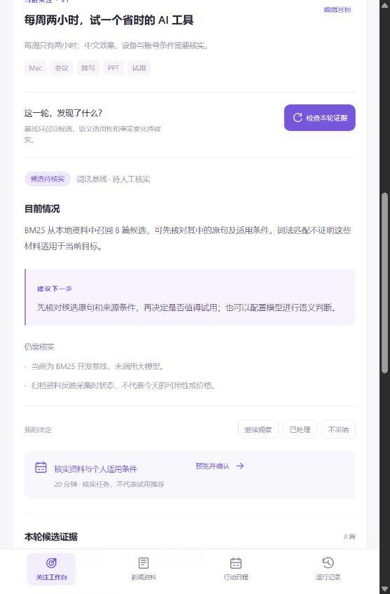
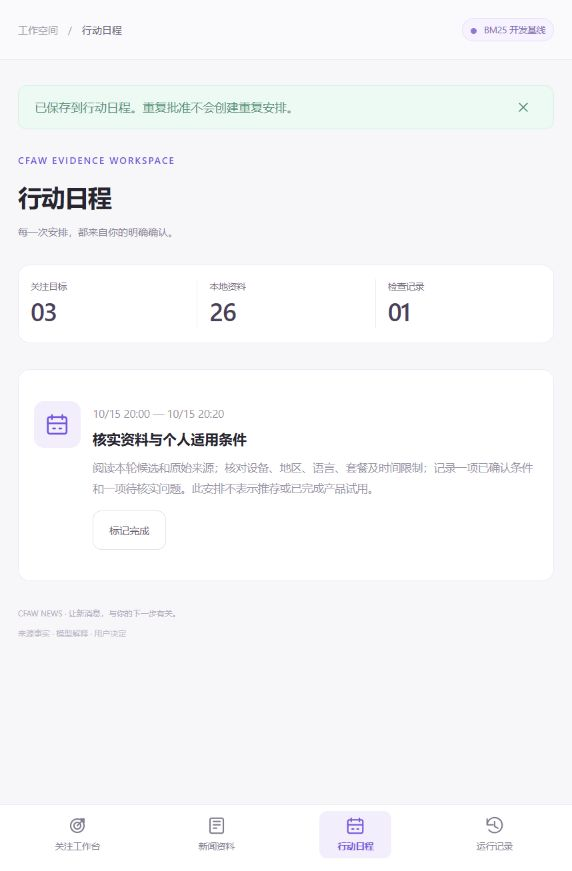

# 起步版验证记录

日期：2026-10-14。验证对象：`D:\agent_project\cfaw-news` 中的独立起步版 v0.2.0。

## 已执行

| 检查 | 结果与范围 |
| --- | --- |
| `powershell -ExecutionPolicy Bypass -File scripts/verify.ps1` | 完整入口通过；使用 Windows 自带 PowerShell 5.1 |
| Ruff | `backend/`、`tests/`、`evals/` 静态检查通过 |
| pytest | **17 passed**；本地领域/API/取消/版本/持久化/模型 mock 测试 |
| `npm run build` | TypeScript 检查与 Vite 构建通过 |
| `pip check` | `No broken requirements found` |
| `python evals/run_baseline.py` | 三组手选种子相关条目的 Recall/MRR/nDCG 管线运行成功，输出可复现 JSON |
| `scripts/start.ps1 -SkipInstall` | 新目录的独立环境实际启动 FastAPI 和 React 静态界面 |
| 浏览器操作 | 创建并确认目标、检查候选、打开引用原句、预览/批准核实安排、核对日程列表；未见浏览器控制台 error |
| 真实来源接入 | 经新项目 API 请求 MIT 公开 RSS，返回成功并解析 **20 条**；仅此来源的本次接入实测 |
| 原资产比较 | 归档、来源目录、图标、LICENSE、原 NOTICE 共 5 个文件 SHA-256 与源文件一致 |
| 平台依赖扫描 | 新业务、界面和启动脚本无旧平台调用或运行时引用 |

pytest 有一项来自上游 Starlette/TestClient 的 HTTPX 弃用提示；17 项测试全部通过。模型适配测试使用 HTTP mock，包含非法引用后的有限修复，不调用真实模型。

浏览器和联网接入使用独立的 `.local/ui-smoke.db`；交付默认工作区重新启动，初始只保留 3 个示例目标与 26 条归档，不导入测试安排或测试目标。

## 关键测试行为

- 伪造文章/段落引用被拒绝，无候选跳过模型。
- 结果固定本轮证据，来源更新不改变历史快照。
- 目标版本或证据变化阻止旧提议导入。
- 保存前没有日程，明确批准后才创建，重复批准只保存一次。
- 时间冲突和不采纳决定阻止写入。
- 取消或编辑目标后，迟到结果不能发布。
- 已完成结果重启保留；中断任务显式失败，不冒充断点恢复成功。
- SSE 事件持久化，重连游标不重复返回已读事件。

## 界面记录

以下均为独立项目的实际浏览器截图，使用测试工作区与默认 BM25 开发基线。

## 没有验证或没有实现

没有输入个人模型密钥、没有真实模型推理质量验证，也没有重新核实 26 条归档的事实和当前条件。MIT 来源接入成功不代表全部 28 个来源或网页正文都可用。

Docker/Linux 与 GitHub Actions 提供了配置，但未在本轮执行 Docker 构建、Linux 运行或远端 CI；没有推送或发布。

本版不含向量检索、训练、独立周期调度、运行中 checkpoint、账户/多租户或系统日历写入。三条种子查询的排序指标只用于开发检查，不作为独立算法成果。
