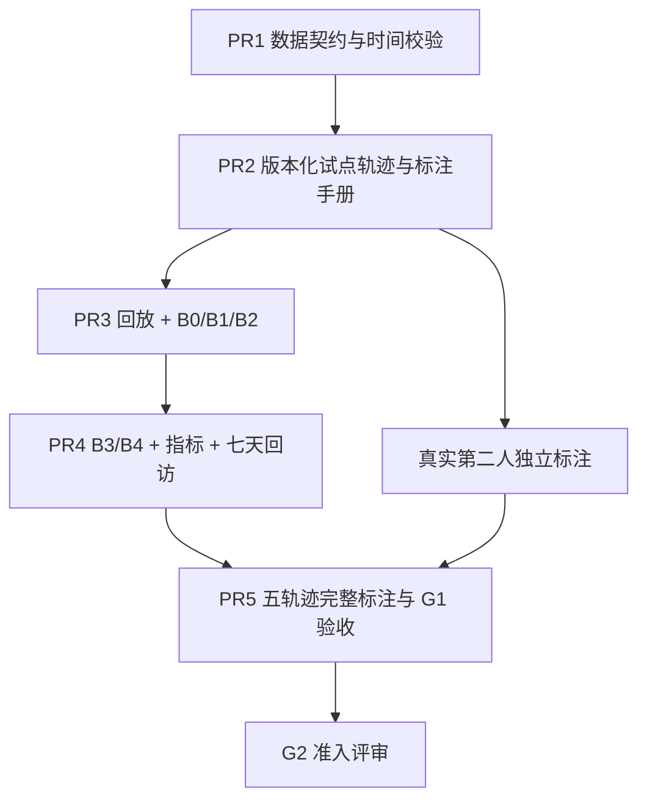

# CFAW News — G1 时序情报数据与评测基座：详细实施计划

> **文档状态**：可执行开发计划 / 尚未实施 G1  
> **文档版本**：G1-PLAN-1.0（2026-10-20）  
> **前置阶段**：G0 已由用户在本地审计完成；本文件没有重新运行源代码或 G0 检查  
> **产品基准**：项目仓库内 `docs/CFAW_News_V1.md`（其内容以用户本地冻结版本为准）  
> **G0 证据**：`audit/G0_REUSE_AUDIT.md`、`audit/G0_BASELINE.json`  
> **G0 源码基点**：`7f7f50324156b6a6ac61480a82311ba6ebd813b2`；Python 包 `cfaw-news==0.2.0`  
> **建议存放路径**：`docs/plans/G1_IMPLEMENTATION_PLAN.md`；如仓库已有同名文件，先审阅差异再合并  
> **适用执行方式**：单人开发 + 真实第二名独立标注者；本地 Windows / Python 3.12 / SQLite；离线、确定性优先

---

## 0. 执行摘要与唯一目标

**G1 的唯一目标**：建立一个严格遵守历史可见时间、可以重现每次用户回访情境的离线评测基座，用它公平比较 **B0–B4** 五组情报排序/去重/回访基线，并保证数据、标注、运行过程及结论均可追溯。

G1 **不是**新首页、在线 Agent、自动化深度研究、线上多源实时监控、生产数据库迁移，也**不以 B4 的分数必须优于 B1 为验收条件**。研究发现“没有提升”可以成立；时序泄漏、伪造双标、引用语义支持未经测试却宣称可靠，则不能成立。

### 0.1 G1 完成时必须回答的六个问题

1. 在任意回放时间 `as_of`，系统到底**可使用哪一份文档的哪一个版本**？是否能证明从未读取未来文本或未来反馈？
2. 五条具有信息演进的开发轨迹中，哪些报道是**同一事件的转载**，哪些是**独立新增证据**，哪些虽属同一项目却是**不同事件**？
3. 对某一用户画像，哪个事件是重点、哪个只值得速览、哪个无需推荐？这些标签由谁、根据什么时点的证据给出？
4. B0–B4 在**相同候选池、阅读预算和信息时间边界**下，各自呈现了什么；为什么输出稳定？
5. 用户七天未打开应用后，能否恢复重要事件与实质更正，而不把重复转载当作新发现？
6. 有哪些结论仅由开发集和合成样例支持；哪些证据仍不足以证明对真实用户有用？

### 0.2 交付清单总览（全部是未来应生成的产物，不代表已存在）

| 产物 | 建议路径 | 验收形式 |
|---|---|---|
| G1 数据字典和版本约定 | `evals/intelligence_v1/DATA_DICTIONARY.md` | 字段、ID、状态、不可变约束可逐项核查 |
| 标注手册 | `evals/intelligence_v1/ANNOTATION_GUIDE.md` | 两人独立可据此打标；有疑难例与仲裁规则 |
| 数据卡与来源登记 | `DATA_CARD.md`、`manifests/source_registry.json` | 实/合成、许可、偏差及覆盖缺口清楚 |
| JSON Schema 与运行时契约 | `schema/*.schema.json`、`contracts.py` | 错误字段、空值、重复 ID 明确拒绝 |
| 时间过滤与版本解析 | `temporal.py`、`loader.py` | T01–T05/T20 等负例通过 |
| 可回放数据 | 5 条轨迹 × 3–6 步，JSONL | 每步保存实际可见 ID 与来源 |
| 标注与仲裁记录 | `labels/annotations.jsonl`、`adjudications.jsonl`、`gold.jsonl` | 双人独立标注真实完成；否则明确未通过 |
| B0–B4 基线与运行器 | `baselines.py`、`replay.py` | 冻结输入得到确定性预测文件 |
| 评测和诊断报告 | `metrics.py`、`report.py`、`reports/` | 指标、分母、误例、限制与耗时齐全 |
| 具名测试 T01–T26 | `tests/evals/` | 对适用范围逐条提供证据；T25 可 N/A |
| 收口报告与冻结哈希 | `G1_ACCEPTANCE.md`、`dataset_manifest.json` | 可独立重放、可验证未篡改 |

### 0.3 硬性非目标

- 不扩展 Goal/Run/Decision/Schedule 原有业务语义，也不拿它们直接充当 Persona、Exposure、Event。
- 不为做 G1 先迁移生产 SQLite；T25 是**真实迁移发生时**的条件验收，本轮无迁移必须写 `N/A`。
- 不调用实时 LLM、联网爬虫、开放 Web Agent、LangGraph/Celery，不使用用户实际业务数据库做离线回放输入。
- 不把已有 912 条当前态文章当作可恢复全部历史的版本库，不把 26 条旧归档、3 组手选标签当作独立 V1 Benchmark。
- 不声称目前具有语义事实核验能力、真实用户阅读理解测量或 7×24 小时后台信息覆盖。

---

## 1. G0 结果是 G1 的输入边界

### 1.1 已有能力与复用安排

G0 实地审阅的 13 项为 **4 reuse / 7 adapt / 2 defer**，无整模块替换。以下列出 G1 真正会调用或避开的模块：

| 源码/组件（G0 已核验） | G1 策略 | 不能直接沿用的语义 |
|---|---|---|
| `backend/cfaw_news/retrieval.py` | **复用 BM25 分词与评分内核**，构造明确输入的 B1 | 当前默认 TopK、无 `as_of`、文章级结果，不能直接充当时序排序器 |
| `evals/run_baseline.py` | **原封保留为旧 seed-sanity 烟测** | 26 条归档与 3 组手选标签不属于 G1 金标 |
| `backend/cfaw_news/ingestion.py` | **参考** URL/时间/采集信息处理，G1 不发新联网任务 | Article 当前行覆盖且缺逐版本时间，不能直接提供历史真相 |
| `backend/cfaw_news/reading.py`、`article_html.py` | **参考** 正文清理/段落规则；G1 版本需固定其清洗修订号 | 当前阅读缓存每篇仅一份、可能覆盖；不得回放时重新抓取当前网页 |
| `backend/cfaw_news/providers.py` | **参考**结构化输出、引用、预算与失败处理方式 | 引用 ID 有效不意味着陈述在语义上受支持；G1 不套旧 Proposal Schema |
| `backend/cfaw_news/database.py`、`service.py` | **只读审查既有契约**，G1 离线隔离 | 现有 10 表不含文档版本/曝光；`service.py` 耦合 HTTPException |
| `frontend/src/NewsLibrary.tsx`、`ArticleReader.tsx` | G4 未来复用；G1 不修改 | 尚无 V1 情报简报、曝光回执和回访流 |
| Goal/Activity/Media | 保持历史兼容与现有回归 | 不扩大为本轮的研究或日程功能 |

**既有基准**：G0 报告记载 Ruff 通过、`pytest` **125 passed / 1 warning**、seed-sanity 通过、前端构建通过、备份恢复与隔离浏览器烟测通过；这是**用户提交的审计证据**，本计划不把它冒充本次重新执行的结果。

### 1.2 直接影响 G1 设计的实测缺口

- 912 条 Article 中 `available_at`、`doc_version_id`、`event_id` 均为 0 条非空；`Article` 和 `ArticleReading` 是当前态，不是版本历史。
- `captured_at` 与文章哈希含义不同；旧 `content_hash` 包含来源与部分元数据，不是原始文档字节的 SHA-256。
- 不同 `+08:00` / `+00:00` 时间字符串直接排序可能错序；全部比较需先解析并转 UTC 时间对象。
- G0 合成探针确认：未来 `available_at` 候选进入旧 search；段落引用合法但陈述虚假时旧验证器仍可通过。
- 来源状态 `ok` 可能只是历史记录；来源故障或停机期间只能记为**覆盖未知**，不能断言无新消息。
- 真实数据再分发许可尚未逐源核实；RSS 的 DNS 预检查和连接之间仍有 TOCTOU 风险，不能因现有采集器运行就扩充网络抓取动作。

### 1.3 G1 的冻结约定

G1 首次提交时，在 `G1_BASELINE_LOCK.md` 记录：

- 源码起点 commit；Python 版本与锁文件哈希；G0 报告及机器 JSON 哈希；数据集 schema revision；评测脚本 revision。
- 本轮工作只写新 `evals/intelligence_v1/`、`tests/evals/` 与必要文档/配置。若必须改 `retrieval.py`，优先**新增纯函数入口**，保证旧调用路径行为不变。
- 所有数据生成器默认离线、禁止读取 `.env`、禁止外连、禁止触碰 `.local/cfaw-news.db`。
- JSONL 统一 UTF-8、LF 行尾、固定字段序列化规则；运行报告和指标使用独立输出目录。

---

## 2. 工作包与依赖、准入/退出门槛



| PR | 核心价值 | 主责文件 | 阶段门禁 | 粗估有效工作日* |
|---|---|---|---|---:|
| **G1-PR1** | 契约、来源、时间与哈希的正确性 | `contracts.py`、`validate.py`、`temporal.py`、schema | T01/T02/T03/T20 拒绝未来输入的负例先过 | 3–5 |
| **G1-PR2** | 第一条可回放的历史故事及标注规范 | `versions/`、`timelines/`、`ANNOTATION_GUIDE.md` | 1 条 × 3–6 步；版本不可改写；人工试标 | 3–5 |
| **G1-PR3** | 公平的候选池、回放与基础对照 | `loader.py`、`replay.py`、`baselines.py` | B0/B1/B2 逐步产出可读、可复现的预测 | 3–5 |
| **G1-PR4** | 关键产品需求：历史曝光与回访 | `baselines.py`、`metrics.py`、`report.py` | B3/B4、事件/回访/时间成本指标和反事实测试 | 3–5 |
| **G1-PR5** | 五条轨迹、独立标注、完整验收 | `labels/`、`reports/`、`G1_ACCEPTANCE.md` | 满足 §13 硬门槛才可宣称 G1-a 通过 | 4–8 + 第二人时间 |

*估算为规划用工量，不是日历承诺或后台执行承诺。实际时间主要取决于材料来源许可、版本核验与第二名标注者是否可用。各 PR 可较小；不得为追求速度越过数据冻结与人工审阅。

### 2.1 建议 Git 策略

- G1 在一个开发分支逐 PR 审核，例如 `feat/g1-intelligence-eval`；合并到主分支时保持回归全绿。
- 每个 PR 有统一模板：问题、输入输出契约、变更文件、涉及的 Txx、运行命令、结果文件哈希、风险、回滚方法。
- **先测后实现**：至少对 T01–T03/T20、T16/T17、T22/T23 写会失败的验证用例，再提供相应防线。
- 不允许通过调整金标或回填未来证据使指标变好；若标签规范变化，提升 `annotation_version` 并明确两版本结果不可直接混比。

---

## 3. 建议目录与包依赖边界

```text
evals/
  __init__.py                        # 若仓库当前没有且需要 python -m 导入时新增
  run_baseline.py                    # G0 保留，不改旧 seed-sanity 行为
  intelligence_v1/
    __init__.py
    README.md
    G1_BASELINE_LOCK.md
    DATA_DICTIONARY.md
    DATA_CARD.md
    ANNOTATION_GUIDE.md
    G1_ACCEPTANCE.md                  # PR5 才填写运行证据
    schema/
      document_version.schema.json
      event_group.schema.json
      claim.schema.json
      persona_version.schema.json
      replay_step.schema.json
      exposure.schema.json
      coverage_window.schema.json
      gold_label.schema.json
      annotation.schema.json
      source_registry.schema.json
    manifests/
      dataset_manifest.json
      source_registry.json
      baseline_config.json              # B0–B4 固定参数与统一预算
    raw/                               # 仅允许合法分发原文；否则只元数据与必要摘录
    versions/documents.jsonl
    events/events.jsonl                # 人工参考真值；预测流程不可读取此文件
    events/event_relations.jsonl
    claims/claims.jsonl                # 来源主张真值；预测流程不得直接读取 gold
    personas/personas.jsonl
    timelines/steps.jsonl
    timelines/exposures.jsonl
    timelines/coverage_windows.jsonl
    labels/annotations.jsonl
    labels/adjudications.jsonl
    labels/gold.jsonl
    splits/families.jsonl
    fixtures/valid/                    # 明确 synthetic
    fixtures/invalid/                  # 明确期望异常码
    contracts.py
    temporal.py
    loader.py
    validate.py
    grouping.py
    baselines.py
    replay.py
    metrics.py
    report.py
    provenance.py
    hashing.py
    exceptions.py
    predictions/                      # 默认不提交大批中间输出
    reports/                          # 固定小报告可提交，完整运行放 .local

tests/evals/
  test_temporal_visibility.py
  test_document_versions.py
  test_event_grouping.py
  test_claim_provenance.py
  test_label_schema.py
  test_split_leakage.py
  test_revisit_policy.py
  test_baseline_determinism.py
  test_metrics_denominators.py
  test_data_manifest.py
  test_provenance_and_rights.py
  test_replay_end_to_end.py
```

### 3.1 分层调用约束

`validate/provenance/hashing → temporal/loader → grouping → baselines → replay/predictions → metrics/report`。

- **预测层不得导入** `labels/gold.jsonl`、`labels/annotations.jsonl`、人工 `events/events.jsonl` 的 gold 事件归并，或任何 `future_*` 字段。`family_id`、`family_scope_ids`、人工 `event_id` 等属于数据划分/评测侧元数据，必须通过专门的 `CandidateDocumentVersion` 投影从排序器输入中剔除；仅有可公开观察、且当时可见的原文标识或上游转载关系可以保留。
- 允许评测层在排名确定后读取 gold 做事件映射、计算得分；绝不回写预测文件。
- 业务旧代码导入仅限纯评分核心；不允许经 `service.py` 调用旧 Run/Approval，也不读取生产 DB。
- 可在 `oracle` 专用实验里使用人工事件组；这类运行必须在算法名、路径、JSONL 和报告中带 `oracle`，且**不能作为 B2 真实预测能力**。

---

## 4. 数据集语义、来源管理与三种时间

### 4.1 研究任务与评测单元

| 任务 | 输入（仅 as_of 可见） | 输出 | 主要衡量 |
|---|---|---|---|
| **T1 事件归并** | 文档版本、可观察到的出处/派生线索 | 预测事件组和文档归属 | pairwise P/R/F1、过合并/漏合并 |
| **T2 情报价值** | 预测事件 + 当时 persona | 事件排序/展示层级 | 事件 Recall@K、nDCG、阅读预算 |
| **T3 回访与更新** | 当时文档、历史展示/曝光、覆盖窗口 | 新事件/实质变化/重复 | 变化 F1、重复曝光、1/3/7 天回访覆盖 |
| **T4 证据支持** | 主张与可见的版本化证据片段 | 支持/反驳/仅提及/未知 | 引用定位率、语义支持率（人工验证） |
| **T5 预算补证** | 初步信息与可选的行动成本 | 补查/停止策略 | G2 以后研究；G1 只保留字段与可离线成本统计 |

一个 `ReplayStep × PersonaVersion` 是一次推荐情景（query），一个 `Event` 是主要排序与召回单位，一个 `DocumentVersion` 是证据单位，事件家族 `family_id` 是切分与置信区间抽样单位。不能把几十篇转载当成几十个独立成功案例。

### 4.2 时间定义：不得偷换

| 字段 | 含义 | 可空？ | 规则 |
|---|---|---|---|
| `published_at` | 发布者声称的发表时间 | 是 | 绝不作为无证据的系统可见时间 |
| `submitted_at` | 社区提交时间，若适用 | 是 | 与原文发表时间分开 |
| `first_seen_at` | 系统首次发现文档身份的时间 | 是（历史遗留） | 不等于每一次新正文版本可见时间 |
| `observed_at` | 本系统确实观察到该**版本内容**的时刻 | 否 | 实际采集依据或注明为合成时序 |
| `available_at` | 本轮离线回放**允许读取此版本内容**的最早时间 | 否 | G1 默认 `>= observed_at`；如外部归档有更早可证存档，应另立经过审计的导入规则，不能偷偷回填 |
| `as_of` | 本次回放时点 | 否 | `available_at <= as_of` 才可使用版本 |
| `rendered_at` | 客户端确认内容确实被展示的时间 | 是 | `included` 不是 `rendered` |
| `opened_at` | 用户打开单条情报或原文时间 | 是 | `opened` 不等于理解 |
| `ack_at` | 用户主动确认了解/处理的时间 | 是 | 必须是明确动作，不能从打开行为推断 |

**实现规范**：所有非空时间必须是含 `Z` 或数值 offset 的 RFC3339/ISO 8601 字符串；解析为带 timezone 的 `datetime`，归一到 UTC 后再比较。拒绝 naive timestamp、无效日历日、字符串直接比大小和无法证明的未来数据回填。`published_at` 可晚于/早于 `observed_at`；发现异常记录并标记，不擅自改写原事实。统一边界为 `<= as_of` 可见。

四道硬门禁：

1. **候选门禁**：`available_at <= as_of`、来源在允许范围、来源权利符合数据用途。
2. **版本门禁**：同一文档在某时刻只能使用该时刻已可见且符合版本链的版本；过去不能读取未来修订或今天重新抓取的正文。
3. **用户上下文门禁**：Persona 修改、Exposure、反馈、上一份简报必须在 `as_of` 前可见；不把一次展示等同用户已读。
4. **预测与生成门禁**：预测输入不能包含未来的 gold、未来事件状态、事后更新摘要、当前网页缓存或尚未可见的人工备注；任何 LLM prompt 如未来引入，同样必须由过滤后材料构造。

### 4.3 来源与许可登记（真实材料入集前先完成）

每个来源登记 `source_id, domain, source_type, publisher_or_upstream, independence_relation, allowed_use, redistribution_rights, license_url_or_note, observed_scope, checked_at, restrictions, provenance_uri`。

- `source_type` 建议：`official | paper | repository | independent_test | media | community | other`。
- `record_origin` 必须严格区分 `real` 和 `synthetic`；不得把合成事件伪装为真实历史新闻。
- 许可未知时：尽量仅保留 URL、哈希、来源信息及允许的必要摘录；若评测无法合法保存足量原文，则**选择合成 fixture**，而不是暗中缓存不可再分发的全文。
- GitHub README、论文、站点公开可读不自动等于允许打包再发布全文；每条保留许可依据和使用边界。
- 两个不同域名引用同一上游新闻稿，证据独立性不能直接计为 2。
- 来源失联/抓取失败/应用停机记录为 `CoverageWindow.status=gap_or_unknown`；对无覆盖时间不宣称“没有发生更新”。

---
## 5. 数据契约：字段、身份、引用与不变量

> 这是 **G1-PR1 要实现的设计契约**，不是当前仓库已存在的 ORM/Schema。以下字段分为“必须”“可空”和“派生”；JSON Schema 应拒绝未知关键字段、非法枚举及越界数据。具体 Python 类型可用项目已安装的 Pydantic 2，依赖必须记入既有锁定流程。

### 5.1 统一 ID、版本与哈希规则

- `document_id`：稳定文档身份，跨版本不变；建议使用规范化上游身份/URL 的 namespace + SHA-256。不要直接继承 `Article.id` 的业务含义。
- `doc_version_id`：稳定版本身份，建议由 `document_id + 内容规范化字节 SHA-256 + 版本采集身份` 派生；**同内容多次抓取视为重复观察，不制造新版本**，只记录可审计 observation（若后续建 observation 表）。
- `content_sha256`：对 G1 保存并供模型实际使用的**规范化可见文本字节**计算 SHA-256（UTF-8，明确换行及正规化规则）；若额外有 raw 原始字节，另设 `raw_sha256`，不可与旧 `Article.content_hash` 混称。
- `paragraph_id`：版本内稳定定位符，如 `p1/p2`；其定位正文在版本冻结后不可改变，标题和摘要不自动充当引文证据。
- `event_id`：具体一次发布、能力变更、安全问题、验证或更正的事件身份；**与 `family_id` 不等价**。
- `family_id`：同一技术/项目及其相关变化组成的**评测侧**切分家族，连同转载、派生 persona、合成反事实全部在同一 split；不得直接供 B0–B4 聚类。
- `claim_id`：可独立检验的一个最小主张；同一声明的事实版本可以被后续证据支持/反驳，但不能悄悄改写旧 claim 文本。
- `persona_version_id`：用户背景的历史版本；`persona_id` 不变、版本随时间追加。
- `delivery_id`：一次简报生成身份；`exposure_id`：一条用户可观察的展示/打开/确认信号身份。
- 采用一份 `hashing.py` 明确编码与规范化过程；每次数据修订重新计算内容哈希和清单，不允许只改 manifest 让脏数据过关。

### 5.2 DocumentVersion（文档版本）

| 字段 | 类型 | 必填 | 不变量 / 备注 |
|---|---|---|---|
| `doc_version_id` | string | 是 | 全集唯一；一经冻结不可覆盖 |
| `document_id` | string | 是 | 对同一原始文档稳定 |
| `canonical_url` | HTTPS URL / null | 条件必填 | 真实来源一般必填；合成可用 `synthetic://` 专用标识且不被当网络链接 |
| `source_id` / `source_type` | string / enum | 是 | 在 source_registry 中存在；区分来源性质 |
| `content_kind` | enum | 是 | `publisher_text / feed_summary / archive_authored / quoted_excerpt / synthetic_text` |
| `record_origin` | `real/synthetic` | 是 | 真实文档有可审查出处；合成有生成/设计说明 |
| `provenance_uri` | string / null | 条件必填 | 真实材料可审查出处；合成 fixture 指向本地设计说明 |
| `redistribution_rights` | enum | 是 | `permitted / excerpt_only / metadata_only / unknown / synthetic` |
| `title`, `language` | string | 是 | 不为空；语言如 `zh/en` |
| `text_excerpt` | string | 依许可 | 不超过规范中限制；若元数据模式则可空但不可伪装成全文 |
| `paragraphs` | array | 当有文本时 | 每项 `{paragraph_id, text}`，段落 ID 唯一；引用只能指向存在段落 |
| `content_sha256` | hex string | 有文本时 | 对该版本所保存文本的规范化内容计算 |
| `cleaner_revision` | string / null | 是 | 记录正文处理规则或 `none` |
| `published_at`, `submitted_at`, `first_seen_at` | UTC timestamp / null | 否 | 缺失不能伪造；保留各自语义 |
| `published_time_confidence` | enum | 是 | `verified / source_reported / inferred / unknown` |
| `observed_at`, `available_at` | UTC timestamp | 是 | 必须有可信来源；G1 规范 `available_at >= observed_at` |
| `supersedes_version_id` | string / null | 是 | 同一 `document_id` 的先前版本；链必须无环 |
| `family_id` | string | 是 | 分组与切分；预测引擎不能把它作为相关性真值输入 |
| `upstream_document_id` | string / null | 否 | 转载/镜像来源关系；必须有客观可见依据 |

**版本选择规则（重要）**：`as_of=t` 时，对每个 `document_id` 只返回在 `t` 前可见的最新可用版本（以 `available_at` + 明确版本关系排序；同时间冲突必须校验或有确定的冲突解决规则）；如果新版本尚不可见，返回旧版本。相关转载作为不同文档身份保留在候选中，供事件聚合去重。

**同 hash 与内容缺失**：同 `document_id` 同 `content_sha256` 的再次观察不可视为新技术变化；元数据-only 记录可参与“发现来源存在”的研究任务，但不可给出超出其可见摘要的事实断言。

### 5.3 EventGroup 与 EventRelation（事件及关系）

`EventGroup` 必需：`event_id, family_id, canonical_subject, event_type, first_observed_at, document_version_ids, related_event_ids, status, identity_note`。

推荐 `event_type`：`release | capability | benchmark | safety | correction | research | tool | other`；`status`：`open | updated | corrected | withdrawn | archived`。**G1 的这一文件是人工参考事件归属（gold/reference）；不要把 `document_version_ids` 与 `event_id` 原样传进 B0–B4 预测。**

`EventRelation` 记录成对关系：`left_doc_version_id, right_doc_version_id, relation, rationale, evidence_at`，其中 `relation`：

- `exact_duplicate`：相同内容和身份的重复版本；
- `syndicated`：不同媒体转载同一上游内容；
- `same_event_different_evidence`：一件事的新增独立测试、更正或补充来源；
- `related_distinct_event`：同项目但不同独立事件，**禁止过度合并**；
- `unrelated`：无明显事件关系；
- `uncertain`：证据不够，不强迫归类。

`evidence_at` 必须不晚于判断允许使用它的回放时点；如果某种关系仅是标注者事后根据全轨迹作出的 gold 认定，必须作为 gold 保存，**不能输入预测层**。

### 5.4 Claim（可核查的主张）

`Claim` 必需：`claim_id, event_id, claim_text, claim_type, asserted_by, evidence_refs, verification_state, valid_as_of, scope, limitations`。

- `claim_type`：`release_fact | capability_claim | measured_result | constraint | risk | other`。
- `evidence_refs` 每项：`doc_version_id, paragraph_id?, direction`；`direction`：`supports | refutes | mentions | unknown`。
- `verification_state`：`source_attributed | independently_supported | disputed | unverified | retracted`。
- `scope` 保存测试环境、数据集、版本与适用条件；缺少适用范围的宣称不能自动升级为普遍规律。
- 仅有官方说法的指标改进应标记“官方声称”；即使段落真的写了“提升 50%”，也不能据此直接标为独立证实。
- Claim 关系和验证状态可按时间形成多个**状态快照**；不能让 D6 才有的纠正状态在 D0 回放时出现。实现可用 `valid_as_of` 的历史版本或时间限定的 evidence association，但同样受四道门禁。
- **G1 不做在线自动事实裁判**：标注证据方向用于评测；引用定位是程序硬校验，语义支持是独立人工测量。

### 5.5 PersonaVersion（用户画像历史）

`PersonaVersion` 必需：`persona_id, persona_version_id, available_at, persona_origin, domain_interests, current_goals, hard_constraints, knowledge_known, attention_budget_seconds, exploration_preference, locale`。

- `persona_origin`：`constructed | consented_real`；默认使用合成用户设定，不提交真实敏感偏好数据。
- 知识状态写成**明确提供的条目**，不能根据曝光自动推断“已掌握”。
- persona 的“当前目标/约束”可以改变推荐价值，不能因此改变有关项目是否发布、实验是否存在等客观事实。
- 一个 `persona_id` 可以有多个时间化版本，过去回放必须选择 `available_at <= as_of` 的最新版本。

### 5.6 ReplayStep（回放步骤）

必需：`timeline_id, step_id, family_scope_ids, as_of, persona_version_id, previous_delivery_id, attention_budget_seconds, time_window_start, time_window_end, visible_doc_version_ids, coverage_window_ids, split`。

- `visible_doc_version_ids` 由 loader **计算后落盘冻结**，不是作者凭直觉在标签中手填的预测候选。允许把人工期望列表另存 `expected_visible_ids` 供测试比对。
- 时间窗口可以是 `[上次主动打开时间, as_of]`，但业务不能从“上次打开”推断简报每条都被用户真正看过。
- `family_scope_ids` 与 `split` 仅用于构造开发/评测情境及检测泄漏；生成排序器输入时一律剔除，不得用它们推断预测事件身份。`split` 是轨迹家族的固有属性；同一 family 派生的 replay step 不跨 split。
- `previous_delivery_id` 所引用 Delivery 的 `generated_at` 必须 `<= as_of`；所有曝光事件亦然。

### 5.7 Delivery / Exposure（仅 G1 合成模拟，G3 才连业务）

建议把“计划展示”和“真正曝光”分成状态事件：

| 状态 | 触发依据 | 是否等于已读？ | 能否用于 B4？ |
|---|---|---|---|
| `included` | 服务器把 event 排入简报 | 否 | 仅作“之前曾推荐”的弱信号 |
| `rendered` | 客户端确认视口渲染 | 否 | 可按“用户可能看过”折扣，但不等于理解 |
| `opened` | 用户明确打开单条内容 | 否 | 较强的交互信号，仍不能断言理解 |
| `acknowledged` | 用户明确标记已了解/处理 | 用户表示已了解，不等于客观掌握 | 可较强降权无新变化内容 |
| `dismissed` | 用户明确不感兴趣 | 否 | 可降低同类无增量推荐，但不能压掉重大更正 |

建议每条为 append-only 事件 `{exposure_id, delivery_id, event_prediction_id?, reference_event_id_for_fixture?, kind, occurred_at, source}`。**生产系统没有 reference/gold event ID；测试 fixture 可以带人工参考但预测层只读其允许的用户历史字段。**

### 5.8 CoverageWindow（来源覆盖区间）

`source_id, start_at, end_at, status, observed_at, reason`；`status`：`covered | partial | failed | unknown | service_offline`。

`covered` 仅表示对应源在该区间的采集/记录达到已定义覆盖要求，不代表全网无遗漏；失败区间应该在结果中呈现 `coverage_gap_count`、对应来源和持续时间。回访结果不能把 `service_offline` 的七天称为“已持续监控七天”。

### 5.9 GoldLabel、Annotation、Adjudication

**GoldLabel 主键**为 `(timeline_id, step_id, persona_version_id, event_id, annotation_version)`，必需：

`relevance`、`potential_value`、`novelty_to_persona`、`evidence_quality`（各 0–3）；`material_change`（`new | meaningful_update | no_change | correction | withdrawal | insufficient`）；`tier`（`focus | radar | archive | hold`）；`graded_relevance`（0–3，**单独定义与冻结，不由模型任意生成**）；`supporting_doc_version_ids`、`rationale`、`uncertainty`、`adjudication_status`。

`Annotation` 额外含匿名 `annotator_id`、`submitted_at`、初始原始标签、证据引用、审阅规范版本；`Adjudication` 包含 `prior_labels`、`final_label`、`reason`、`adjudicator_id`、`adjudicated_at`。两个标注者要先独立提交、再交流分歧。仲裁员不能根据某个算法推荐结果“修改到更合理”。

### 5.10 Manifest 与不可变发布

推荐 `dataset_manifest.json` 记录：

- `dataset_id`, `dataset_revision`, `schema_revision`, `annotation_version`, `created_at`, `frozen_at`, `record_origin_breakdown`；
- `file_hashes`：每个受控数据/标签/脚本配置的相对路径、SHA-256、记录数；
- `source_registry_sha256`, `persona_revision`, `split_policy`, `family_split_counts`, `baseline_config_sha256`；
- `legal_notes`, `limitations`, `status`（`draft | frozen | superseded`）。

**避免自哈希循环**：Manifest 只列出其他输入文件的哈希，不把自己列在自己的 `file_hashes` 中；运行器另外记录 Manifest 文件本身 SHA-256。冻结后修改任何 gold、JSONL、split 或配置，旧运行必须因哈希不匹配失败；确需修订时创建**新 revision**，保存前后差异与原因。

### 5.11 最小 JSONL 样例（全为虚构 fixture）

以下为结构说明，不是已经生成的合格样本；其中 `content_sha256` 必须由生成器基于实际 `paragraphs` 文本计算后填入，**不得直接复制占位字符串参与验证**。

```json
{"doc_version_id":"syn:agent-x:v1","document_id":"syn:agent-x","canonical_url":"synthetic://fixture/agent-x","source_id":"fixture_official","source_type":"official","content_kind":"synthetic_text","record_origin":"synthetic","provenance_uri":"fixtures/valid/agent_x/README.md","redistribution_rights":"synthetic","title":"Agent X 发布（合成）","language":"zh","paragraphs":[{"paragraph_id":"p1","text":"项目作者宣布公开 Agent X 的第一版代码。"}],"text_excerpt":"项目作者宣布公开 Agent X 的第一版代码。","content_sha256":"<generate_at_build>","cleaner_revision":"none","published_at":"2026-01-01T00:00:00Z","published_time_confidence":"source_reported","observed_at":"2026-01-02T00:00:00Z","available_at":"2026-01-02T00:00:00Z","supersedes_version_id":null,"family_id":"family:agent-x","upstream_document_id":null}
```

```json
{"persona_id":"persona:ai-developer","persona_version_id":"persona:ai-developer:v1","available_at":"2026-01-01T00:00:00Z","persona_origin":"constructed","domain_interests":["AI Agent","RAG"],"current_goals":["跟踪有价值的 Agent 工具"],"hard_constraints":["每次阅读预算 420 秒"],"knowledge_known":[],"attention_budget_seconds":420,"exploration_preference":"broad_but_ranked","locale":"zh-CN"}
```

```json
{"timeline_id":"DEV-01","step_id":"D2","family_scope_ids":["family:agent-x"],"as_of":"2026-01-03T00:00:00Z","persona_version_id":"persona:ai-developer:v1","previous_delivery_id":null,"attention_budget_seconds":420,"time_window_start":"2026-01-01T00:00:00Z","time_window_end":"2026-01-03T00:00:00Z","visible_doc_version_ids":["syn:agent-x:v1"],"coverage_window_ids":[],"split":"dev"}
```

样例的 `visible_doc_version_ids` 只为帮助理解接口；最终版本必须由 loader 自动产生、与本行匹配并通过冻结检查。

---
## 6. 数据建设：5 条开发轨迹的逐步设计

### 6.1 G1-a / G1-b / G1-c 的规模与用途

| 层次 | 建议规模 | 本阶段位置 | 研究结论允许达到的程度 |
|---|---|---|---|
| **G1-a 契约开发** | 5 个事件家族主轨迹，每条 3–6 步，总 15–30 个回放时点；建议 30–60 个文档版本 | **G1 硬门槛** | 证明契约、数据流程、回放和基线能运转；不证明泛化 |
| **G1-b 算法开发** | 后续扩至 20–30 条轨迹、尽量 100–200 个时点，按样本质量决定 | G1 之后持续扩展/G2–G3 | 只做方法开发、敏感性分析和调参，不能冒充独立最终测试 |
| **G1-c 独立留出** | 后续建议至少 20 个不同事件家族的独立轨迹，规模按代表性和资源调整 | G5 冻结评估 | 作为最终泛化结果的候选证据；收集和标注流程必须与开发数据隔离 |

注意：**5 条轨迹不是 5 个独立验证用户，也不是 30 次独立实验**。同一 family 的时点、persona 变体、转载和反事实都强相关。最终报告至少按 family 列分数，不用大量派生 step 夸大统计显著性。

### 6.2 试点顺序

- **PR2 先做 DEV-01**，包含最少 4 个时点，验证 `DocumentVersion → time gate → event relations → persona → gold → replay` 全链路。
- 审阅 DEV-01 的标注争议和协议缺口后，才复制数据制作模板到另外四条轨迹；避免先填完 5 条再发现契约错误。
- 真实资料如果缺乏可信历史版本，允许先使用**明确标注的合成材料**完成契约和防泄漏测试，再在 G1-b 中逐步增加权利清楚、时间证据充分的真实材料。
- 每条轨迹至少包含：一个 `no_change` 时点；一个“纯时间排序容易漏掉的旧但重要变化”；一个误合并或漏合并挑战；可用 `focus/radar/archive/hold` 不同层级。

### 6.3 轨迹工作单

| 轨迹 | 设计主题 | 关键时序材料 | 必验算法行为 | 配套错误样例 |
|---|---|---|---|---|
| **DEV-01** | 技术项目发布→转载→独立验证 | D0 官方发布；D1–D3 多处转载；D4 第三方限定范围测试；D5 官方补充 | 转载不多次占位；独立新证据产生增量；早期不冒称独立验证 | 将两家转载错误当作双份证实 |
| **DEV-02** | 框架新版本兼容性更正 | D0 官方 release；D1 社区讨论；D2 官方更正；D3 后续新证据 | 更正可以升权，且引用旧/新文档版本，不能把更正前事实改掉 | 使用最新文档反向污染 D0 回放 |
| **DEV-03** | 热度高但证据稀薄 | D0 新工具介绍；D1 热门转载；D2 营销宣称；D3 有限条件实践；D4 无增量 | 速览并保留不确定性；热度不自动等于高可信高价值 | 无测试条件却声称普遍改进 |
| **DEV-04** | 已介绍旧技术发生安全/限制变化 | D0 曾推荐；D1–D5 无变化；D6 重要安全提示；D8 用户回访 | 旧事件新风险仍可进入重点；时间衰减不埋没安全更正 | “上次展示过”导致永久压掉更新 |
| **DEV-05** | 跨领域弱相关信息产生启发 | D0 非 Agent 领域的新方法；D1 含有与 persona 目标潜在联系；D2 更多讨论；D3 有限验证 | 不被兴趣关键词完全过滤；允许用速览保留探索性机会 | 过强个性化形成信息茧房 |

这些均是**构造计划，不是真实事件事实**。不要将合成 Agent X、虚构 benchmark 或伪造 GitHub URL 混入真实来源统计。

### 6.4 固定七天回访剧本（建议作为 `fixtures/valid/revisit_7d/`）

| 回放日 | 事件与证据 | 用户历史 | 预期信息处理 |
|---|---|---|---|
| D0 | X 作为早期项目发布；只有官方声明 | 生成一份包含 X 的简报（`included`） | X 可进入速览，明确“早期/待核实” |
| D1–D3 | 三篇来自同一上游公告的转载 | 用户没有打开 X | 不制造三个新事件，不算三份独立证据 |
| D4 | 独立开发者在限定环境中测试 X | 无 `ack` | 新证据可以改变信心/展示层级；限定条件不可丢失 |
| D5 | 应用服务停机或一来源失败（单独反事实分支） | 无客户端访问 | 记录 coverage gap，不宣称该来源没变化 |
| D6 | 官方更正 X 的平台/兼容性限制 | 原 D0 版本仍须可读 | 标记 `correction`，解释“此前 vs 现在” |
| D7 | 出现同领域不同解决方案 Y | 仍未打开应用 | Y 作为独立新事件，不与 X 过合并 |
| D8 | 用户主动打开 CFAW News | 仅 D0 `included`，`rendered/opened/ack` 可能全部为空 | 一份简报：X 的 D4/D6 重要增量 + Y；按重要性和时间加权，不按最近 24h 强截断 |

**固定反事实**：

1. 删除 D6，更正标签与推荐原因均不能凭空出现；
2. 改变 Persona 为“不关心部署，关注学术可靠性”，对事实归纳不变、排序/价值可以变；
3. 把 D4 `available_at` 改为 D9，D8 **绝不能**使用 D4 证据；
4. 把 D0 从 `included` 改成 `rendered` / `opened` / `ack`，逐次考察降权差异，不把其中任何状态解释为“已经掌握”；
5. 在 D4 与 D8 之间插入源站采集失败窗口，报告应标为覆盖有限，而非“期间没有其他新信息”。

---

## 7. 标注规范与独立人工流程

### 7.1 标注岗位和信息屏蔽

- **Annotator A**：开发者本人，可标注但需承认可能了解构造目的；
- **Annotator B**：真实的第二名独立审阅者，先在不看 A 的标注和模型预测的情况下完成同一份任务；
- **Adjudicator**：可由 A/B 讨论形成一致裁定，但需记录分歧、证据和最终理由。若第三人可用更好，不是 G1 强制条件。
- 在第二人未参与前，样例状态仅可标为 `single_annotator_development`；**不能使用 AI 生成多份结果伪称独立双标**，也不能将 G1-a 标为已满足双标硬门槛。
- 标注者只看某个 `as_of` 前可见的资料和在该时间已知的 Persona；应通过分时点打包或工具强制隔离，防止从未来结果回顾性评分。

### 7.2 人工工作流（每条轨迹）

1. **来源预检**：校验每份文档内容是否可见、时间可证、许可是否可用于所选数据集；问题登记为 `exclude/metadata_only/synthetic`。
2. **文档关系**：对同源/跨源报道标记 duplicate、syndicated、same-event-different-evidence、related-distinct 等；记录上游传播链的已知部分。
3. **主张抽取**：每条最小 claim 只表达一件能核查的事；指定所用段落，判定是报道作者的声称还是有独立测试支持。
4. **Persona × Step × Event 评分**：独立填写四维 0–3、变化类型、层级、graded relevance、理由与不确定性。
5. **独立冻结初标**：保存 A/B 原始记录及哈希，不在讨论阶段覆盖原始结果。
6. **一致性分析**：先输出总体及各类别混淆矩阵、原始一致率、κ，列出争议案例。
7. **仲裁**：根据预定义规范和当时可用证据裁决；仍无法裁决时保留 `uncertain` 或 `insufficient`，不能强行求一个确定结论。
8. **冻结金标**：输出版本化 `gold.jsonl`、manifest，记录每次变更的原因与时间。

### 7.3 四维量表（每项 0–3）

| 标签 | 0 | 1 | 2 | 3 |
|---|---|---|---|---|
| `relevance` | 对 persona 无关系 | 弱相关 | 明显关联兴趣 | 直接关联目标/关键约束 |
| `potential_value` | 无明确价值 | 有趣但用途不明 | 有合理现实或研究潜力 | 可能明显改善工作/研究决策 |
| `novelty_to_persona` | 已知且无增量 | 轻微补充 | 新事实或明确更新 | 新能力、关键约束或重大纠正 |
| `evidence_quality` | 无法追溯来源 | 只有单方声称 | 官方原始材料或有限独立验证 | 多份实质独立的直接证据且适用范围明确 |

**提醒**：`evidence_quality=3` 是对**具体主张**的证据充分程度的评估，而不是给整家媒体永久授予“权威”。来源不同 ≠ 数据独立；技术热门 ≠ 技术成熟。

### 7.4 事件变化和层级判定

| `material_change` | 判定准则 | 反例 |
|---|---|---|
| `new` | 对该时点首次可见的新事件 | 原发布稿新增一个转载 |
| `meaningful_update` | 独立验证、重要能力/限制变化足以影响认知 | 热度变化、纯措辞改写 |
| `no_change` | 无实质新事实 | 新证据修订重要条件，却因事件 ID 相同而判无变化 |
| `correction` | 可核查的更正，改变之前某个事实或主张状态 | 自媒体评论、未证实传闻 |
| `withdrawal` | 来源明确撤回产品、功能或声明 | 系统没搜到网页，就推断已撤回 |
| `insufficient` | 当前资料无法断言有无变化 | 等同“没有变化” |

`focus`：确实重要，且依据充分可核实；重要风险/更正可以突出，但不夸大结论确定性。  
`radar`：已确认项目/论文存在，可能有价值，尚需进一步验证。  
`archive`：普通信息、无增量转载、低价值但可检索。  
`hold`：来源不能核实、资料错误严重、版权限制无法合法展示，或信息条件不足以安全推荐。

`graded_relevance` 单独标注为 **0=无推荐价值、1=弱/备查、2=明显值得了解、3=高优先级**。它是 nDCG 的**固定金标**，不能通过更改公式在测试后提升算法分数。`tier` 可用于展示策略，`graded_relevance` 用于排序评测，两者不应无理由矛盾；违反一致性条件时触发人工复查。

### 7.5 判定边界与常见争议

| 争议 | 裁定原则 |
|---|---|
| 项目首次出现但只有官网声明 | 可以 `radar`，其能力主张仍为 `source_attributed/unverified` |
| 官方更新了性能表，却没有第三方重复实验 | 仍不是独立验证；可作为新声明，但不必判有实质能力提高 |
| 同一项目发布两个版本 | 若是两次独立公告，可为不同 `event_id`；同 `family_id` |
| 独立研究者引用了官方 Benchmark | 若未自行重复测量，不自动计独立验证 |
| 已在简报出现但用户未点开 | 标 `included/rendered` 的实际事实，不推断 `knowledge_known` |
| 用户修改工作方向 | 可改变相同事件的推荐价值，但事实不变 |
| 源站 503 / 软件关闭 | 标 CoverageGap；对未观察到的世界不下“无变化”结论 |
| 未来资料解释过去 | 只能作为 gold 裁定时记录“事后已知”，不得污染该时点应给的推荐标准 |

### 7.6 一致性指标与处理门槛

- 成对事件关系：原始一致率 + positive pair precision/recall/F1（按标注者互为参考、报告分歧），避免仅看多数负样本带来的高一致率。
- 0–3 有序维度：**quadratic weighted Cohen's κ**，同时列样本数、分布、原始一致率和混淆矩阵。
- `tier` / `material_change`：Cohen's κ 或适当的 Krippendorff α，并提供每类混淆矩阵；极不平衡标签单看 κ 容易失真。
- 建议把 **κ≥0.70** 作为初始可观察目标（并非统计真理）；若某类低于 0.70，先修手册、补边界案例并**在新版本重标**，不通过删除争议样本凑数。
- 置信区间以 family 为抽样单位；当 family 只有 5 个时展示区间但明确“不稳定，不能作泛化推断”。
- 标注实际由两人完成、争议与仲裁留痕，是 G1-a 的**硬条件**。如果资源不满足，可在 `G1_ACCEPTANCE.md` 记为“技术验收通过 / 人工标注门槛未通过”，不得标 G1 全面完成。

---

## 8. B0–B4：完整基线规范与公平对比

### 8.1 共同输入与输出契约

每个 `ReplayStep`：

```text
Input:
  as_of: 已规范化 UTC 的回放时间
  persona: 该时刻实际可见的 persona 版本
  candidates: 严格时间过滤后、每文档仅一条当时有效版本
  exposure_history: as_of 前显式可见的投递/浏览历史
  source_coverage: 已知来源覆盖窗口
  budget: max_focus=3, max_radar=12, max_read_seconds=420（实验配置）

Output:
  ranked_items: [{prediction_event_id?, doc_version_ids, score, rank,
                  predicted_change_type?, proposed_tier?, estimated_read_seconds}]
  diagnostics: candidate_doc_count, predicted_event_count, used_signals,
               available_source_count, coverage_gaps, execution_ms, model_tokens
```

**相同候选池**：B0–B4 在同一个时点只能接受同一份 `candidate_doc_version_ids` 和 persona/历史。不要让 B1 默认的 Top8 截断限制 B2/B3/B4 的输入候选；召回 top K 应在**最终排序后**统一截取。

**公平单位**：B0/B1 可输出文章级条目，B2 起输出预测事件组。评分时由**仅评测器**使用文档→gold 事件映射计算事件级 Recall；这张 gold 映射绝不能提前提供给 ranker。重复文章展示应作为 B0/B1 的实际缺点报告，不能在评分前偷偷用 gold 去重。

### 8.2 B0 — 按可见时间倒序

- 使用在 `as_of` 前已知的文档 `available_at` 或明确的事件可见更新时间；不使用网页自报 `published_at` 来决定过去可用性。
- 排序键：`(-available_at, doc_version_id)`（时间相同按 ID 升序）；同一文档返回当前时刻可见的最新版本。
- 不使用 persona relevance，不使用 gold，不使用 LLM，不自动合并跨站转载。
- 预期观察：最新新闻可见，旧的重要更正可能被大量普通更新埋没。

### 8.3 B1 — 当前 BM25 的词法相关性基线

- 明确把 `PersonaVersion` 转换成固定、无模型随机性的查询文本：`domain_interests + current_goals + hard_constraints`；记录 query 字面值和 tokenizer revision。
- 复用 `backend/cfaw_news/retrieval.py` 的 BM25 核心，但包装成**显式候选列表输入**的评分器。若旧实现只输出正分 TopK，应新增安全适配器取得全候选分数；未命中者设置可解释的最低分，再用稳定 ID 破同分。
- 不导入 `service.py`，不访问 Article 当前数据库，不使用固定 Top8 作为所有算法的共享初筛。
- 候选全为 `loader.visible_versions(as_of)` 提供。查询、候选、评分配置保存到运行元数据。
- 与旧 `seed-sanity-v1` 的数值并非同一评测，不应强行要求分数相同。

### 8.4 B2 — BM25 + 预测事件去重

**B2-predicted（正式基线）**：

- 先用可观察特征合并**完全一致 URL+相同内容**；可加入确定性的同上游标识或高相似文本规则，但阈值写入 config 并在训练/开发集固定。
- 对“同项目不同事件”保守处理：项目名称相同不自动并为一个事件；证据不足时宁可留下两条，也不能隐瞒重要更正。
- 事件代表条目可以选择 B1 得分最高的证据或组合分数，如 `max(doc BM25)`；但合并规则和计算方式必须冻结。
- 输出包含 `predicted_event_id`、组成文档、代表来源、合并理由及是否证据独立。`predicted_event_id` 从可见文档和聚类结果确定性派生，不从 gold 拷贝。

**B2-oracle（仅诊断上界）**：使用人工 gold 事件组，名称必须写 `B2-oracle`，**单独报告、不得与 B2-predicted 混为可部署方法**。如果 oracle 明显优于预测版，说明事件聚合本身可能是瓶颈。

### 8.5 B3 — B2 + 简单时间加权

设计意图：不能只推荐今天的普通小新闻而漏掉六天前仍重要的更新；但简单 recency 不是“实质变化理解”。

初版可用透明的开发集预注册公式（示例，须在首轮实验之前锁定）：

```text
bm25_norm       = 归一化后的 B2 事件代表 BM25 分值（0..1）
age_days        = max(0, (as_of - latest_visible_material_at).total_seconds()/86400)
recency         = exp(-ln(2) * age_days / half_life_days)
base_score      = 0.75 * bm25_norm + 0.25 * recency
```

- `half_life_days` 初始设为 **7**，同时在**开发集**做 3/7/14 天敏感性报告；正式报告注明配置选择过程，不用最终留出集调参。
- `latest_visible_material_at` 在 G1-predicted 中只能从可见版本及**可观察的新内容规则**计算，不得用金标 `meaningful_update` 的时间。若无法可靠判定“实质”，使用最新有效版本可见时间并承认可能把标题重写视作新鲜。
- 对同一事件多个文档/多个观察时间，必须确定“哪个观测表示最新证据”，保留分组理由；不能从 future claim 取 latest timestamp。
- 记录 B3 相比 B2 的回访覆盖和旧重要事件漏报，不能因为预设其合理就宣称有效。

### 8.6 B4 — B3 + 显式曝光与增量规则

建议先用完全确定的、**基于可见数据**的规则，不训练模型：

```text
last_exposure  = 在 as_of 前，查找该预测事件已确实记录的最新状态
has_new_text   = 本轮可见证据的内容版本集合相较上次相关 delivery 是否变化
was_included   = 上轮 delivery 包含该事件（弱信号）
was_rendered   = 客户端明确报告曾展示（中等信号）
was_acked      = 用户明确标记已了解（强信号）

penalty = 0
if was_included and not has_new_text: penalty += 0.10
if was_rendered and not has_new_text: penalty += 0.10
if was_acked and not has_new_text: penalty += 0.25
if has_new_text: penalty = 0  # 有新文本时不按旧曝光压制；不等于已认定实质更新
score_B4 = score_B3 - penalty
```

此处系数是**预注册的试验起点**，不是性能最优或真实用户行为定律。`has_new_text` 只是无监督增量代理特征，不能直接当 `meaningful_update`。未来 G3 应区分轻微文字变化、可靠独立证据、新风险和纠正，再决定是否升权。

**重要安全行为**：如果新证据被规则识别为可观察的纠正/风险信号（例如明确的新版本字段），可以另设保守 `material_change_candidate` 标识以避免曝光惩罚；但 gold 的 `correction` 标签只在评测使用。不得写死“DEV-04 自动提升”。

### 8.7 阅读预算与分层策略

初始实验锁定：`max_focus=3`、`max_radar=12`、`max_estimated_read_seconds=420`，另报 180/900 秒。不是永久产品配额。

- 同一**预测事件**在同一简报最多一个主展示位，相关证据可在详情下列出。
- G1 首先评测**排名**；`focus/radar` 分层建议使用固定阈值或排名位置规则，基线不得读取 gold tier。比如首 3 个候选 focus，其余预算内 radar；这只是展示实验策略，不说明基线具备“信息价值理解”。
- 预计阅读时间建议先用固定、可复现的代理值：`focus=90秒`，`radar=12秒`；真实用户阅读时间需 G4 测量，不得称已经节约了多少实际时间。
- 超预算截断必须统一执行；模型或算法不可以通过多塞速览内容让 Recall 虚高。
- 若没有合格事件，合法输出空简报并说明缺口，不虚构条目填满配额。

### 8.8 公平比较报告格式

每个实验至少报告：

1. `algorithm_id` 与明确区分 `predicted/oracle`；
2. 数据集/标签/配置的 SHA、Git SHA、Python/依赖版本、seed；
3. 每步同一候选数量、来源覆盖、可见文档数、预测事件数、实际展示数；
4. 事件排序、预算截断、重复率、事件误合并/漏合并；
5. Recall/nDCG、变化识别及回访覆盖、失败类型与分母；
6. 离线耗时与可计算的成本（若无 LLM 则 `model_tokens=0` 可成立，未知模型费用不得伪造为零）；
7. 对 oracle 上界、合成样本占比和开发集规模的显著限制声明。

---
## 9. 评测指标：定义、分母、报告与失效处理

### 9.1 基本约定

- **先过滤候选，再排名，再预算截断，最后读取 gold 计分**。不能先用 gold 选候选。
- `K` 必须固定且写入指标名（如 EventRecall@5），`@budget` 必须给出预算秒数；两者不能混称。
- 一个 gold event 在简报中出现一次即计为命中，多篇转载不能让召回重复加分。
- 缺失和空分母用 JSON `null` + `undefined_reason`，**不要生成非标准 JSON 的 NaN**，也不能返回 0%/100% 装作有样本。
- 逐 step 保存分子、分母、值；汇总同时报告 macro（逐 step 平均）和 micro（总分子/总分母），并说明各自适用范围。
- family 只有 5 个时报告详细个案优于滥用 p 值；后续可按 family bootstrap 出探索性置信区间，不能假装时点互相独立。

### 9.2 主要指标定义

| 指标 | 数学/操作定义 | 单位与注意事项 |
|---|---|---|
| **ImportantEventRecall@K** | 分子 = TopK 实际覆盖且 gold 为 `focus` 的**独立事件数**；分母 = 该 step 候选可见、gold 为 `focus` 的事件总数 | 事件；若无重要事件设 `null` |
| **ImportantMissRate@budget** | `1 - ImportantEventRecall@budget`（仅在同一正分母、统一预算下） | 限定阅读预算的漏报率 |
| **EventnDCG@K** | `DCG = Σ (2^grade_i−1)/log2(i+1)`；`IDCG` 为可见 gold 事件按 `graded_relevance` 最优排列 | event `grade∈{0,1,2,3}`，同一事件重复位不重复赚 gain；`IDCG=0` 为 `null` |
| **DuplicateExposureRate** | 同一次简报中多次展示同一**gold event**的额外主卡数量 / 展示主卡总数 | 评测器可用 gold 进行**事后**判重，不反馈给算法 |
| **RepeatedNoChangeRate** | 跨回访简报、无新实质证据却重复作为主情报展示的事件次数 / 历史已展示且仍可候选的事件展示次数 | `included/rendered/ack` 可以分状态另报，不混淆 |
| **EventPairPrecision/Recall/F1** | 对可比较文档对，预测 same-event 与 gold same-event 的 TP/FP/FN | 显示被测正负文档对数；oracle 需单列 |
| **MaterialChangeP/R/F1** | 预测 `meaningful_update/correction/withdrawal` 为正类，对有 gold 的事件时点算 TP/FP/FN | 强调可见时间；更正/撤回另报细类 |
| **ClaimCitationValidity** | 结构上存在且 `doc_version/paragraph_id` 在当时可见的引用数 / 所有输出引用数 | 只能证明定位合法，不证明语义支持 |
| **EvidenceSupportPrecision** | 人工审阅中引用内容**语义支持该具体陈述**的数量 / 有引用且被实际抽样核查的陈述数量 | 必须报告采样方案及分母；没有人工核查时为 `not_measured` |
| **IndependenceErrorRate** | 被系统当作独立佐证、但人工关系标为转载/同上游的证据组数 / 被系统判为独立佐证的组数 | 注意同域名也可能独立、异域名也可能转载 |
| **RevisitCoverage@1/3/7d** | 从上次访问后相应观察窗口内仍重要且可见的 gold 事件，实际在预算内命中的比例 | 如果来源有 gap，另外报覆盖未知的窗口；不将未知视为无事件 |
| **LatencyPer100Docs** | 纯离线运行墙钟耗时 × 100 / 实际被处理的候选文档数 | 环境/机器须记录；空分母为 null |
| **ModelTokens/Cost** | 输入/输出 Token 与实际调用成本的独立统计 | G1 B0–B4 无模型调用可如实为 0；未来请求失败或未知费用要另记 |

### 9.3 指标结果 JSON 契约

每条指标推荐这样落盘（示意）：

```json
{"metric":"ImportantEventRecall@5","algorithm_id":"B1","step_id":"D8","numerator":2,"denominator":3,"value":0.6666666667,"unit":"event","undefined_reason":null,"dataset_revision":"g1-dev-r1"}
```

当分母为 0 时：`numerator=0, denominator=0, value=null, undefined_reason="no_visible_gold_focus_events"`，不是 `value=1.0`。

### 9.4 G1 报告必须包含的诊断表

1. 五条轨迹逐 step：日期、persona、可见来源/文档/事件数、coverage gap、gold focus 数。
2. B0–B4 对应排名、最终预算内呈现事件、是否重复；B2-predicted 与 B2-oracle 独立。
3. 事件聚合误差：假合并（尤其同项目不同公告）、漏合并（尤其转载）。
4. 重要漏报清单：未出现的 gold 重点事件、为何漏报（来源不可见/召回失败/排序靠后/预算截断/错误合并）。
5. 回访清单：首次介绍、纯重复、更正、撤回、未知覆盖时间及对曝光状态的敏感性。
6. 支持分析：结构性引用有效率、语义支持人工核查结果、无法验证的陈述。
7. 数据组成与限制：合成/真实各占比、语言、来源性质、跨域案例、同家族相关性和人工分歧。

---

## 10. T01–T26：逐项可执行测试矩阵

> Txx 是项目 V1 规划及 G0 审计沿用的**需求 ID**。下表为**未来需要编写的断言**，不是当前测试通过记录。G1 阶段优先覆盖 T01–T24 + T26；T25 只在真实 schema 迁移发生后验收。每个测试保存 fixture、预期异常码或预期输出快照，不靠 `assert result is not None` 这种空洞断言。

| ID | 测试路径建议 | 输入操作 | 精确预期/断言 | PR |
|---|---|---|---|---|
| **T01** | `test_temporal_visibility.py` | `available_at=2030-01-01`，`as_of=2026-10-20` | 该版本不在候选/索引/预测输入/任何 prompt；显式可见性检查有原因码 | PR1 |
| **T02** | 同上 | `published_at=D0`、`observed_at=available_at=D5`，回放 D1 | 文档在 D1 不可见；D5 才可见；不能按早发布回灌 | PR1 |
| **T03** | `test_document_versions.py` | v1 可见 D0，v2 更正 D6；回放 D3 | 只返回 v1 的段落与 SHA；**不能**读取 v2 文本 | PR1/2 |
| **T04** | 同上 | 同一 `document_id` 同一内容 SHA 反复观察 | 不新增第二个有效内容版本；记录重复观察但不制造技术变化 | PR2 |
| **T05** | 同上 | 同一文档 D6 内容变化生成 v2 | v2 append-only，v1 完整保留，`supersedes` 同文档无环 | PR2 |
| **T06** | `test_event_grouping.py` | 两个站点转载同一上游稿件 | B2-predicted 使用可见派生特征可归一事件（对该 fixture 的明显转载）；不计为独立证实 | PR3 |
| **T07** | 同上 | 同项目分别发布版本和安全公告 | 两个预测事件不应仅因同项目名称被合并 | PR3 |
| **T08** | `test_claim_provenance.py` | 厂商声称“性能提高”但无第三方实验 | Claim 是 `source_attributed/unverified`，不能 `independently_supported` | PR2 |
| **T09** | 同上 | 独立测试仅在某版本/数据集有效 | Claim 保存 scope，输出不得扩展到所有任务或平台 | PR2 |
| **T10** | `test_replay_end_to_end.py` | 空候选、失联源站 503、未知覆盖段 | 允许空简报；报告 gap；不输出“没有任何新技术” | PR1/4 |
| **T11** | `test_revisit_policy.py` | 只有 `included`，用户从未 `opened/ack` | 只记录曾被推荐，不设置 `knowledge_known=true` | PR4 |
| **T12** | 同上 | 同事件多次展示，无新版/新事实 | B4 对其实施明确、可测的非增量降权；可解释 penalty | PR4 |
| **T13** | 同上 | 上次已展示，后来文档发生可见更正 | 允许移除旧曝光惩罚、进入候选；不能因曾展示而永久封锁。**能否排进重点为效果指标，不以 gold 强制写死排序** | PR4 |
| **T14** | 同上 | D6 有重要旧变动、D8 普通新文 | 事件仍在候选池；预算内是否命中记录为回访效果，不得用最近24h硬截断 | PR4 |
| **T15** | `test_event_grouping.py` | 同一预测事件含 3 篇相关报道 | 在 B2–B4 同一简报只允许一个主卡位；证据可以多链接 | PR3/4 |
| **T16** | `test_claim_provenance.py` | 输出引用 `docX/p999`，p999 不存在 | `CitationNotFound` 或等价错误；拒绝该陈述/显式失败 | PR2 |
| **T17** | 同上 | `docX/p1` 存在，但正文无“百万倍提升”依据 | 定位可以通过、人工语义支持标**失败**；系统不能宣称引用语义已验证 | PR2/5 |
| **T18** | `test_baseline_determinism.py` | 两项排序分数、时间都相同 | 所有 B0–B4 按固定 ID 规则给出相同顺序 | PR3/4 |
| **T19** | `test_label_schema.py` | 同一时点换 persona 的明确约束 | 技术事实与证据引用一致，推荐层级/价值排序可不同 | PR2/5 |
| **T20** | `test_temporal_visibility.py` | `ack_at=D9` 却在 D8 回放输入 | 拒绝/过滤未来历史；日志有明确错误码 | PR1 |
| **T21** | `test_replay_end_to_end.py` | 采集端 D2–D5 停机 | 报告 `service_offline/unknown` 覆盖段；不报“此期间无更新” | PR2/4 |
| **T22** | `test_data_manifest.py` | 冻结 gold 后改一个字节 | 哈希校验失败；不生成正式指标 | PR1/5 |
| **T23** | `test_split_leakage.py` | 同 family 的转载/反事实划入 dev 与 test | split 检查拒绝或明确报错；不得自动洗成有效数据 | PR1/5 |
| **T24** | `test_baseline_determinism.py` | 同 manifest/配置/seed 连续运行两次 | 排名与 canonical JSONL 输出逐字节一致；耗时与运行 UTC 另放 metadata，不影响确定性对比 | PR3/4/5 |
| **T25** | `test_legacy_regressions.py` | **仅真实 schema 迁移时**做旧库备份/非空关系回归 | 迁移前后旧 Goal/Run/Decision/Schedule 关联、旧 API 与回滚恢复正确；G1 无迁移记 `N/A` | G2+/条件 |
| **T26** | `test_provenance_and_rights.py` | 混入 synthetic/real、许可缺失和伪造链接 | 每记录具有合法 origin/provenance；真实来源权利不明不得当可再分发全文；合成不计真实样本 | PR1/2 |

### 10.1 比原 26 项还要补充的工程防线

建议新增具名测试，不占用 T01–T26 原有 ID：

- `TZ01`：`2026-10-20T08:00:00+08:00` 与 `2026-10-20T00:00:00Z` 是同一瞬间；比较结果一致。
- `TZ02`：无时区/无效时间/混乱格式拒绝。
- `VER01`：`supersedes` 跨 `document_id`、指向未来或形成环时失败。
- `HASH01`：文档内容变动但 SHA 未更新，校验失败。
- `GOLD01`：所有 gold 引用的事件和版本存在，且标签支持证据对该时点可见。
- `GROUP01`：人工事件 gold 不可由预测层导入；将其移除不应改变 B0/B1 的输出。
- `ORACLE01`：只有 `B2-oracle` 可以使用 gold 分组且报告标识明确。
- `METRIC01`：无 gold 重点事件时输出 `null` + 分母 0，不抛除零错误。
- `METRIC02`：转载 5 篇只有 1 个 gold event，Recall 不能获得 5 份增益。
- `BUDGET01`：180/420/900 秒三种预算下强制统一展示截断逻辑。
- `ISOLATION01`：回放代码运行时不打开工作库、`.env` 或外网。
- `LINEAGE01`：反事实 persona 变体保留相同 family split；gold 修改一定产生新的版本。

### 10.2 分阶段测试执行门槛

| 里程碑 | 最低要求 | 未满足时不得宣布 |
|---|---|---|
| PR1 | T01/T02/T03/T20、T22/T23/T26 的基础负例；TZ01/TZ02/HASH01 | 时间与来源契约已稳定 |
| PR2 | T04/T05/T08/T09/T16/T17/T19/T21 的样本层检查 | 第一条轨迹具备可信版本/出处 |
| PR3 | T06/T07/T15/T18 的 B0/B1/B2 真实预测；ORACLE01 | 事件聚合评测有效 |
| PR4 | T10–T14、T24、METRIC01/02/BUDGET01；七天回访反事实 | B0–B4 整体回放稳定 |
| PR5 | 全量适用 T01–T24、T26；标注双人证据；旧 125 项回归等 | G1-a 技术与人工硬门槛通过 |

---
## 11. PR 级开发任务与 Definition of Done

### 11.1 G1-PR1 — Schema、Manifest、时间门禁（先做）

**目标**：输入任何不合规范的数据都显式失败，输入合法历史数据时只返回 `as_of` 当时可见的内容；不接现有业务数据库。

**按顺序实现**：

1. 新建 package、`README.md`、`DATA_DICTIONARY.md`、`schema/`；明确标注所有字段哪些来自真实证据，哪些为合成 fixture。
2. 定义 Pydantic/JSON Schema：DocumentVersion、PersonaVersion、ReplayStep、Exposure、CoverageWindow、Manifest；为 Claim、Event、Gold 先完成最小严格 Schema。
3. 实现 `parse_instant(s)->datetime_utc`：有时区才接受；所有比较发生在 UTC datetime 上。
4. 实现 `visible_versions(records, as_of)`：先按 availability/source 过滤，再按 document 选历史有效版本，稳定排序；无效版本链返回明确错误。
5. 实现 `visible_persona(...)`、`visible_exposures(...)`、`previous_delivery(...)`；拒绝未来用户状态。
6. 实现 `validate_dataset(manifest, mode)`：检查 ID/引用、哈希、拆分/家族、时间、来源许可、实/合成。
7. 完成 `fixtures/invalid` 逐条异常码表，如 `FUTURE_VERSION`, `NAIVE_DATETIME`, `SHA_MISMATCH`, `CROSS_FAMILY_SPLIT`, `RIGHTS_UNKNOWN_FULLTEXT`。
8. 准备 `source_registry.json` 的真实/合成来源条目；不造假 license，不进行网络抓取。
9. 用**一条最小三步 synthetic fixture**跑通验证器，再落实 T01–T03/T20。

**建议函数签名（均为计划接口）**：

```python
from datetime import datetime
from typing import Sequence


def parse_instant(value: str) -> datetime: ...  # aware UTC

def visible_versions(
    records: Sequence["DocumentVersion"],
    *,
    as_of: datetime,
    allowed_source_ids: frozenset[str] | None = None,
) -> list["DocumentVersion"]: ...

def validate_dataset(manifest_path: str, *, strict: bool = True) -> "ValidationReport": ...
```

**PR1 DoD**：

- [ ] 时间、hash、ID、source/provenance、family、引用链的非法样例显式拒绝。
- [ ] T01/T02/T03/T20 及 TZ01/TZ02 在隔离条件下通过。
- [ ] 修改冻结文件时，manifest 验证失败；新版本发布路径已定义。
- [ ] 运行验证器不会读取 `.local/` 业务库，不加载 `.env`，不会联网。
- [ ] Ruff + 全部原有 pytest + seed sanity 仍通过；新测试结果附 PR。
- [ ] 对未来未完成的事件/Claim/标注语义校验，明确记作 `pending`，不提前标完成。

### 11.2 G1-PR2 — 最小轨迹、Claim 与标注手册

**目标**：用 DEV-01 至少 4 个 `as_of` 实际证明“今天的修订不能出现在昨天的回放”；允许真实/合成混合，但每一份来源都交代合法性。

**按顺序实现**：

1. 先建 `DEV-01/README.md`：研究目标、事件家族、来源列表、每一步可见信息表、合成/真实边界。
2. 写 3–6 个 ReplayStep 与 6–12 个文档版本的试点目标（若故事简化，不强求填满数字，但 G1-a 统计需如实说明）。
3. 对同 URL 同内容、同 URL 新正文、不同 URL 转载与新独立测试设计对照样本。
4. 保存清洗后的 `paragraphs`、`cleaner_revision` 与内容 SHA；明确引用段落范围。
5. 写 EventRelation 与最小 Claim，按 D0/D4 等时间分段，避免未来验证状态穿越。
6. 写 `ANNOTATION_GUIDE.md` v1，附 0–3 刻度与边界样例；使用 1 个 persona 的多个历史版本模拟目标变化。
7. 开发者先单独试标，汇总困难问题；随后向真正第二位标注者提供隐藏未来的信息包，收集独立初标。
8. 做 T04/T05/T08/T09/T16/T17 等；额外在 DEV-01 中引入“引用位置存在但无语义支持”的负例。
9. 将试点样本和数据卡标记 `pilot / developer data`；未得到第二人数据时不伪造仲裁文件。

**PR2 DoD**：

- [ ] DEV-01 能在至少 4 个时间点显示不同的可见版本集合。
- [ ] `available_at`、`observed_at`、`supersedes`、段落引用均可验证。
- [ ] 转载和独立新增证据在标签中有可复核区别。
- [ ] 标注手册足以让陌生第二位审阅者执行，不依赖开发者现场解释技术事实。
- [ ] T04/T05/T08/T09/T16/T17 通过；时间可见性回归持续通过。
- [ ] `DATA_CARD.md` 写明来源版权范围、采样偏差、合成比例与不可用的真实性主张。

### 11.3 G1-PR3 — Replay、B0/B1/B2 与事件聚合误差

**目标**：同一步骤、同一可见候选，运行三组对照；排序可以确定性复现。B2-predicted 与 B2-oracle 必须双轨命名。

**按顺序实现**：

1. 实现 `load_step()` 与快照解析：自动计算可见版本，比较冻结 `visible_doc_version_ids`，不一致则失败或明确要求重新生成 revision。
2. 实现 `RankerProtocol.rank(context, candidates)`；输出使用统一 `RankedItem` schema。
3. B0 只用证据可见时间、固定 ID 破同分。
4. B1 创建 persona query builder，复用旧 BM25，**取得全候选打分**，不隐式截断 Top8。
5. B2-predicted 先做最少可证实规则：同 URL+同 hash、已观察到的转载上游关系、保守文本归并；误合并同项目两个事件应产生失败测试。
6. B2-oracle 仅作为诊断；CLI 标识为 `b2-oracle`，报告区分“真实预测/上界”。
7. 在 `replay.py` 记录每步 candidates 数量、排名、score components、预测事件构成及哈希；所有排序稳定。
8. 只在 evaluator 阶段加载 gold 映射进行 Recall/nDCG 和 group error 计算。
9. 为 DEV-01 加入相似度阈值边界反例，特别是 `related_distinct_event`。

**PR3 DoD**：

- [ ] B0/B1/B2-predicted/b2-oracle 都有可运行 CLI 入口。
- [ ] 四个入口共享完全一致的可见候选列表；不会在 B1 先裁掉低分文档。
- [ ] B0/B1 不读取金标；删除 gold 预测仍可执行（评测会失败是正常的）。
- [ ] B2-predicted 对明显转载用例合并，对同项目不同公告用例不误合并。
- [ ] 同样配置运行两次，canonical prediction JSONL 完全相同；错误率、输入规模、未覆盖关系如实报告。
- [ ] G0 旧 `run_baseline.py` 仍按原基线工作。

### 11.4 G1-PR4 — B3/B4、指标与七天回访

**目标**：将“重要历史增量 vs 当天普通新闻”变成一个能测量而非只凭主观描述的基线实验。

**按顺序实现**：

1. 实现 B3 recency：时间都转 UTC；只使用当前已观察材料。保存 `half_life_days` 和每个事件的 `latest_visible_material_at`。
2. 实现 B4：从模拟历史输入中分离 `included/rendered/opened/ack`；无新文本的推荐进行显式惩罚；有新增文本时不因已曝光而永久压制。
3. 实现统一预算截断器（180/420/900s），每个预测事件只占一个主卡位。
4. 实现 §9 主要指标；空分母是 `null`，含 `undefined_reason`，指标的分子分母落盘。
5. 增加 `CoverageWindow` 报告；服务停机和源失败时输出 coverage gap，不伪称 7 天全量覆盖。
6. 实现七天回访 fixture D0–D8，并运行五种反事实（删除更正、修改 Persona、未来可见、改变曝光状态、插入采集失败）。
7. 输出第一版 `report.md`：每步 TopK、重要漏报、重复/归并错误、变化检测、成本、无法解释项。
8. 对 B3/B4 相对 B1 没有提升的情况主动记录；不以“算法名称更复杂”作为好坏证据。

**PR4 DoD**：

- [ ] B0–B4 各输出逐步预测 JSONL、配置、可见候选列表、指标文件与运行指纹。
- [ ] T10–T14/T24、T18、METRIC01/02、BUDGET01 通过。
- [ ] 对 D8 用户回访，能报告 D4/D6/Y 是否成功覆盖、X 是否重复展示及未覆盖原因。
- [ ] 过去时点的预测完全不能看见 D8 后的用户反馈、论文或更正。
- [ ] B4 的降权日志明确指出是 `included`、`rendered` 还是 `ack` 信号；无“用户已理解”推断。

### 11.5 G1-PR5 — 五轨迹、标注仲裁、冻结验收

**目标**：从“一条样例能跑”变成“五条具有不同困难情景的可验证开发集”，且正式标注与技术硬门槛达标。

**按顺序实现**：

1. 沿 DEV-01 模板完成 DEV-02…DEV-05；每条 3–6 个 step，材料版本/出处/事件/claim/persona/覆盖记录/标签齐全。
2. 逐条校验规范文本与历史材料；将合成与真实的比例写在 Dataset Card 中，许可不清的真实文本剔除或替换为合法形式。
3. 第二名真实标注者对五条轨迹独立完成评分；留原始结果，不以模型建议覆盖人工数据。
4. 生成分歧矩阵、原始一致率、加权 κ，召开/记录仲裁并冻结 gold v1。
5. 运行 family leakage、manifest tamper、future feedback、zero denominator 的全部恶意样例；记录拒绝日志。
6. 在 5 条轨迹每个 step 上运行 B0–B4、B2-oracle；保存预测/指标/完整错误个案。
7. 实际执行旧 Ruff、pytest、seed、`pip check`、前端 build；不修改线上用户库。
8. 把成功和失败都写入 `G1_ACCEPTANCE.md`；区分“平台正确性”“标注质量”“算法效果”“未评范围”。
9. 通过 §13 硬门槛才向 G2 提交准入评审；否则列明未满足项并继续 G1 收敛。

**PR5 DoD**：

- [ ] 5 条 × 3–6 步、必需的 JSONL/Manifest/来源/标签存在且完整，内容哈希相符。
- [ ] 至少 2 名真实独立标注者；有原始标签、争议、仲裁及手册版本。
- [ ] B0–B4（及独立的 oracle）确定性复现；所有适用的 T01–T24 与 T26 通过。
- [ ] 指标包含分子/分母，明确哪些为 null，哪些因未知来源无法测量；有误例分析。
- [ ] G0 原有工程回归通过；如未做迁移，则 T25=`N/A`。
- [ ] 对外只主张“离线开发数据可复现”，不声称“生产可用”“真实用户效果已证实”“线上覆盖已达标”。

---

## 12. 运行命令与工件组织（待实现的命令行协议）

> **下列 `python -m evals.intelligence_v1...` 是 G1 中要实现的 CLI**，当前 G0 不保证它们已存在。项目根目录为工作目录；Windows PowerShell，使用已存在的 `.venv`。建议参数名在 PR1 统一定稿后冻结。

### 12.1 基础回归（G0 已有入口，G1 每次 PR 应重跑）

```powershell
# 在仓库根目录运行
.\.venv\Scripts\python.exe -m ruff check backend tests evals
.\.venv\Scripts\python.exe -m pytest -q
.\.venv\Scripts\python.exe evals/run_baseline.py
.\.venv\Scripts\python.exe -m pip check
Push-Location frontend
npm run build
Pop-Location
```

### 12.2 G1 CLI 设计（PR1–PR5 实现）

```powershell
$PY = '.\.venv\Scripts\python.exe'
$ROOT = 'evals/intelligence_v1'

# PR1：验证契约、来源、时间、哈希、切分与非法样例
& $PY -m evals.intelligence_v1.validate --manifest "$ROOT/manifests/dataset_manifest.json" --strict
& $PY -m pytest tests/evals/test_temporal_visibility.py -q

# PR2：检查每个时间步的可见版本（CLI 由 G1 实现）
& $PY -m evals.intelligence_v1.replay --timeline DEV-01 --dry-run --out .local/evals/g1/dev01-visible

# PR3/PR4：以相同数据/设置运行 B0–B4，输出放被忽略的 .local
foreach ($algo in @('b0', 'b1', 'b2-predicted', 'b2-oracle', 'b3', 'b4')) {
  & $PY -m evals.intelligence_v1.replay --split dev --algo $algo --config "$ROOT/manifests/baseline_config.json" --out ".local/evals/g1/$algo"
}

# PR5：报告与闭环验证；真实 CLI 可能拆分参数，但输入契约不能变
& $PY -m evals.intelligence_v1.report --runs .local/evals/g1 --manifest "$ROOT/manifests/dataset_manifest.json" --out .local/evals/g1/summary
& $PY -m pytest tests/evals -q
```

### 12.3 必须保存的运行记录字段

每次运行 `run_metadata.json` 建议包含：

```json
{
  "run_id": "local:g1:example",
  "algorithm_id": "b2-predicted",
  "git_sha": "<capture-at-run>",
  "dataset_manifest_sha256": "<sha256>",
  "schema_revision": "g1-schema-v1",
  "annotation_version": "g1-gold-v1",
  "baseline_config_sha256": "<sha256>",
  "random_seed": 0,
  "python_version": "<capture-at-run>",
  "split": "dev",
  "input_candidate_sha256": "<sha256>",
  "predictions_sha256": "<sha256>",
  "metrics_sha256": "<sha256>",
  "oracle_mode": false,
  "network_access": false,
  "live_model_called": false
}
```

**确定性注意**：`generated_at`、计时和日志文件路径可保留在 `run_metadata.json`，但不要写入声称逐字节确定的 `predictions.jsonl`。同一配置两次运行比较 `predictions.jsonl` 与确定性的 `metrics.json`；运行器读取 gold 仅计分、不得影响前者。

### 12.4 PR 归档证据目录

```text
.local/evals/g1/
  run-YYYYMMDD-identifier/
    input_snapshot.json
    run_metadata.json
    predictions.jsonl
    metrics.json
    diagnostics.jsonl
    report.md
    logs/
```

如果向 Git 提交可复核的小型报告，应先做脱敏、版权检查，并且避免提交 `.local/`、原始用户画像、私人数据库、Token、密钥、`dev-diaries/`、不可再分发的原始全文或可恢复用户身份的缓存。

---

## 13. G1 完成/冻结/移交 G2 的硬门槛

### 13.1 否决型正确性门槛（全部要满足）

- [ ] **轨迹**：5 条完整开发轨迹、每条 3–6 个回放时点；必要文档版本、事件关系、主张、persona、曝光/覆盖样例与金标齐备。
- [ ] **时间**：T01/T02/T03/T20 **100% 通过**；同一时间数据不能从未来发现、未来修订、未来反馈或金标理由获取信息。
- [ ] **合同**：schema、主外键式引用、版本 hash、时区转换、身份唯一性、family split 与 manifest **100% 通过**；拒绝错误样例。
- [ ] **来源**：真实/合成逐条可见；真实材料版权/存储权限有记录；版权未知不能作为允许分发全文。
- [ ] **基线**：B0、B1、B2-predicted、B3、B4 均能在五条轨迹逐时点运行；B2-oracle 另列、不能冒名。
- [ ] **复现**：相同固定输入、配置和 seed 生成相同 canonical 预测 JSONL 与确定性指标汇总；保存 file SHA 和源码版本。
- [ ] **标注**：真实第二名标注者独立完成五轨迹；分歧与仲裁可复核；一致性指标真实计算。缺第二人即标注硬门槛**未通过**。
- [ ] **指标**：事件召回、nDCG、重复、变化、回访、支持评测状态、成本与来源覆盖有逐步报告；分母为零不造数。
- [ ] **回归**：现有测试、Ruff、seed 及前端 build 继续通过；不损害原 Goal/Run/Decision/Schedule 历史。
- [ ] **迁移状态**：G1 不迁移生产库时 T25=`N/A`；若未来实施，必须提供真实迁移及回滚证据。
- [ ] **限制**：报告不将合成表现说成实时新闻能力，不将代码引用有效说成语义正确，不将离线试验说成真实用户满意度。

### 13.2 研究观察目标（不作为否决型门槛）

- B2 相比 B1 的重复暴露率是否降低，是否伴随误合并重要事件的风险？
- B3 相比 B2 的 7 天回访覆盖是否改善？是否因时间权重漏掉低频但高价值的历史进展？
- B4 相比 B3 的跨回访无增量重复率是否降低？是否把用户未打开但仍重要的内容压得过低？
- Persona 的改变是否产生符合标注者判断的排序差异，同时技术事实不变化？
- EvidenceSupportPrecision 是否揭露“引用段落存在但结论不被支持”的案例？（没有开展真实人工审查就写 `not_measured`。）

**研究结果允许为零提升或负提升**。不能把开发集上的最好权重称为可泛化最优，不能因某项指标差修改冻结金标，也不能只展示对自己有利的指标。

### 13.3 冻结 G1 接口给 G2 使用

对 G2 只交付四类稳定接口：

1. `ReplayContext` / `CandidateDocumentVersion`：过去某时点可见哪些信息；
2. `PredictedEventGroup` / `EvidenceRef`：系统能形成怎样的事件与引用；
3. `PersonaVersion` / `ExposureHistory`：用户背景与交互当时已知什么；
4. `RankedIntelligenceItem` / `MetricReport`：排序结果及如何评测。

**不冻结未成熟的算法权重**、不要求生产库结构照搬 JSONL 文件；以后生产化应另外做数据模型 ADR、迁移与旧接口兼容性验证。

---

## 14. 风险清单、风险应对与停止规则

| 风险 | 等级 | 触发信号 | 处置与验收 |
|---|---|---|---|
| R01 旧库无法提供历史版本 | P0 | `Article` 只有现态，试图还原旧正文 | 仅从可证明版本/合成 fixture 构建，禁止编造过去版本；T03/T05 |
| R02 时间泄漏 | P0 | 新文出现在旧回放/未来用户反馈参与评分 | 四门禁、恶意负例、UTC 比较；T01–T03/T20 全过 |
| R03 gold 泄漏 | P0 | B2 读取人工 event_id 或 Persona 偷含未来知识 | 预测层与 gold 目录隔离；oracle 独立命名，T23/GROUP01 |
| R04 标注不独立 | P0 | 一人反复标/LLM 多次投票 | 必须第二名真实审阅者，缺失就不能关闭 G1-a |
| R05 语义支持被结构检查掩盖 | P0 | 有 p1 却能编造一百万倍提升 | Claim/引用定位与人工语义支持分开；T16/T17 |
| R06 数据版权和隐私 | P0 | 无许可的全文、个人实际 Goals 泄露 | 来源登记；使用合成或合法摘录；检查 Git 变更 |
| R07 事件过合并 | P0 | 只因为项目同名就合并独立公告 | T07、过合并错误榜、B2-oracle 上界对照 |
| R08 稀疏样本与过拟合 | P1 | 5 条轨迹指标波动大 | 只作开发验证；G1-b/G1-c 增加独立家族，不做过度显著性结论 |
| R09 来源故障误报无消息 | P1 | 10 个历史 SourceState 状态 ok 就断言当天全覆盖 | CoverageWindow 明确 `unknown/failed/service_offline`；T10/T21 |
| R10 G1 侵入旧业务 | P1 | 数据迁移破坏 Goal/Run/日程 | G1 离线目录运行；生产迁移另审 ADR 与 T25 |
| R11 预算比较不公平 | P1 | B1 只看 Top8，其他看全候选/读取 gold | 统一候选、统一预算；每步数据量和可见 ID 输出 |
| R12 RSS/网络安全界限被误用 | P1 | 为 G1 扩源并声称 SSRF 已全解决 | G1 禁新联网；G2+ 联网前另修 DNS 检查-连接分离风险 |
| R13 伪确定性 | P1 | prediction 内写 now()/随机 UUID/不稳定文件顺序 | 排序稳定，canonical JSON，时钟写 metadata，T24 |
| R14 产品目标走偏 | P1 | 开始做通用 AI 自动调试、复杂审批/日程、新大 UI | G1 仅评估情报发现与回访；其它进入未来 backlog，不占本阶段工时 |

**停止规则**：发现任何 P0 泄漏、未来证据可见、被禁止分发的真实全文、金标被预测读取、伪造独立标注时，立即停止生成正式评测结果；修复后提高数据版本并重跑，不沿用问题版本的“通过”状态。

---

## 15. 从现在开始的逐日/逐提交工作安排

> 以下是推荐顺序，适合单人开发把复杂事项拆成可审查的小提交；“第 N 个有效工作日”只表示顺序，不代表必须在该日完成。

| 顺序 | 主任务 | 最小可提交成果 | 对应证据 |
|---|---|---|---|
| 1 | 锁定 G0 基准、初始化 G1 包、草拟数据字典 | `G1_BASELINE_LOCK.md`、包目录、README | PR1 目录/文档审阅 |
| 2 | 完成时间解析、UTC 规范化、版本身份约束 | `temporal.py`、DocumentVersion schema | T01–T03、TZ01/TZ02 |
| 3 | 编写 Persona/Exposure/Coverage、来源与哈希/Manifest 验证 | `validate.py`、`provenance.py`、invalid fixtures | T20/T22/T23/T26 |
| 4 | 构造 DEV-01 第一版样本与 4 个以上时间点 | `versions/`、`timelines/`、来源说明 | PR2 时间快照 |
| 5 | 编写 Claim/事件关系与标注手册，并试标 | `ANNOTATION_GUIDE.md`、原始初标 | T04/T05/T08/T09/T16/T17 |
| 6 | 实现纯离线 replay 与 B0/B1 | `loader.py`、`replay.py`、`baselines.py` | B0/B1 排名和候选哈希 |
| 7 | 实现 B2-predicted + oracle 诊断 | `grouping.py`、组错误报告 | T06/T07/T15/GROUP01 |
| 8 | 实现 B3/B4 与用户曝光区别 | 时间/曝光评分和解释日志 | T11–T14、T18 |
| 9 | 实现统计与七天回访 | `metrics.py`、`report.py`、D8 剧本 | T10/T21/T24、反事实对比 |
| 10 | 扩展 DEV-02…DEV-05，完成数据卡 | 5 条完整轨迹与来源登记 | 15–30 steps；manifest 校验 |
| 11 | 真实第二人独立标注、分歧和仲裁 | annotations + adjudications + gold v1 | 双标和一致性证据 |
| 12 | 全量 B0–B4 复现、旧回归与验收收口 | `G1_ACCEPTANCE.md`、冻结哈希、误例报告 | §13 G1-a 准入表 |

若安排或资源不足，优先确保 1–5 的契约和轨迹真实性；**不能通过省略独立标注或把未来信息灌入过去来缩短时间**。预计完整 G1-a 大致需要 16–28 个有效工作日加第二名标注者排期，实际受材料质量和争议数量影响。

---

## 16. 工作提交模板、验收报告模板与交接

### 16.1 每个 PR 建议使用的 Markdown 描述模板

```markdown
## PR 标题
G1-PRx: <只写这一 PR 的交付目标>

## 问题与范围
- 修复的 G0 缺口：Rxx
- 数据契约/模块：...
- 明确不涉及：生产迁移、联网、旧 Goal 语义等

## 变更
- 新增/变更文件：...
- 行为和输入输出说明：...
- 数据/标注 revision：...

## 测试证据
- 新增 Txx：命令、实际通过/失败、日志路径与哈希
- 旧 pytest/Ruff/seed/build：本次实际结果
- 负例/反事实：...

## 风险与回滚
- 数据不可变性：...
- 用户数据/密钥/版权检查：...
- 回滚方法：...

## DoD
- [ ] 本 PR 的单独验收条件均已满足
```

### 16.2 `G1_ACCEPTANCE.md` 最终必须填写的内容

| 类别 | 应包含信息 |
|---|---|
| 基准 | G0 SHA、G1 SHA、env/python/依赖 lock hash、dataset manifest SHA |
| 数据 | 轨迹数、步骤数、版本数、事件家族数、来源数量、真实/合成比例、版权限制 |
| 时间 | 未来泄漏/混合时区/迟采集/版本覆盖测试的**实际结果** |
| 标注 | 标注者数、匿名 ID、初标日期、加权 κ、分歧、仲裁、无法裁决项 |
| 基线 | B0–B4+Oracle 的配置、可见候选量、指标及确定性哈希 |
| 失败 | 最严重 5 个漏报、误合并、重复曝光、主张不支持和覆盖不明案例 |
| 回归 | Ruff/pytest/seed/npm build 等各自的执行环境、通过/失败、原始日志指纹 |
| T25 | 若未迁移：明确 `N/A`；若迁移：真实旧库迁移与恢复证据 |
| G2 准入 | 硬门槛逐项 pass/fail/blocked，并由开发者签署最终决定 |

### 16.3 最终对用户可读的成果解释

G1 通过时能够负责任地说：

> “CFAW News 已经有一套独立、可追溯的离线时序情报评测基座。它能在历史时点复现可见证据，公平运行新闻时间排序、BM25、预测事件去重、时间加权和曝光感知基线，并明确报告重要事件覆盖、重复、变化与证据质量限制。”

G1 通过时**还不能**说：

> “系统已经全面覆盖 AI 技术新闻”“每天替用户找到最有价值的信息”“自主事实核验已可靠”“经过独立真实用户评测显著更好”“可以直接部署到公网”。

这些分别属于 G2/G3 的情报生成算法、G4 产品使用体验、G5 更强基线与独立评测、以及生产运维/安全审查的后续验证范围。

---

## 附录 A：G1 阶段最重要的五项技术决策（ADR 草案）

**ADR-G1-01 离线优先**：先在 JSONL 上冻结语义并可回放，不侵入生产 SQLite；理由是旧 Article/Reading 只保当前态，提前迁移会给错误契约固化成本。未来业务落地单独审 ORM/迁移。

**ADR-G1-02 证据可见时间优先**：`available_at` 有强事实约束，不跟随自报发布日期；理由是避免回放里提前知道“尚未看到”的材料。

**ADR-G1-03 预测和金标严格隔离**：B2-predicted 才是可部署候选，B2-oracle 只是理论上界；理由是避免用人工正确事件组假装实现自动聚合。

**ADR-G1-04 用户曝光分层**：`included / rendered / opened / ack` 分开记录；理由是用户打开应用或收到推荐不等于已经理解内容，回访排序不能作错误认知推断。

**ADR-G1-05 双人标注不造假**：两名独立真实标注者是 G1-a 的人工硬门槛；AI 多次调用不替代独立人工审阅。如果资源缺失，产品仍可继续本地工程试验，但必须保留阶段未通过状态。

## 附录 B：证据与后续工作来源

本计划以以下用户提供的材料为准，而非声称进行了新的代码审计：

1. `audit/G0_REUSE_AUDIT.md`（2026-10-20）：13 项源码复用、10 表数据库、两个反证探针、T01–T26、风险 R01–R14 和建议的 PR 顺序。
2. `audit/G0_BASELINE.json`（2026-10-20）：源码基点、工具/依赖版本、实际 125 项 pytest、旧 seed 结果、数据库备份恢复与隔离浏览器记录。
3. 本项目冻结的 `docs/CFAW_News_V1.md`：产品方向——**主要 AI 技术信息获取入口；广覆盖、事件聚合、分层呈现、回访补齐；用户自主选择后续行动；无默认应用外推送**。
4. 先前 V1 研发规划：G1-a 5 条轨迹、G1-b 20–30 条、G1-c 独立留出；B0–B4；独立双标、可复现、时序门禁、T01–T26。

> **计划与事实的界限**：上面记录了 G0 文档中已经完成的本地验证；关于 G1 的文件路径、Schema、时间规则、算法公式、工作量、CLI 与验收模板，除专门引用为既有项目事实者外，都是**本文件建议后续实施的规范**。它们不能自动视为已被仓库接受或已经运行通过。

