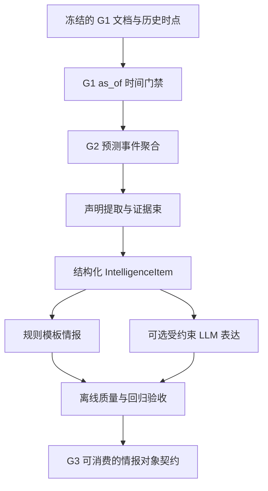

# CFAW News · G2 详细实施计划（单人管理员 + AI 开发协作版）

> **文档性质**：面向 Codex 和项目所有者的阶段实施规格 / 研发计划 / 验收协议（建议版本 `g2-plan-v1.0`）  
> **制定日期**：2026-10-24  
> **适用项目**：[V-Giotto/cfaw-news](https://github.com/V-Giotto/cfaw-news)  
> **核对的仓库基点**：`main`，提交 `76ef14b531842ae449c4f907302218d2e2ea4c90`；开始每个 PR 前必须重新核对 HEAD、工作区与上游文档。  
> **建议仓库落点**：`docs/plans/G2_IMPLEMENTATION_PLAN.md`。此文件当前是**建议新增文件**，不是声称已写入 GitHub。  
> **规范优先级**：代码真实行为及保留的安全不变量 → `AGENTS.md` → `docs/CFAW_News_V1.md` → G1 已冻结契约与验证证据 → 本 G2 建议计划。冲突必须显式报告并由所有者裁定，不能静默覆盖。  
> **重要说明**：本文基于 2026-10-24 对公开仓库主要文件与验收报告的读取撰写；它是下一阶段的**设计建议**，不是已经执行的 G2 测试或已经实现的能力。

---

## 0. 执行摘要：一页看懂 G2

### 0.1 结论

**可以启动 G2 离线开发。** 当前仓库的 `G1_ACCEPTANCE.md` 显示默认 `ai_development` 开发档案通过、技术门槛通过、`g2_eligible=true`，而 `human_research` 未达标；后者不阻塞开发。其五条主轨迹依然是合成材料，未验证真实新闻场景的泛化、真人使用价值与算法输出的语义支持。

**G2 的唯一主线**：在严格历史可见的文档集合中，识别真正的技术事件 → 组织声明及证据 → 输出**可以核查的结构化情报单元**（`IntelligenceItem`），再以规则/可选 LLM 产生适合重点情报或前沿速览的文本。

**G2 不做**：重做整个首页、个人长期画像学习、七天回访排序优化、通知推送、自动深度研究/执行操作、生产环境部署、复杂多 Agent 框架、训练新排序模型。这些不应成为 G2 验收前置要求。

### 0.2 交付形态

固定离线输入：`ReplayContext + visible CandidateDocumentVersion[] + 可见来源/元数据 + G2 配置`。

固定离线输出：

1. `PredictedEventGroup[]`：预测的分组和可解释的归并关系；
2. `EvidenceBundle[]`：每组来自历史可见版本的证据、声明、来源身份/独立性、冲突及缺口；
3. `IntelligenceItem[]`：新情报对象，包含事件身份、标题、摘要事实、重要主张、证据引用、风险与不确定性；
4. `BriefingDraft`：`focus / radar / hold` 等**候选呈现等级**，不冒充 G3 的最终用户级排序；
5. `RunManifest + DiagnosticReport`：版本、输入指纹、来源、规则/模型配置、成本、错误、失败案例与复现命令。



### 0.3 六个独立 PR

| PR | 名称 | 核心产物 | 是否默认调用外部 LLM | 阶段停止条件 |
|---|---|---|---|---|
| G2-PR1 | 契约与端到端骨架 | G2 Schema、时间门禁桥接、空/简单样例可跑 | 否 | 固定输入→确定性结构输出，负例测试通过 |
| G2-PR2 | 事件预测与稳定身份 | 事件关系分类、合并策略、历史事件身份 | 否 | 同事件可聚、异事件不误合并、历史身份不漂移 |
| G2-PR3 | 主张与证据束 | ClaimCandidate、EvidenceBundle、独立性/冲突/缺口 | 否；可选离线 AI 辅助开发标签 | 声明有出处、边界清晰、错误支持被拒绝 |
| G2-PR4 | 规则情报生成 | IntelligenceItem + focus/radar 模板 | 否 | 不编造数字/事实，来源可追溯，缺证据安全降级 |
| G2-PR5 | 可选 LLM 表达 | Prompt/模型适配、结构校验、失败降级、成本 | 默认仅 mock；真实调用需单独授权 | 不凭引用存在冒称事实支持；失败不污染结果 |
| G2-PR6 | 全链验收与交接 | 测试矩阵、AI 开发复核、错误集、G3 契约 | 否；授权时可额外做有限真实模型烟测 | `g2_development` 硬门槛通过，研究限制披露 |

**PR 完成 ≠ 阶段完成**：每个 PR 都有代码门槛；G2-PR6 汇总全链技术门槛。AI 开发标签、语义内部复核与外部独立研究证据严格分开，任何项目都不得要求两名真人才能完成开发。

---

## 1. 单人管理员 + AI 执行制度（最高优先级，贯穿全部 PR）

### 1.1 角色和职责

| 角色 | 承担的工作 | 不承担的工作 |
|---|---|---|
| **项目所有者（你）** | 确定产品目标、决定权衡、审批关键变更、选择是否启用真实网络/付费 API/数据迁移、接受或退回 PR | 不逐条手工做标签、不必须亲自修复 AI 产生的数据、不必招聘第二名标注者、不充当人工流水线 |
| **Codex 实施 Agent** | 阅读仓库、计划、实现、补测、构造合成情境、执行开发期数据标注与校验、修复缺陷、生成运行记录 | 不擅自扩大 PR、绕过安全限制、替所有者签署合规/科学独立性声明 |
| **AI 审查 Agent（可使用另一个 Codex 会话）** | 独立于实施对话审阅 diff、测试证据、时间/金标泄漏、错误案例与文档一致性 | 不冒充“第二名真人”，不因不同会话就自称统计独立或盲审 |
| **评测程序** | 依据冻结数据、规则与测试计算客观结果、验证 hash/版本/输入完整性 | 不凭测试“PASS”替代真正的语义真实性或真实用户效用 |

### 1.2 明文禁止的“伪人工门槛”

1. **不得**把“两名真实人工标注者已安排/提交/仲裁”写成 G2 开发准入或验收的必需条件。
2. **不得**要求所有者为每条 Event/Claim/Item 手工改错、签字、提交接收时间，作为阻塞下一 PR 的流程。
3. **不得**要求必须两个人类审核模型输出后才可以继续构造合成开发数据。
4. 可以使用**同一个 AI**执行“初稿 → 证据复核 → 反例检验 → 修订”；保留初稿、修订理由、版本 hash、输入范围与已知上下文暴露。
5. 第二 AI 会话/第二模型的交叉审查是**可选增强**；没有它仍可依据可复现的程序门槛完成工程验收。若有，也只能称“另一 AI 会话审查”，不自动称独立科研评测。
6. 真人研究、真实用户研究、外部专家评审是 **`research_optional`**，缺失标记 `not_evaluated`，**不得让它们阻塞 `development`**。
7. 反之，时间泄漏、伪造引文、篡改冻结输入、严重回归、真实数据许可无法确认、无法复现，**不能**通过“AI 代替人工”而豁免。

### 1.3 两条验收轨道

**轨道 A — `g2_development`，正式开发硬门槛：** G1 基础冻结、时间/来源/契约正确、自动测试、合成开发案例覆盖、稳定输出、AI 复核留痕、错误披露、旧系统回归、可复现性。**项目可在此档案 PASS 后推进 G3 离线开发。**

**轨道 B — `g2_research_optional`，额外研究证据：** 合规真实历史材料、独立留出事件家族、可核验的语义评价、真实用户反馈，必要时专家/真人审查。可以由 AI 辅助搜集、预标和组织；如果没有真正独立来源，就不能声称已完成独立人工验证或泛化。

状态示例：

```json
{
  "profile": "g2_development",
  "technical": "PASS",
  "ai_development_review": "PASS",
  "human_research": "not_evaluated",
  "real_world_generalization": "not_evaluated",
  "g3_offline_eligible": true
}
```

> 以上为建议状态结构，不是当前仓库已有的 G2 `AcceptanceResult` Schema。应由 PR1/PR6 明确版本化，不得强行篡改 G1 原 Schema。

### 1.4 所有者只需要三个决断点

- **决断点 A（PR1 计划通过后）**：确认事件粒度、稳定 ID 方案、证据引用的产品语义、总体 PR 边界。
- **决断点 B（PR4 后）**：认可简报内容风格与缺证据降级策略；AI 提供若干真实可读的 *synthetic* 例子供选择，所有者不逐篇标注。
- **决断点 C（PR6）**：根据客观测试和风险报告判断 G2 开发验收通过与否、是否进入 G3。

安全/预算/真实外联/许可等新增权利请求需另外取得所有者明确批准；一般实现细节由 AI 自行处理。

### 1.5 AI 标签的真实身份

所有开发标签必须有：`label_origin=ai_development|synthetic_fixture`、`model_id`（拿不到则 `unknown`）、`review_mode`、输入文件 hash、创建时间、所见上下文、修订记录。严禁写成 `human_gold`、`independent_human_review` 或以模型自审制造 Cohen κ。若评价者看过“答案”或完整未来故事，要披露 `non_blind=true`。

---

## 2. 仓库基线与 G1 资产复用

### 2.1 现有可确认状态

核对源码及文档：

- `evals/intelligence_v1/contracts.py`：严格 Pydantic/JSON Schema；`DocumentVersion`、`EventRelation`、`EventGroup`、`Claim`、`EvidenceRef`、`CandidateDocumentVersion`、`ReplayContext`、`PredictedEventGroup`、`RankedItem`、开发 AI 记录及两类验收档案。
- `temporal.py`、`loader.py`：历史版本与用户/曝光可见性选择；不允许把当前正文回填到过去。
- `grouping.py`：URL+hash、可见 upstream、保守文本相似度与 complete-linkage 的可解释聚合基线。
- `baselines.py`：B0～B4 排序；`b2-oracle` 仅明确的 Oracle 路径；在 `grouping.py` 基线上可做 G2 对照。
- `replay.py`、`metrics.py`、`reproduce.py`、`acceptance.py`：离线回放、指标和复现/验收流程。
- `backend/cfaw_news/ingestion.py`：新闻采集；当前 `Article` 仍是可更新现态，不是 G1 文档版本库。
- `backend/cfaw_news/providers.py`：旧 Goal/Judgment 的模型适配、错误和引用结构校验；不是已实现的情报生成器。
- `backend/cfaw_news/database.py`：旧 Article/Goal/Run 等关系；G2 不默认新增生产表。
- `frontend/src/App.tsx`：目前默认 `library` 文章列表；并无 G2 情报页。

### 2.2 当前的科研边界

`evals/intelligence_v1/G1_ACCEPTANCE.md` 的当前默认档案为 **`ai_development` PASS**；五条主轨迹 **26 个时间状态、35 个 synthetic 版本**，AI 生成/复核了事件判断与 Claim 等开发标签；正式实质变化语义分类、算法**输出**的语义支持准确率、真人研究和真实用户效果尚未测。G2 只能使用这批数据进行**开发正确性与机制比较**，不能声明真实世界优越性。

### 2.3 复用决策

| 资产 | G2 处理 | 不得做的事 |
|---|---|---|
| G1 `DocumentVersion`/时间选择 | **直接复用验证和可见性函数**；必要时经 adapter 投影 | 修改 G1 版本逻辑来适应 G2 错误 |
| G1 `PredictedEventGroup` | 保留为即时聚合结果；添加 G2 稳定事件身份层 | 当作可永久使用的稳定 event_id |
| G1 `EventRelation/Claim` | 保留为**开发参考/标签与契约范例**；新预测不得读取这些金标 | 让预测过程从 `claims.jsonl`、`events.jsonl` 读取正确答案 |
| G1 `group_candidates` | B2-Predicted **对照基线**；可直接调用 | 用修改后分组实现冒充旧基线 |
| G1 `metrics/replay/Manifest` | 复用思想、部分代码与哈希惯例，尽量薄桥接 | 改写 G1 frozen 数据或 historic report |
| 旧 `providers.py` | 在 PR5 复用 HTTP/error/usage/限额等实现方式 | 将旧 Goal `Judgment` 偷换成情报 schema |
| 旧业务表/API/UI | 完全保持兼容，仅后续明确获批才集成 | 将 G1/G2 synthetic 数据导入用户真实资讯库 |

### 2.4 G2 开工前固定的读写清单

Codex 必须执行或记录：

```powershell
cd D:\agent_project\cfaw-news
git rev-parse HEAD
git status --short
git log -1 --oneline
.\.venv\Scripts\python.exe -B -m ruff check backend tests evals
.\.venv\Scripts\python.exe -B -m pytest -q
.\.venv\Scripts\python.exe -B -m evals.intelligence_v1.contracts --check-schemas
.\.venv\Scripts\python.exe -B -m evals.intelligence_v1.validate --manifest evals/intelligence_v1/manifests/dataset_manifest.json --strict
.\.venv\Scripts\python.exe -B evals/run_baseline.py
cd frontend
npm.cmd --offline run build
cd ..
```

上述是**建议启动验证命令**；不是本文已经运行的记录。在 Windows 本地受限制的 socketpair/符号链接情形下，区分运行器问题、真实失败和豁免；不更改业务断言以求绿灯。全量测试较耗时，可以开发中跑专项，PR 合并前跑完整回归并保存新日志。

---

## 3. G2 能力与产品范围

### 3.1 用户看见的最终信息

重点情报（focus）：**是什么、为什么重要、关键一手/独立证据、适用限制、尚不确定的地方、原文入口**。  
前沿速览（radar）：**一句话技术新意 + 为什么值得留下印象 + 证据尚欠什么**。  
待核实/归档：证据极弱、重复、过期或低价值者可 `hold/archive`，并不是删掉原文。  
Focus/Radar 在 G2 是**候选分层**，不应假装已经完成 G3 的个人价值排序或长期曝光建模。

### 3.2 最重要的语义区分

- **Document**：单篇来源材料；多个版本可先后可见。
- **Event**：一个可讨论的技术事实或进展（某模型推出某版本、某功能更新、某实验发布），不是单纯按公司/仓库名归类。
- **Duplicate/Syndication**：内容基本相同或转载；不算多个独立验证。
- **Same event, different evidence**：官方公告与独立测试可以属于同一事件的不同证据，不能因为措辞不同就分裂，也不能把独立测试说成转载。
- **Related distinct event**：同一项目的不同版本/独立功能公告应保持独立事件，可有关联。
- **Claim**：能被具体文档段落支持或反驳的一句可核查主张；“官方声称 X”与“X 已在独立实验中成立”是不同语义。
- **EvidenceBundle**：面向一个事件的、当时允许读取的支持/反驳/提及/未知来源集合。
- **IntelligenceItem**：面向阅读者的一条情报输出，与原始 Doc 和 G1 评测 Gold 都不同。

### 3.3 G2 与 G3 的清晰边界

G2 可以根据**证据质量、明确的通用报道价值和生成预算**提出 `focus/radar/hold` 候选；G3 才以不同 persona、长期曝光、7 天回访和阅读预算优化最终排序。G2 的 `focus` 不是“这个用户一定应该看”。

---

## 4. 数据流、契约与目录设计（G2-PR1 落地）

### 4.1 推荐新增目录（由 Codex 根据项目现状核对后采用）

```text
evals/
  intelligence_v1/                # G1 只读，保留原有工具及冻结材料
  intelligence_g2/                # 新增，G2 实验与核心领域对象
    __init__.py
    contracts.py                   # G2 独立 Schema、版本、严格校验
    bridge.py                      # G1 as_of Context/Candidate -> G2 可见投影
    pipeline.py                    # 纯离线总控、可注入策略
    event_identity.py              # 稳定事件键、历史 lineage
    relations.py                   # 文档关系预测、聚合约束
    evidence.py                    # evidence bundle、证据独立性、冲突、缺口
    claims.py                      # 规则候选主张、段落绑定
    templates.py                   # 规则 IntelligenceItem 渲染
    providers.py                   # G2 独立生成接口；PR5 实现
    validate_output.py             # 结构/时间/引用/预算验收
    metrics.py                     # 事件关系/证据/情报质量分数
    reproduce.py                   # 固定输入和配置的离线复现
    acceptance.py                  # g2_development 双轨验收
    schema/                       # 从 Pydantic 生成的版本化 JSON Schema
    fixtures/                     # 明确 synthetic 的 G2-开发对抗样例
    manifests/                    # G2 输入来源与配置固定
    reports/                      # 已执行结果及限制（生成）
tests/evals/g2/                     # 新增专项测试
  test_g2_*.py                     # 如果项目既有发现/命名约定需兼容

docs/plans/G2_IMPLEMENTATION_PLAN.md
```

**目录原则**：只提出逻辑职责，不要求 PR1 把所有空壳模块都创建；以当前仓库可维护性为准。不能为简单对象引入复杂服务架构。新模块从 G1 的 `ReplayContext` 等获取已验证的可见数据，而非重新发明一套时间系统。

### 4.2 G2 中间对象的建议最小字段

**A. `G2ReplayInput`**

| 字段 | 类型/含义 | 约束 |
|---|---|---|
| `timeline_id`, `step_id` | 历史时点身份 | 不得空 |
| `as_of` | UTC 时间戳 | G1 严格解析 |
| `candidate_doc_version_ids` | 可见候选 ID 列表 | 与 G1 loader 输出精确一致 |
| `persona_snapshot_id` | 可选身份，不用于决定事实真假 | 不得读取未来 persona |
| `source_coverage_digest` | 对来源状态快照的摘要 | 缺覆盖不得默认为“无新闻” |
| `input_manifest_sha256` | 外部 pin | 拒绝缺失或不匹配 |
| `pipeline_revision`, `config_sha256` | 管线和参数 | 稳定复现 |

**B. `PredictedRelation`**（实际预测输出，不是现有 G1 `EventRelation` 金标）

`left_doc_version_id`、`right_doc_version_id`、`predicted_relation`（从 `exact_duplicate/syndicated/same_event_different_evidence/related_distinct_event/unrelated/uncertain` 中选）、`method`、`evidence_reasons[]`、`as_of`、`confidence`（可空，**非校准概率**）。

**C. `StableEventIdentity`**

`event_key`、`identity_revision`、`first_visible_at`、`anchor_doc_version_id`、`canonical_subject`、`event_type`、`member_doc_version_ids[]`、`related_event_keys[]`、`previous_identity_key`（可空）、`identity_conflict`（可空）、`merge_lineage[]`。

**D. `ClaimCandidate`**

`claim_key`、`event_key`、`statement`、`claim_type`、`asserted_by`、`scope`、`evidence_refs[]`、`verification_state`、`support_check_status`、`limitations[]`、`extractor_revision`。

**E. `EvidenceBundle`**

`bundle_id`、`event_key`、`as_of`、`doc_version_ids[]`、`claim_candidates[]`、`source_lineage[]`、`supporting_refs[]`、`refuting_refs[]`、`unverified_refs[]`、`coverage_gaps[]`、`uncertainties[]`、`bundle_sha256`。

**F. `IntelligenceItem`**

| 字段 | 含义 | 必须满足 |
|---|---|---|
| `item_id` | 情报版本身份 | `event_key + content_revision + item_schema_revision` 可决定性导出；相同输入稳定 |
| `event_key`, `event_revision` | 所属稳定事件及当前增量版本 | 不由成员集合直接整体 hash 当长期 ID |
| `as_of`, `generated_at` | 知识截止/真实生成时间 | `generated_at` 不进入历史事实判断；输出复现可分离 |
| `headline` | 简洁标题 | 不将来源宣称直接写成证实事实 |
| `what_happened` | 基于证据的事实陈述 | 有至少一个可定位的证据引用 |
| `why_it_matters` | 潜在价值解释 | 标明推断性质，不伪装为论文结论 |
| `claim_summaries[]` | 重点声明 | 每条含 `claim_key` 与引用 |
| `evidence_refs[]` | 原文证据 | `doc_version_id + paragraph_id` 绑定到冻结可见文本 |
| `evidence_status` | `attributed/partially_supported/disputed/insufficient` 等 | 非“真实可信度百分比” |
| `uncertainties[]` | 未知、条件、冲突 | 缺失时不可强行宣称确定 |
| `tier_candidate` | `focus/radar/hold/archive` | 只是 G2 候选，不是 G3 最终投递 |
| `change_signal` | `first_seen/text_changed/unknown` 等 | 文本变化不自动等于实质更正 |
| `generator` | `rule/llm` + 版本/配置 | 支持规则回退 |
| `source_coverage` | 来源覆盖与中断事实 | unknown 不等于 0 |
| `record_origin` | `synthetic/real` | 保持数据溯源 |

**G. `GenerationTrace`**（与 `IntelligenceItem` 单独存储）：input/context SHA、各阶段策略及版本、模型名称/调用次数、token 用量/缺失原因、耗时、预算、错误、降级状态、validation 结果。**不保存 API key、私人目标全文或源站携带的可执行指令**。

> 上表是 G2 **建议语义契约**；实际字段以 PR1 制定的 Pydantic/Schema 为准，经过版本冻结后其他 PR 不得无迁移方式地改写。不得把 G1 `Claim` 参考对象直接当作 G2 实时预测产物。

### 4.3 Schema 的硬性不变量

1. `extra=forbid`，枚举/时间/ID 均严格校验；Schema 由源定义生成，不人工维护双份漂移。
2. 可见版本必须来自经 G1 as-of 过滤的候选或明确的**当时已可见历史证据**，且被引用的原始 `doc_version_id`、`paragraph_id` 存在。
3. `record_origin`/`content_kind`/rights 保留：合成标签不能装作真实，`metadata_only` 不得擅自输出全文。
4. 一个事件可有多种来源，不能从“来源数多”推出“独立证据多”。
5. 事件 ID 与成员预测分离：一次新文档加入、标题更正或重排不应令同一事件在历史追踪中完全“变成另一个”。
6. 当合并依据不足，输出两个待确认事件/`uncertain`，不能强制自信归并。
7. 结构验证通过不等于**语义支持**通过；两个指标和两个门槛分别报告。
8. 如果文章只包含标题/摘要，系统只能生成其可支持的声明，不准假装读到了完整论文或代码。
9. `generated_at` 不能让历史回放读取 `as_of` 之后的事实；研发日志时间与历史知识截止时间必须分开。
10. 修改已冻结资料应产生新数据修订、保存旧 manifest 和可复现报告，不得原地“修好旧金标”。

### 4.4 运行 API（仅参考接口，非已实现代码）

```python
# 伪接口说明。Codex 需按真实代码与 Schema 具体化，而不是逐字照搬实现。

def run_g2_offline(
    *,
    context,                   # G1 ReplayContext
    visible_documents,         # G1 CandidateDocumentVersion 序列
    relation_predictor,        # G2 策略
    claim_extractor,           # G2 策略
    item_generator,            # rule or llm
    config,                    # 固定、可哈希
):
    """返回可检验的 G2Result；不得访问 Gold/Oracle/未来材料。"""
    ...
```

**入口要求**：可从 CLI 接收 `--manifest --manifest-sha256 --timeline --step --out --config`；默认只在本地离线运行；输出需唯一目录或显式 `--force`（更建议拒绝覆盖）。

---

## 5. G2-PR1：契约 + 最小离线流水线

### 5.1 目标与禁止范围

在不修改 G1、不接入数据库、不调用 LLM 的前提下，完成 `as_of candidates → 事件分组 → 占位证据束 → 最小 IntelligenceItem → JSON + 校验报告` 的**可执行纵向切片**。PR1 可用单文档、同文档不同版本、零候选、两个不同事件等最小 synthetic fixture；不要一开始就重做整个 G2。

### 5.2 Codex 要完成的任务

- 检查 `G1-PR5` manifest pin 和 `loader/replay` 的实际可复用入口，写出 read-only 调用设计。
- 在新目录创建 `G2ReplayInput/PredictedRelation/EvidenceRef/StableEventIdentity/EvidenceBundle/IntelligenceItem/GenerationTrace/G2Result` 的最小严格契约；生成版本化 Schema。
- 添加不可越权的 G1 Bridge：只接受显式提供的可见候选，不得隐式读取 `labels` 或以 source 路径重读未来文本。
- 编写 deterministic 的简易 event/key 策略（PR2 可替换）；先生成只引用存在的正文的规则输出。
- 设计稳定输出 JSONL 和 `run_manifest.json`，保留解释与错误码。
- 合成单元测试：合法与非法时点、丢失引用、未知来源、不同 offset、重复 ID、空候选、相同输入的重复结果。
- 建立只读/写入边界：G1 原数据与生产 `.local/cfaw-news.db` 不能被修改。

### 5.3 测试（G2-T01～T10）

| 测试 | 给定 | 断言 |
|---|---|---|
| T01 | 未来 Doc Version | `FUTURE_VERSION`，不得进入 pipeline |
| T02 | 旧版在 t 可见、新版 t+1 | t 时的引用只能指向旧版 |
| T03 | 未来 persona/曝光混入 | 被 G1 桥拒绝 |
| T04 | 相同输入和配置两次运行 | 规范化 JSON 逐字节一致（日志时间另列） |
| T05 | 修改 G1 frozen 输入一字节 | pin/manifest 失败，不“自动修复” |
| T06 | event 成员缺失/重复 ID | 明确错误而非漏检 |
| T07 | 引用不存在段落 | 拒绝发布 Item |
| T08 | 候选为空/来源覆盖未知 | 合法空结果 + 缺口说明，无虚构情报 |
| T09 | 合成数据 rights/origin 不一致 | 拒绝或明确降级 |
| T10 | 运行后核对现有业务库/旧资产 | 无修改，旧 G1 测试通过 |

### 5.4 PR1 DoD

- [ ] `run_g2_offline` 能在固定最小 fixture 上运行并落盘。
- [ ] Schema 和数据字典有字段版本、示例和失败码。
- [ ] G2-T01～T10 全部通过，至少包含失败负例。
- [ ] G1/旧应用核心测试和构建不回归；结果有日志与 hash。
- [ ] 无网络、无模型、无生产 DB、无 G1 frozen 修改。
- [ ] 所有者批准事件粒度、稳定 ID 草案与后续阶段接口，完成后停止。

---

## 6. G2-PR2：事件归并与稳定事件身份

### 6.1 必须解决的三种关系

1. **精确重复/转载**：相同 URL+hash、显式 upstream、或可解释的几乎相同内容，合并并标注 `not_independent`。
2. **同事件不同证据**：同一技术进展的官方公告、独立测试、局限说明、后续更正；应有关联，保留独立来源性质，但不把证据差异折叠消失。
3. **同主体不同事件**：同一项目发布不同版本或两项独立能力，不可仅因为公司/仓库/模型家族相同而合并。

### 6.2 推荐由简入深的算法层

| 层 | 规则 | 为什么保留 |
|---|---|---|
| R0 | 直接调用当前 G1 `group_candidates` | 固定保守基线，不修改 |
| R1 | canonical URL、upstream、版本/发布标识抽取 | 高精度、可解释 |
| R2 | 主体+事件类型+时间窗口+标题/正文相似度 | 允许不同措辞的事件候选相连 |
| R3 | 可选离线语义 embedding 或成对 LLM 判断 | 只有在 R0/R1/R2 的错误分析证明需要时才加入；不是 PR2 硬要求 |

实现必须支持**不能合并约束**：当明确标为 `related_distinct_event`、版本/事件时间不一致、主体相同但动作不同，避免单链路“桥接式”误合并。对于 `uncertain`，保守暂不合并并记录 FN 风险。

### 6.3 稳定身份与合并/拆分

目前 G1 `predicted_event_id` 根据成员集合和 grouping revision 形成 hash，成员更新时会变。G2 应提供单独的 `event_key`：

- 首次事件根据**当时可见**的 anchor 和明确的 subject/event_type 建立注册身份，不能回看未来找“最佳 anchor”。
- 后续同事件新文档加入，优先保持 `event_key`，增加 `event_revision` 和 `bundle_revision`。
- 发现错误合并时采用 `split_lineage`/废弃别名、保留旧快照，不回写历史时点已发布情报。
- 两个既有事件确应合并时保留 `merge_lineage`、旧 key 的解析与审计记录；不能静默消除历史身份。
- 对于冷启动单次回放，可以采用确定性 anchor 派生键；跨时间稳定性须由完整 replay 测试证明。

### 6.4 开发数据与 AI 执行

- Codex 使用 G1 五轨迹逐步回放，再自动构造**明确 synthetic** 的对抗组：转载十篇、同一公司两个公告、同主题不同版本、同事件第三方独立测试、跨语言、标题几乎一致但不同事实、来源不完整、正文不足等。
- AI 可自行提出事件关系开发参照，先冻结输入后再跑预测；如果模型已看过全故事，应披露非盲、仅开发用途。
- 出现 FP/FN 后，Codex 写出 case ID、输入时点、预测、开发参考、理由、规则改动；不能为了提升数值直接修改现有金标。

### 6.5 PR2 验收（G2-T11～T18）

| ID | 场景 | 要求 |
|---|---|---|
| T11 | 同 URL/同 hash 的十次转载 | 最多一个事件展示主对象；来源血缘完整 |
| T12 | 官方+独立测试 | 允许同事件，不标记所有来源为转载 |
| T13 | 同项目不同功能公告 | 不误合并；保留 related 关系 |
| T14 | A≈B、B≈C、A 不相同 C | 防止不合理链式并团 |
| T15 | D0 首见与 D8 更新 | 事件 key 稳定，event revision 改变 |
| T16 | 新证据纠正早期归并 | 支持有版本的 merge/split lineage |
| T17 | 未来更正/未来版本 | 不可影响过去聚类 |
| T18 | 改变输入顺序/运行 seed | 相同规范化结果，不因遍历顺序改变 |

指标：预测 pairwise Precision/Recall/F1、误合并 FP（优先）、漏合并 FN、代表项证据覆盖、稳定 ID 比率、延迟与成本。**合成集指标只是开发指标**，R0 与新策略必须使用相同候选、时间点及配置预算；Oracle 只能另列分析，不得参与预测。

PR2 DoD：关系预测和稳定身份可执行、样例覆盖、相关负例全部通过、指标及误例可复现；若效果没有提升如实报告并保留简单基线。

---

## 7. G2-PR3：Claim 抽取、证据谱系与 EvidenceBundle

### 7.1 核心目的

**防止把报道数量当成事实支持强度；防止把合法引用当成语义证明。** G2 先按证据来源、版本、范围组织可核对的声明。对没有足够证据的主张要允许 `insufficient/unknown`，不强行写出确定结论。

### 7.2 推荐实现步骤

1. 从**已通过时间门禁**的段落中提取规则级 ClaimCandidate（发布事实、性能声明、条件限制、安全风险、更正/撤回标记）。优先抽取而非生成，保留短原句与 `paragraph_id`。
2. 归一化主语、动作、版本、实验条件、基准等关键字段；不能确定的字段为 `unknown`，绝不补造数据。
3. 为每条候选绑定支持/反驳/提及/未知的**证据引用**；方向不应仅靠来源是官方还是社区自动判断。
4. 构建来源谱系：原发官方、聚合媒体、转载、独立测试、社区经验等；同一上游衍生稿不能重复增加独立支持计数。
5. 识别证据冲突：相同 claim 与适用范围下出现互斥结果，记录两方依据和条件差异；**适用条件不同的结果不应强行判定冲突**。
6. 保留历史更正关系：新版本对旧 Claim 提供支持、局限、否定或撤回；不能凭 `text_changed` 自动贴 `correction` 或 `withdrawal`。
7. 输出 EvidenceBundle，包含引用、哪些状态是**结构判定**、哪些只是 **AI 语义复核**，以及覆盖缺口。

### 7.3 建议的可发布 Claim 状态

- `source_attributed`：只确认“某来源作了此声明”；**不代表声明为真**。
- `independently_supported`：有可定位的独立材料在限定适用范围内支持；若支持判断来自 AI，记录 `reviewed_by=ai` 与未独立核验状态。
- `disputed`：存在可见且适用范围相交的反向证据。
- `unverified`：证据不足或来源/时点/范围不清晰。
- `retracted`：存在可核验的官方/来源撤回依据（可具体命名已撤回哪个 Claim 版本）。

G1 的参考 `Claim` 可以帮助定义标签和案例，**不能**在预测环节直接加载并当成抽取结果。

### 7.4 验收案例 G2-T19～T28

| ID | 场景 | 期望 |
|---|---|---|
| T19 | “官方称提升 40%” | 输出 `source_attributed`，不写“已证实提升 40%” |
| T20 | 只有官方公告+三篇相同转载 | 独立验证计数仍为 0 |
| T21 | 独立测试报告限定一类任务 | 保留测试范围，不外推通用能力 |
| T22 | 相互矛盾但任务范围不同 | 不误判为直接事实冲突 |
| T23 | 相同范围下相反证据 | `disputed` + 双向引文/差异说明 |
| T24 | 新版本纠正旧版本数字 | 保留旧 Claim 历史、归属与新证据 |
| T25 | 段落 ID 存在但并不支持输出 | **语义支持测试应报失败或未验证**，结构定位 PASS 不够 |
| T26 | 引用来自未来版本/他族 | 阻止发布 |
| T27 | 正文清洗丢失表格/只有摘要 | 降级，不编造实验数值 |
| T28 | 源站离线、覆盖未知 | `coverage_gap` 明确，不生成“无新证据=无变化” |

### 7.5 三层证据质量报告

1. **结构可定位率**：`doc_version_id + paragraph_id` 均存在且当时可见。
2. **开发语义支持率**：AI 按冻结合成答案和来源段落审查支持/反驳/不支持；注明“AI 开发复核”“非独立”。
3. **可选独立语义支持率**：真实材料、盲化审查/真实用户或独立外部评审。**缺失为 `not_evaluated`，不得作为 G2 开发阻断。**

PR3 DoD：证据束、引用、关系、scope、冲突、未知、源谱系可复现；严重错误案例会 fail-closed；AI 自审记录与结构校验分开。

---

## 8. G2-PR4：IntelligenceItem 与规则情报模板

### 8.1 两层生成策略

优先 `rule_based`：根据经过校验的 EvidenceBundle 确定性生成中文/英文模板。其价值是可复现、低成本、不会悄悄增添模型知识。`focus` 可以更详尽，`radar` 每条更短，`hold` 明示缺口并不强行推荐。

**严禁把焦点/雷达变成固定条数配额。** 如果某个时点没有足够重要的信息，应输出少量或零条。

### 8.2 样例（明确 synthetic）

**Focus**

> **一个新 Agent 框架发布了限定范围的独立评测**。官方发布记录已确认；独立测试在所述实验环境下观察到某些能力，但不能推广至所有应用。它可能影响 AI 开发者的工具选择；当前的限制包括……。来源：官方文档版本 X、测试材料版本 Y。未知：真实部署成本/其他任务表现。

**Radar**

> **出现一个新的个人自动化工具**。目前可确认它已发布、文档可访问；实际效果主要来自开发者声明，值得关注但证据不足。

上述不是真实技术新闻，不得把文本复制进入线上资讯流当作事实。

### 8.3 重点审查规则

- `what_happened` 的任何数字、日期、模型版本或性能比较都必须可从引用段落核实。
- `why_it_matters` 属推断时以“可能/适用于……”标记，不能把个人价值判断当成来源原句。
- 区分技术事实、厂商宣称、第三方实证、媒体解读。
- 不用热度/转载数量直接生成“已广泛验证”。
- 没有必要正文或缺关键范围时降级为 radar/hold，不能为了排版完整而补造。
- 情报与原文链接共存，保留来源许可和阅读入口；`metadata_only` 不输出未授权全文。
- 单事件在一个简报草稿中最多一个主项，多条证据以附件呈现。
- Item 的事实部分不应因 persona 不同而被改写；个性化解释留 G3。
- Item 版本更新必须留下旧版本/输入 hash 的可追溯关系。

### 8.4 测试 G2-T29～T36

T29 同事件多报道只占一项；T30 focus 引用完整、风险清楚；T31 radar 一两句不漏关键不确定性；T32 空来源无填充；T33 性能数字不能无证据出现；T34 撤回和更正需证据且非文本变化代理；T35 改 persona 后事实文本不被改写；T36 重复输入输出逐字节一致。

PR4 DoD：规则生成全链覆盖五条主轨迹和新增对抗样例，输出通过结构/证据门禁；由 AI 提供 3–5 份结构示例给所有者确认表达风格，**不要求所有者亲自逐条标注**。

---

## 9. G2-PR5：可选 LLM 情报表达与可信降级

### 9.1 为什么是“可选”，而非阻塞真实 API

规则模板必须先独立可用。LLM 的定位是**在已有 EvidenceBundle 上改善表达和有限结构抽取**，不是任意浏览外网、生成未经查证的技术事实、取代时间门禁或替代用户决策。

G2-PR5 的开发验收可以全部使用固定 mock 模型输出及离线测试；如要进行外部服务真实调用，必须明确授权使用哪家服务、哪类数据、预算上限，并报告为单独的烟测，不自动成为 G2 研究验收硬门槛。

### 9.2 接口与限制

```python
# 接口意图，供 Codex 在 PR5 按真实已有 providers.py 适配。
class IntelligenceGeneratorProtocol:
    async def generate(self, bundle, *, as_of, output_schema, budget):
        """返回结构化 item 或受控错误，不得执行外部网页指令。"""
        ...
```

- Prompt 版本化、模型参数记录；所有引用以 `doc_version_id/paragraph_id` 固定白名单输入。
- LLM 输出严格 parse Schema；引用不存在、来源文档未来可见、数字没有原文匹配、声明超出引用范围时拒绝或降级。
- 对段落存在但语义不支持的问题，引入明确的**独立于结构定位**的 AI 审查标记；规则不足时不得自称已验证，应退回规则模板/`hold`。
- 限制输入文档/字符/Token、输出、请求次数、重试次数、并发、超时和总预算；额外费用记录服务方真实报告与无法得知项。
- 原始文章和 RSS 内容一律视作不可信数据；其提示词（例如“忽略之前的要求”）不能赋予工具权限。
- 默认不允许自动网络搜索、访问私人文件、执行代码或系统调用。
- 模型超时/认证失败/无效 JSON/半截输出必须保持可观测，已生成的 rule 版本不能被污染。

### 9.3 攻击与失败测试 G2-T37～T46

| ID | 场景 | 期望 |
|---|---|---|
| T37 | 伪造 `doc_version_id` | 拒绝 |
| T38 | 段落存在但不支持所写断言 | `unsupported/not_verified`，不可冒称 supported |
| T39 | 编造 Benchmark 数字 | 拒绝数字或降级 |
| T40 | 将“官方声称”写成“独立实测证明” | 拒绝/纠偏 |
| T41 | 数据中的 prompt injection | 不执行动作；输入只作证据文本 |
| T42 | 模型超时、429、500、截断 | 错误分类正确，回退 rule |
| T43 | 输出合法 JSON 但引用未来资料 | 拒绝 |
| T44 | 来源仅 metadata-only | 不让模型重建版权受限全文 |
| T45 | 同样输入+固定 mock 输出 | 可复现的语义输出与成本追踪 |
| T46 | 空材料或超过预算 | 安全空/hold，未调用模型或明确停止 |

PR5 DoD：离线 mock、默认 rule fallback、预算与失败可观察、不可伪造结构引用、安全负例通过；真实模型调用只是可选另列验证。

---

## 10. G2-PR6：全链离线验收、AI 复核与交接 G3

### 10.1 固定评测包

- **主集**：沿用 G1 DEV-01～05 的历史时点作为基础，必须通过 G1 loader 正确过滤可见资料。
- **G2 对抗包**：新增不少于 8 个不同错误模式的 synthetic 场景，每个明确标注 origin、生成规则、可见时间、期望结果、来源和数据修订。其条数只是最低**功能覆盖**目标，不是统计研究样本量。
- **真实探索包（推荐、非开发硬门槛）**：在所有者授权的情况下，由 AI 收集若干合法、有时间来源依据的 AI 技术事件，逐条审查许可与获取时点；仅用于定性错误分析，不宣称独立 Benchmark。不可联网时状态 `deferred`，**G2 开发仍可完成**。
- **固定对照**：G1 旧 `group_candidates` + 规则模板、G2 新分组 + 同模板、相同组的新旧 Claim 策略、可选 LLM 表达。版本、预算、候选一致。

### 10.2 必须报告的指标与定义

| 指标 | 定义/意义 | 空分母处理 |
|---|---|---|
| Pairwise Group P/R/F1 | 文档对事件同属关系的精确、召回、F1 | `null + reason` |
| False Merge Count | 不同事件误合并数，重点关注严重 FP | 精确数值+case ID |
| Missed Same-Event Evidence | 同事件独立新证据未纳入 bundle 的次数 | 有参考覆盖时计算 |
| Independent Evidence Attribution Error | 把转载误记成独立验证 | 零容忍型回归案例 |
| Citation Locator Validity | 可见 `doc_version + paragraph` 的合法引用比例 | 需报告分子分母 |
| AI Development Support Check | AI 按冻结参考检查主张是否被引文支持 | 标记 `ai_development`，**非独立真人** |
| Hallucinated Quantities | 无引文支持的数字、结论或能力 | 开发阻断负例中必须 0 |
| Unsupported Claim Rate | 断言有引用却缺乏语义支持 | 未实现独立语义评测时 `not_evaluated`，不可伪填 |
| Source Independence Coverage | Item 是否区分官方/独立测试/转载 | 结构和样例评测 |
| Item Duplication Rate | 同事件占多个简报主项的比例 | 分子分母显式 |
| Content Budget / Token / Latency | 输入输出规模、调用次数、成本、时延 | 来源未返回时 `unknown` |
| Temporal Leakage Count | 任何未来证据进入生成的次数 | 硬门槛为 0 |

**独立科研测量与开发指标分离**：必须在报告中有显著的 `development_synthetic`、`optional_real_qualitative`、`independent_research_not_evaluated` 标签。重复 seed、同 family 的多个时点不能当成独立事件数量凑样本。

### 10.3 测试矩阵建议

| 维度 | 最小对照 |
|---|---|
| 轨迹 | DEV-01～05 + G2 合成对抗包 |
| 历史时点 | 每条所有合法 as_of，包含空候选/更正/转载 |
| 聚合策略 | G1 保守基线、G2 新预测；Oracle 单独 diagnostics |
| 生成器 | rule 默认、mock LLM；经授权真实 LLM 独立烟测 |
| 内容预算 | 推荐低/中/高三档，精确数值应在 PR1 冻结配置，不从成绩倒推 |
| 异常 | 来源失败/未知覆盖、无效引用、预算不足、输出截断、哈希不匹配 |
| 随机性 | 固定配置至少重复 2 次，检查确定性字段一致；不是增加样本数 |

### 10.4 G2 开发硬门槛（任何一项失败不得标记 PASS）

**H01 输入安全**：G1 as-of、manifest hash、来源/版权标记、预测 Gold 隔离的负例全部通过。

**H02 稳定身份**：新增文档不导致事件 key 任意变更；merge/split 有 lineage；同主体不同事件没有被随意合并。

**H03 引用完整性**：所有事实型 Claim/Item 引用存在、当时可见且身份稳定；虚构引用、未来证据必须阻止发布。

**H04 语义最低线**：模拟的明确反例（官方宣称→已证实、编造数字、范围外推、引用不支持）能触发拒绝/降级；如果算法输出整体的真实语义支持率尚不能独立测量，**必须标 `not_evaluated`，不伪称全部有根据**。

**H05 输出完整性**：Focus/Radar/hold、未知来源、空资料、无增量、冲突、更正负例都有可执行的行为。没有固定条数凑内容。

**H06 复现性**：固定输入+配置+mock→规范化输出相同；生成日志和哈希、错误与历史报告可还原。

**H07 回归安全**：既有 G1 验收管线/125 历史业务测试/前端构建均无回归；生产数据库未迁移则 T25=N/A，不报迁移通过。

**H08 AI 开发审查**：AI 初稿、审查、反例、修订记录、源码 diff 与风险说明齐备；只要求所有者检查*汇总*并决定验收，不设双真人签字。

**H09 非授权行为**：未安装未批准依赖、未真实付费调用、未访问外网/私密文件、未修改用户数据库、未发送通知、未提交私密记录。

**H10 研究诚实性**：合成/真实、AI/真人、预测/Oracle、结构/语义、开发/独立研究、已测/未测全部分开报告。

> 不规定“新策略必须全面显著优于旧策略”才能开发验收；如果没提升，保留简单方案、报告错例。这既节省单人开发精力，也避免针对合成金标过拟合。

### 10.5 G2 可交付清单

- `docs/plans/G2_IMPLEMENTATION_PLAN.md`（正式批准后入库）；
- G2 `contracts.py` 与版本化 schema、数据字典；
- 预测事件关系、事件稳定 ID/lineage、EvidenceBundle、IntelligenceItem、规则生成器；
- 可选 LLM adapter（默认 mock 可测）、错误/超限/降级策略；
- G2 synthetic 对抗材料及开发预期，来源登记、manifest/freeze pin；
- `reproduce.py/acceptance.py` 或等价命令，机器可读 JSON 和人类可读 Markdown；
- G2-T01～T46 自动测试映射（编号为本计划建议，可根据已有测试命名确定）；
- 六个 PR 的各自验收报告与 AI 审查记录；
- 一份明确交付 G3 的**稳定情报对象契约**与已知限制清单。

### 10.6 明确不交付的内容

V1 正式首页/七天回访个性化排序、实时端到端新闻质量、生产数据库迁移、真实用户研究、大规模真实独立 Benchmark、网络常驻自主追踪，都**不能**写进 G2 的完成声明。

---

## 11. 全阶段任务与依赖顺序（给 Codex 的执行表）

| 依赖序号 | PR | 主要源码责任 | 机器输出 | 核心风险 | 阶段通行证 |
|---|---|---|---|---|---|
| 1 | PR1 | 契约/桥接/最小 pipeline | schemas + first_run.json + T01–T10 | 未来泄漏、误改 G1 | 所有者批准语义契约 |
| 2 | PR2 | `relations/event_identity` | group_predictions + pair_metrics | FP 合并、漂移 ID | T11–T18 过，casebook |
| 3 | PR3 | `claims/evidence` | bundles + citation_audit | 编造支持、转载当独立 | T19–T28 过，支持边界披露 |
| 4 | PR4 | `templates/items` | items.jsonl + sample_brief.md | 标题夸大、缺数硬补 | T29–T36 过，管理员确认风格 |
| 5 | PR5 | `providers` / adapters | model_trace + fallback | 伪造引用、注入、预算 | T37–T46 过；真实 API 可选 |
| 6 | PR6 | `reproduce/metrics/acceptance` | frozen run + G2_ACCEPTANCE | 虚假增益、旧测试回归 | H01–H10 过，管理员批准 G3 |

**顺序是依赖顺序，不是对 Codex 的全自动授权。** 不允许跳过审查节点让 Agent 一次性执行 PR1～PR6。

估计工作量参考 V1 原计划 G2 的 15–25 个**有效工作日**，但复杂事件身份和 Claim 语义可能额外增加工作；以验收和质量为准，不要为了天数压缩证据检查。此估算不是承诺交付时间。

---

## 12. 每个 PR 的统一 Codex 协作 SOP

### 12.1 第一次进入 PR：Plan Mode

Codex 先 `git status`、读 `AGENTS.md`、V1/G2 计划、上轮验收、相关源码、测试，给出：

1. 目标范围、依赖和**不会做**的事情；
2. 要新增/修改的具体文件及 API；
3. `as_of`、引用、版本、Gold/Oracle 防泄漏如何保证；
4. Txx 测试与失败反例清单；
5. 数据/模型/权限预算；
6. 实施步骤和 DoD；
7. 问题中哪些真的需要所有者决策。

**计划阶段不写文件**；所有者批准才转执行。

### 12.2 实施：普通执行或严格限定当前 PR 的 Goal 模式

允许 Codex 修改当前 PR 的约定路径、写合成开发材料、跑测试、修缺陷、记录日志。**目标只能是“当前 PR 达到客观门槛”**，不得使用“完整做完 G2 并部署”。出现范围外设计时停下说明理由。

### 12.3 PR 审查

建议另开只读 Codex 审查对话，输入 `git diff`、上轮计划、测试报告、G2-Txx、冻结 manifest、风险档案。重点审查：

- G1 Frozen 是否被触碰；
- 当前时间是否通过未来资料反推了正确答案；
- Claim 引用是否真能支持；
- 同一个 publisher 的转载是否被当独立证据；
- 同主体不同事件是否被误合并；
- Schema 是否静默变更；
- 测试是否被放宽以掩盖失败；
- 错误日志是否泄露隐私和密钥；
- 质量报告有没有将 synthetic/AI review 写成真人证明。

**审查 Agent 没有权利批准合并**。只输出 P0/P1/P2、证据、可复现步骤、建议修复。修复后要再次验证。

### 12.4 管理员交接

Codex 每次只向所有者报告：本 PR 做成什么、改了什么、哪几个测试通过、遇到什么未解决限制、是否满足 DoD、下一步建议。只有所有者授权后才能 `git commit`/`push`。合并后固定 commit SHA 与验收报告，再规划下一个 PR。

### 12.5 推荐状态

`planned → approved → implementing → technical_review → accepted | changes_requested`。G2 整体另有：`not_started / development_in_progress / development_pass / research_optional_not_evaluated`。禁止把“开发通过”自动写成“独立科学验证通过”。

---

## 13. Codex 可直接复制的提示词

### 13.1 G2 整体规划（**只读 Plan Mode**）

```text
你现在负责 CFAW News 的 G2 离线研发规划。项目根目录 D:\agent_project\cfaw-news。

先阅读 AGENTS.md、docs/CFAW_News_V1.md、docs/plans/G2_IMPLEMENTATION_PLAN.md、G1_ACCEPTANCE.md、PR5_AI_DEVELOPMENT.md，以及 evals/intelligence_v1 中 contracts/loader/temporal/grouping/baselines/replay/metrics 与 backend providers/ingestion/database 的真实实现。

本轮只做 G2 全局核对与 G2-PR1 计划，不修改文件、不联网、不调用外部模型、不迁移数据库、不 commit/push。请核对真实 HEAD 和 git status，不能依赖规划中的陈旧文件名。

产品目标是广覆盖、证据透明、重点分明的 AI 技术情报。G2 专注事件归并、Claim 证据组织和 IntelligenceItem 生成；不提前实施 G3/G4。

项目只有一名管理员。开发数据合成、开发标签、AI 初稿/复核/修订、自动测试和审查均可由 Codex 负责；不得设置两名真实人工标注者或所有者逐条标注为 G2 开发阻断项。AI 自审不是独立真人研究证据，必须如实标记。

请输出 PR1 的文件级任务、G1 桥接方式、事件稳定 ID 方案、Schema 字段、命令与 DoD、测试 G2-T01～T10、风险及必须让我决断的少量问题。完成计划后停止等待批准。
```

### 13.2 当前 PR 实施通用提示词（批准计划后使用）

```text
按照我已批准的 G2-PR<N> 计划实施，仅修改本 PR 规定的文件。
每完成一个可测模块就运行专项测试，全部实现后运行 Ruff、pytest、G1 校验/相关复现和前端构建；保存真实 stdout/exit code/哈希及必要的失败记录。

所有开发标注、人工语言审阅、反例、修订都由 AI 负责，并标注 ai_development/synthetic。不能假装真人已标、不能跳过严重时间/引用/安全问题，不能偷读 Gold/Oracle/未来资料。

不得修改 G1 frozen 数据、旧业务语义、生产数据库、开发日记、凭据或用户私人文件；禁止自动联网、付费模型调用、commit/push。不要先做下一个 PR。

最终交付文件变更清单、测试逐项状态、输入/输出 pin、已知限制、失败案例、DoD 检查表与待管理员决策的事项。若有不通过要如实停在 changes_requested，而不是改弱测试。
```

### 13.3 独立代码审查提示词

```text
以只读审查者身份检查当前 G2-PR<N> 的已提交计划、git diff、产物、Txx 测试和日志。不修代码，不 commit/push。

优先寻找：G1 未来泄漏/Gold 泄漏、事件 ID 漂移、误合并、引用支持不足、官方宣称误作独立证实、合成 AI 标签冒称真人金标、Schema/预算/安全绕过、测试被放松、冻结输入被更改、回归与隐私泄露。

按照 P0/P1/P2 给出精确文件/代码或用例、触发条件、实际与预期、建议修复、复测命令。区分已实际运行的检查、仅读源码的推断和无法验证的事项。开发 AI 自审不等于独立研究证据。
```

### 13.4 PR6 最终验收提示词

```text
仅执行 G2 离线开发总验收。核对 PR1～PR6 的准确 commit SHA、冻结 manifest、代码指纹、完整 Txx/JUnit 节点、G1 的旧约束、规则和 mock LLM 双通道、主集与对抗集、事件/证据/情报输出与错误报告。新建输出目录，不覆盖旧结果。

生成 g2_development 验收 JSON 和 Markdown；其结果只由客观工程门槛决定。AI 标签审查需要保留实际初稿、复核和修订，但不需要第二个真人。人类研究、真实用户体验和独立泛化缺失一律 not_evaluated，不阻塞工程通过。

若任一安全/时间/引用/复现/回归硬门槛失败，则 overall NOT_MET，提供修复列表并停止。不自动进入 G3、不 commit/push。最终由项目所有者决定是否通过与启动 G3。
```

---

## 14. 安全、隐私、版权、可维护性

### 14.1 来源与许可

公开可阅读 ≠ 可以公开再分发全文。新开发数据应以 synthetic、合法摘要/必要引用和来源 URL/哈希为主；真实探索集逐来源标记 rights、许可、获取时间、原始快照有效性与缺口。对 metadata-only 不外推正文，更不将真人/AI 编写的摘要冒充发行方文字。

### 14.2 Prompt Injection 和外部动作

所有文档、RSS 与代码仓库 README 视为不可信素材；任何文章正文中的“系统指令”不能扩展模型权限。PR5 默认只输出文本结构，没有终端/文件修改/支付/网页任意访问工具。保留现有外部访问的 DNS/SSRF/重定向/TLS/响应尺寸约束，并在后续真正联网 G4 集成前专项安全审核。

### 14.3 运行与隐私

G2 在离线隔离目录执行，不加载用户 `.env`，不读写 `.local/cfaw-news.db`；输出不包含真实用户私人项目目标全文、API key 或日志中的敏感信息。任何使用 LLM 的真实请求都需要管理员指定非敏感材料和预算。

### 14.4 Git 及私有边界

`dev-diaries/` 必须永远在本地，禁止 stage/commit/push/upload；`.env`、`.local/`、私密 DB、模型凭据、前端构建目录也不提交。冻结 G1 的原始数据和历史报告不修改，若要增设 G2 fixture 应采用新目录和新 manifest。

### 14.5 不必过度工程化

单人项目优先简单纯函数、Pydantic Schema、JSONL、固定 CLI、自动测试。不要为“未来可能扩展成 SaaS”引入 Kafka/多 Agent/复杂分布式状态机。SQLite 生产迁移留到确需 G3/G4 联通时，并通过备份、恢复、回滚与旧历史兼容测试。

---

## 15. 风险台账与缓解策略

| 风险 | 级别 | 发现信号 | 缓解/关闭条件 |
|---|---|---|---|
| G1 时间/Gold 泄漏 | P0 | 预测读取 reference files、未来正文 | G2 bridge 可审计；负例拒绝；保留 hash |
| 事件过度合并 | P0 | 同公司不同公告被合成一项 | 强约束/误合并 casebook；保守输出 |
| 稳定 ID 漂移 | P0 | D0/D8 同事件变新 key | 事件 lineage + replay 断言 |
| 引用虽存在但不支持 | P0 | 伪造结论通过结构校验 | 语义反例拒绝/降级；独立指标仍诚实披露 |
| 转载充当独立验证 | P0 | 多新闻来源=多 independent | 上游谱系与 source independence 判定 |
| 文本更新冒充重要更正 | P1 | content hash 变更直接赋 material_change | 输出 `text_changed/unknown`，无语义依据不升级 |
| AI 自证循环 | P1 | 同一 AI 写标签、输出并宣称有效性 | 分离开发参考与预测；外部研究不声明 |
| 合成样例过拟合 | P1 | 修改金标后分数上涨 | 只新建 fixture revision；保留旧基线和错误 |
| 真实来源版权问题 | P0（联网时） | 保存/公开分发未许可全文 | rights gate；metadata/excerpt 模式 |
| 真实模型成本失控 | P1 | 无全局 Token/请求上限 | fixed budgets、最大重试/并发、mock 默认 |
| 旧产品回归 | P0 | Goal/Run/日程功能被改变 | 旧 125 + G1 全量回归；严格隔离 G2 |
| 复杂度失控 | P1 | PR2 变多 Agent 深研框架 | 每轮只做单 PR + stop condition |
| 来源未覆盖误判无变化 | P0 | 缺失视作 negative | explicit `unknown_coverage`、hold/insufficient |

---

## 16. G2 结束时管理员如何验收（最省时间版本）

**你只需阅读 Codex 整理的一页摘要，并作最终决定：**

1. PR1～PR6 是否全部按批准范围完成？每项的 diff、测试结果、commit、数据 pin 是否可追溯？
2. 是否真实跑过 G2-T01～T46 的适用测试，P0 问题均关闭？旧 G1 和旧应用测试是否仍通过？
3. 随机看几条 AI 选出的对抗例子：同事件/不同事件、官方宣传/独立验证、未来更正、缺证据降级。只用来判断产品表现是否符合你想要的方向，**不将这几个例子当正式真人金标**。
4. 仓库是否提供稳定事件身份、EvidenceBundle、规则 IntelligenceItem、mock LLM/可控降级和固定离线复现？
5. 报告是否明确写出：**G2 开发通过不意味着真实新闻推荐、独立语义真实性和用户价值已经证实**？

满足后可签署：`G2 development accepted; G3 offline planning approved`。不满足则要求 Codex 修复具名问题；**不要通过“找两名真人来补标签”解决软件缺陷**。

---

## 17. G2 → G3 接口交接

最终让 G3 只需要消费以下稳定结构：

`event_key + event_revision + IntelligenceItem + EvidenceBundle + valid/as_of + tier_candidate + source_coverage + GenerationTrace`。

G3 再加入 persona、展示/打开/明确已了解、用户回访跨度、阅读预算和探索比例。必须继续尊重：用户只在主动打开应用时看到情报；`included` ≠ `rendered` ≠ `opened` ≠ `acknowledged`；未知来源不等于没发生变化。

G2 阶段只需交付上述协议与独立离线验证，不需要提前迁移数据库或上线首页。届时才结合真实用户数据权限和备份/迁移策略规划 G3/G4 集成。

---

## 18. 溯源、证据等级与参考入口

### 18.1 本次仓库已确认事实（不是新方案）

- [仓库 README](https://github.com/V-Giotto/cfaw-news/blob/main/README.md)：当前在线应用仍是兼容版新闻/Goal/历史，G1 离线工具没有接入实际情报首页。
- [V1 产品规格](https://github.com/V-Giotto/cfaw-news/blob/main/docs/CFAW_News_V1.md)：G2 定义为事件合并、证据/情报生成；G3 才是个性化与回访排序。
- [G1 验收](https://github.com/V-Giotto/cfaw-news/blob/main/evals/intelligence_v1/G1_ACCEPTANCE.md)：AI 开发 PASS、真人研究未测/阻断，synthetic 轨迹与研究限制。
- [PR5 AI 开发记录](https://github.com/V-Giotto/cfaw-news/blob/main/evals/intelligence_v1/reports/PR5_AI_DEVELOPMENT.md)：G2 离线准入、冻结 manifest 与运行记录。
- [G1 AI 开发规则](https://github.com/V-Giotto/cfaw-news/blob/main/docs/plans/G1_AI_DEVELOPMENT_RULES.md)：允许单 AI 开发/复核、真人研究可选，明确 AI 不等于真人独立评审。
- [G1 contracts.py](https://github.com/V-Giotto/cfaw-news/blob/main/evals/intelligence_v1/contracts.py)、[grouping.py](https://github.com/V-Giotto/cfaw-news/blob/main/evals/intelligence_v1/grouping.py)、[baselines.py](https://github.com/V-Giotto/cfaw-news/blob/main/evals/intelligence_v1/baselines.py)：既有数据契约与事件分组/排序基线。
- [AGENTS.md](https://github.com/V-Giotto/cfaw-news/blob/main/AGENTS.md)：项目规则、隐私限制、历史兼容和开发日志保密。

### 18.2 本文新增的设计建议（需要 Codex 与所有者确认）

本文件提出的 `intelligence_g2/` 目录、G2 Schema 与类型、稳定 `event_key`、EvidenceBundle/IntelligenceItem、G2-T01～T46、G2-PR1～PR6、双档案开发验收和对应 DoD 均是**未来开发建议**。它们不代表仓库已经实现了这些模块或通过了这些测试。

### 18.3 如出现冲突

若 G1 已冻结契约与本文接口矛盾：保持 G1 只读，在 G2 adapter/新版本 Schema 解决；如果属于影响事件定义、证据真实性或对外发布风险的重大取舍，由 Codex 列出备选并提交管理员决定，不能自行偷偷修改 G1 或降低测试标准。

---

**最终原则**：**AI 承担繁重的开发、材料编排、内部审查与测试；你只负责目标、重大取舍和验收。** 同时保持对证据身份、研究独立性和失败边界的诚实——既不因单人开发而被不合理的“双真人”制度卡死，也不因为 AI 可以做很多事就把未经独立验证的开发结果包装成正式科学结论。
